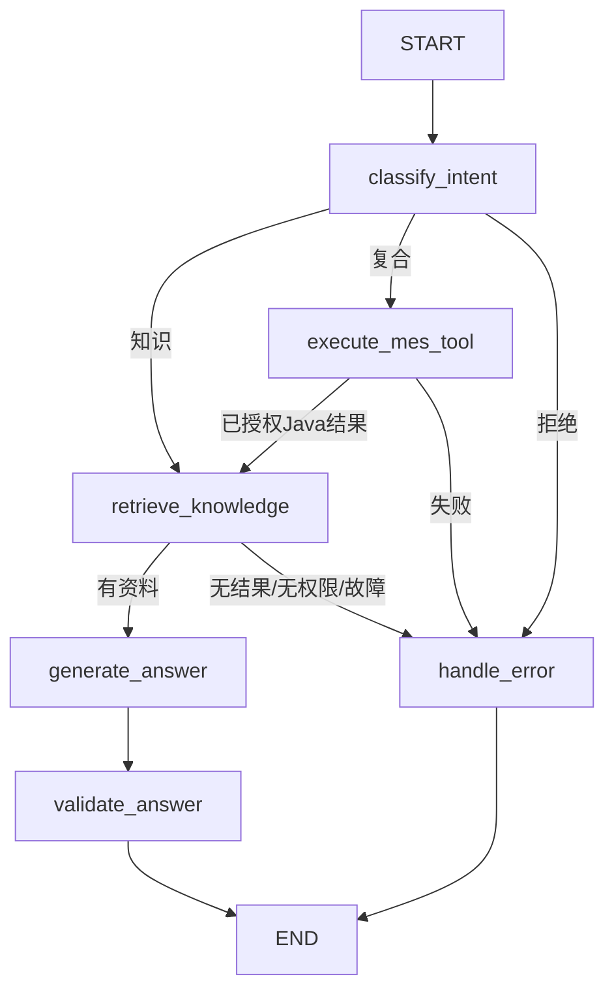

# MES Python LangGraph / PDF RAG

这是仓库内的独立Python服务，Java8仍负责登录、业务权限和数据库查询。当前可运行真实PDF检索，无需聊天模型Key；Jina提供向量，Chroma保存在本机。未配置DeepSeek时只显示检索原文，不宣称模型生成了总结。

## 1. 本机与跨电脑启动

需要Python3.11、[uv](https://docs.astral.sh/uv/getting-started/installation/)、原MES所需JDK8/Maven/MySQL/Redis。以下在包含`agent/`、`mes/`的仓库根目录执行。只运行Python测试不需要数据库。

```powershell
uv sync --frozen --project agent
# 首次启动自动从示例创建 .local/agent.env 并生成随机服务签名密钥。
./scripts/local/Start-Agent.ps1
```

编辑本机`.local/agent.env`，填写`JINA_API_KEY`；保留`DEEPSEEK_API_KEY=`为空。Key不能填在网页、代码或Git跟踪文件中。修改配置后重启：

```powershell
./scripts/local/Stop-Agent.ps1
./scripts/local/Start-Agent.ps1
Invoke-RestMethod http://127.0.0.1:8001/health
```

`health`的`embeddingConfigured`/`llmConfigured`仅表示存在配置，不能证明网络请求成功。真实连接证据见[评测报告](../docs/R004-Agent与RAG评测报告.md)。当前Jina已实调；DeepSeek按用户要求留待以后。

在新电脑把已授权原件放到仓库上一级`pdf文档/`，或设置`AGENT_PDF_DIR`指向它；不要复制虚拟环境和Chroma来替代可复现安装。24份文件名及SHA256在[manifest.json](documents/manifest.json)。原件由用户另外提供，Git不携带。清单以明确授权和实际文件为准，不能仅因目录新增PDF就自动批准。

停止Python服务后建立/维护索引，再启动服务：

```powershell
./scripts/local/Stop-Agent.ps1
uv run --project agent python -m app.cli ingest
uv run --project agent python -m app.cli status
./scripts/local/Start-Agent.ps1
# Java启动脚本只导入同一私有文件中的MES_AGENT_*白名单。
./scripts/local/Start-Local.ps1 -Rebuild
```

已有数据库配置、外部业务库启动方法沿用[主运行指南](../docs/AI助手接入与运行指南.md)。Start-Local默认维护独立`mes_study`学习库，不代表真实生产部署。本机入口是`http://127.0.0.1:9090/login-ui`，Python只绑定`127.0.0.1:8001`。重复启动会检查已管理PID；停止脚本只停止命令行属于本仓库的进程。

## 2. 配置

完整名称见[.env.example](.env.example)，私有实际值放`.local/agent.env`，两端重启后生效。

| 项 | 默认/作用 |
| --- | --- |
| MES_AGENT_ENABLED | Java示例启用Python入口；没有配置时Java默认关闭 |
| MES_AGENT_BASE_URL | `http://127.0.0.1:8001`；当前Java仅接受字面回环或localhost |
| MES_AGENT_SHARED_SECRET | 至少32字符随机密钥，两端一致；脚本首次生成，不是模型Key |
| MES_AGENT_CONNECT_TIMEOUT_MS / READ_TIMEOUT_MS | Java连接3000ms、读取35000ms |
| AGENT_REQUEST_TIMEOUT_SECONDS | 图总期限30s；最多2个工具，递归上限12 |
| JINA_API_KEY | Jina Embeddings鉴权；不会作为聊天Key使用 |
| AGENT_EMBEDDING_MODEL / DIMENSIONS | `jina-embeddings-v3` / 512；更换模型或维度须重建对应索引 |
| AGENT_EMBEDDING_TIMEOUT_SECONDS / BATCH_SIZE | 20s / 24；查询不重试，离线入库对429/503最多4次退避重试 |
| AGENT_DATA_DIR | 默认`agent/data`：Chroma、有效版本目录、向量缓存、入库记录，均忽略Git |
| AGENT_PDF_DIR | 默认仓库上一级`pdf文档`，不从网页传入路径 |
| AGENT_TOP_K / MIN_SIMILARITY | 5 / 0.38；cosine阈值不是置信概率 |
| AGENT_MAX_CONTEXT_CHARACTERS | 文档上下文6000字符；先按ACL检索最多30个候选，再本地BM25重排 |
| DEEPSEEK_API_KEY | 当前留空；以后由用户在私有文件填写 |
| AGENT_LLM_BASE_URL / MODEL | `https://api.deepseek.com` / `deepseek-flash` |
| AGENT_LLM_TIMEOUT_SECONDS | 15s；不自动重试聊天请求 |

DeepSeek模型名按2026-10-27核实的[官方文档](https://api-docs.deepseek.com/quick_start/agent_integrations/)配置；实际服务以供应商账户权限为准。适配器调用`/chat/completions`，关闭thinking、要求JSON证据选择。它只能选择本次检索片段的精确原文，不生成新的生产参数。填Key后应重新运行真实服务验收，当前HTTP替身测试不替代该步骤。Java原R003的`MES_LLM_*`是另一套可选意图识别配置，仍默认禁用，不是Python的Key设置入口。

## 3. 真实请求链与图

浏览器只访问已登录Java的`POST /admin/assistant/chat`。简单编码/路线查询继续Java规则快路径。知识查询要求`mes:assistant:knowledge:read`；复合查询还要求`mes:assistant:routing:read`。额外`mes:assistant:knowledge:restricted`才可取得restricted文档范围。

Java独立从用户原话提取唯一编码，预执行只读工具，再把最小结果与授权上下文签名发到Python。Python不接MySQL、不读取Cookie、不持有管理员凭据，也不提供匿名Java回调或写入工具。



这是有限StateGraph工作流。两个工具是`get_material_routing`（消费Java已执行结果）和`search_sop_knowledge`（读取有权限向量索引）。未实现任意工具规划、反复自主循环、多Agent或生产写入。

`messages`只含Java维护的至多4条历史用户问题；会话按登录主体和不透明UUID隔离，最多8组、30分钟TTL，清空抽屉会更换UUID。历史不带权限，不能扩大工具或文档范围。短追问会携带此前问题检索；跨话题应明确文档或清空，当前不是完整长期记忆系统。

## 4. 服务鉴权与契约

唯一聊天接口`POST /api/agent/chat`接收平面JSON：`requestId`、`question`、`intentHint`、`messages`、`authorizedContext`、`providedToolResults`。正文最多64KiB，当前问题最多1000字符，字段额外项拒绝。Java生成匿名subject、scope、allowedTools和<=60秒有效期。

HMAC-SHA256原文（UTF-8，小写hex）：

```text
POST\n/api/agent/chat\n{X-MES-Timestamp}\n{X-MES-Nonce}\n{sha256(rawBody)}
```

`X-MES-Signature`为签名，nonce是UUID并等于requestId，时间戳为UTC整数秒且等于issuedAt，允许时钟偏差30秒。Python校验签名、字段、有效期和nonce防重放，错误返回401。当前有界nonce缓存属于单进程，启动脚本固定1 worker；多实例共享防重放存储、远程TLS和生产部署仍待单独建设。

返回`status/mode/answer/citations`，附带`agentExecuted`、真实节点与工具记录、`retrievalStatus`、`answerMode`、模型标志。`agentExecuted=true`仅证明图执行。引用包括documentId、文件名、已确认版本或unknown、物理1起页码、chunkId、scope和精确原文；不返回原件绝对路径。前端通过textContent展示和复制。

| 情形 | 状态与含义 |
| --- | --- |
| 未配置聊天Key，检索有结果 | SUCCESS / EXTRACTIVE_NO_MODEL，模型未尝试，显示真实摘录 |
| 模型选择的证据通过原文校验 | GROUNDED_MODEL，才记本次modelConnected=true；当前未做真实服务验收 |
| 模型超时/HTTP失败/非法JSON/越出检索证据 | EXTRACTIVE_FALLBACK，保留原文并记录LLM_*原因码 |
| 有索引但无相关结果 | NO_KNOWLEDGE / NO_MATCH，不编造答案 |
| 没有可检索索引 | NO_INDEX / NOT_INDEXED |
| 当前无可访问文档 | DOCUMENT_FORBIDDEN / FORBIDDEN |
| 向量/索引故障 | RETRIEVAL_ERROR / ERROR，Java映射503 |
| Python未启用/不可达/签名配置缺失 | Java AGENT_UNAVAILABLE /503；纯路线查询仍可用 |
| 非法上游返回 / 总超时 | Java502 /504或TIMEOUT，均非成功答案 |

R003原Java链路的四个字段仍沿用原语义。Python链路中RULE表示规则分类与原文整理；MODEL表示模型证据选择通过；RULE_FALLBACK表示证据选择失败后回到摘录。`modelAttempted`/`modelConnected`针对本次聊天步骤，不能代表Embedding或数据库状态。无Key时为RULE/false/false/null，另外用answerMode明确没有模型总结。

## 5. PDF索引维护

pypdf逐页提取，物理页码与印刷页码可能不同；中文按段落、换行、句号等递归切分，每块<=800字符、重叠120字符且不跨页。PDF文字均为资料，不能覆盖系统指令。Jina分别用`retrieval.passage`/`retrieval.query`，不是用Embedding API切分文件。接口依据[Jina官方文档](https://api.jina.ai/docs)。

24份已授权，23份有文字，共1635块。`OSHA_3133`45页扫描件记录为NO_EXTRACTABLE_TEXT；没有偷偷进行OCR，也没有让模型补出内容。其他混合/图片页仅索引实际提取出的文字。资料包含政策、标准、ERP说明、教学和安全参考，不能称作本工厂伺服控制器SOP或生产参数。

入库校验授权、文件名、路径根和SHA256。相同文件/切分器/解析器/权限/版本跳过；新内容先完整向量化，upsert成功后发布有效目录，再删除旧块。查询在Chroma内先过滤ACL与有效哈希；本地BM25只重排已过滤候选。向量缓存使限流后能复用已成功批次。入库报告在`agent/data/last-ingest.json`。

```powershell
# 停Python后执行；只维护派生索引，不改原件。
uv run --project agent python -m app.cli ingest --document-id doc-4b100188ad1539b0
uv run --project agent python -m app.cli ingest --force
uv run --project agent python -m app.cli delete doc-4b100188ad1539b0
```

永久撤销文档应先把清单approved改为false或移除，再运行完整ingest；完整入库会撤销不再批准的目录项。仅delete后下一次完整ingest会按仍批准的清单恢复。原件更新须复核授权与版本并更新SHA256，再运行ingest。不要在API进程运行时并发维护索引，本版只支持单写入者。

## 6. 验证与评测

```powershell
uv run --project agent pytest agent/tests -q
uv run --project agent ruff check --config agent/pyproject.toml agent/app agent/tests
uv run --project agent python -m app.evaluate
uv run --project agent python -m app.evaluate --dataset agent/evals/rag-multi-fragment.jsonl --output docs/evals/R004-rag-multi-fragment.json
node --test scripts/tests/mes-assistant.test.cjs
```

pytest使用临时PDF/索引和明确的测试向量、HTTP替身，不消耗真实Key。`app.evaluate`实际访问Jina和本地授权索引，强制不调用聊天模型；Key配额不足会如实产生失败，不能把替身结果写入真实报告。

20条主评测和1条独立跨页组合题来自原PDF；每次先核验期望原文/页码，再检查返回文件、页码、全部关键证据、拒答、引用精确性、错误工具调用与耗时。主集保持不变，保留纯向量基线和本地重排结果；本轮19/20，另1/1跨页通过，不等于模型回答准确率。详情与未命中的R004-07见[专项报告](../docs/R004-Agent与RAG评测报告.md)。

可在本机停Python模拟不可达，然后对比知识问题和纯`100112`查询；恢复后重试。签名错误、过期、重放、权限、提示注入、模型HTTP异常等有自动化测试。不要用浏览器填写Key来模拟；外部服务实测必须另留脱敏证据。

## 7. 回滚与后续

设置`MES_AGENT_ENABLED=false`并重启Java可停用Python入口，原工艺查询保留；停止Python即可停用知识服务。删除派生索引前可以备份整个`agent/data`，不动原PDF或业务表。知识按钮权限的回滚只撤销本次指定角色的关联，不删除其他角色权限。

DeepSeek真实凭据/网络验收、生产库、远程部署、OCR、长期记忆和自动多步规划均未验证或未实现。BOM、库存、工单、报工、统计继续按B0–B5独立路线推进；本服务没有顺带实现这些制造业务。
