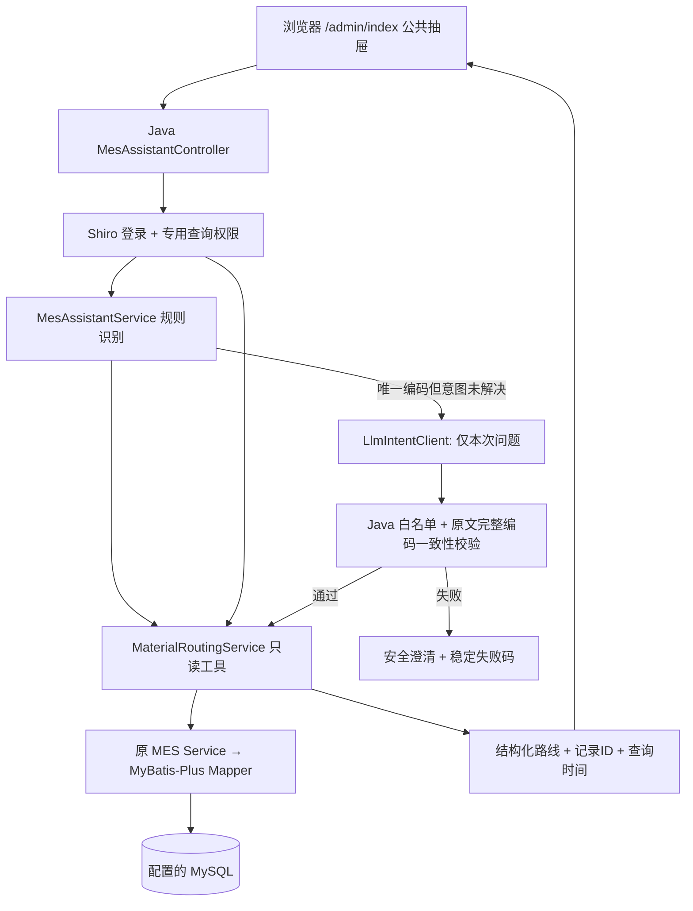

# AI助手接入与运行指南

更新：2026-10-27（R003）。适用仓库：`Gooddaybro/MES-SpringBoot` 的 `agent` 分支。本文中的路径都相对于该 Git 仓库根目录，即包含 `mes/`、`scripts/` 和 `docs/` 的目录。R003 详细状态见 [模型适配与评测报告](R003模型适配与评测报告.md)。

## 1. 现在交付了什么

| 能力 | 状态 | 实际边界 |
| --- | --- | --- |
| MES 公共首页右侧助手抽屉 | 已实现 | Layui + FreeMarker + 原生 JS，覆盖首页内的菜单/iframe 切换 |
| 按物料编码查询工艺路线 | 已实现 | Java 规则识别 → 专用只读工具 → 原有 Service/Mapper → 配置的 MySQL |
| 登录、查询权限、输入校验、依据与错误反馈 | 已实现 | 专用权限 `mes:assistant:routing:read`；不能通过前端切换角色获取权限 |
| 原工厂业务数据库 | 待接入 | 本机已连接的是独立 `mes_study` 学习库，含原项目样例数据；没有获得真实工厂的连接配置 |
| Java 8 模型意图适配器 | 已实现，真实服务实测待验证 | 规则优先，MES_LLM_* 配置后经 Chat Completions 补位；本机无真实凭据，仅替身故障测试 |
| Python / 多步 Agent | 未实现 | 本轮是 Java 内受控意图识别与单次只读工具执行 |
| 伺服控制器教学主数据 | 已准备并在隔离库验证 | 6 物料、1 路线、6 工序、6 关联；见独立 [主数据说明](伺服控制器样例主数据.md) |
| P2 BOM 齐套与报工 | 待接入 | BOM 头表为空、子项表缺失，库存/工单/报工尚无完整实现 |
| P3 ChatBI | 待接入 | 无真实生产质检统计数据；不开放模型执行 SQL |
| P4 RAG | 待接入 | 无文档库、Embedding、Milvus 或已导入的 FANUC 手册 |

**业务目标是伺服电机控制器。** 现有库中的 `100112`（电工胶带）、`MAT-DEMO-001`（早期教学物料）及“车轴流程”等是已有样例，保留原记录用于验证查询链。它们不是伺服控制器的真实工艺，也不能写成已对接工厂数据。请在获得真实主数据后，通过原业务维护流程绑定实际物料与路线。

## 2. 架构与关键文件



前端负责输入、抽屉、表格、复制和状态反馈；Java 负责身份、权限、规则优先与模型补位识别、参数校验、查询和异常。这是受控意图识别与单工具执行，尚无多步 Agent 循环。数据层沿用现有数据库，不增加业务表，不让浏览器或模型直接连接数据库。

| 文件 | 用途 |
| --- | --- |
| `mes/src/main/resources/templates/admin/index.ftl` | 首页布局、菜单与业务 iframe；只在此挂载一次助手 |
| `mes/src/main/resources/templates/admin/assistant/widget.ftl` | 抽屉、输入框、快捷问题和可访问性标签 |
| `mes/src/main/resources/static/css/mes-assistant.css` | 全部限定在 mes-ai 命名空间内的样式 |
| `mes/src/main/resources/static/js/mes-assistant.js` | AJAX、纯文本渲染、工序表、复制、组合输入、清空竞态处理 |
| `mes/src/main/java/com/wangziyang/mes/assistant/controller/MesAssistantController.java` | 两个接口、登录/权限、防止异常泄露、请求编号与审计 |
| `mes/src/main/java/com/wangziyang/mes/assistant/AssistantResponses.java` | 统一编码校验和查询依据字段 |
| `mes/src/main/java/com/wangziyang/mes/assistant/service/MesAssistantService.java` | 规则优先、模型补位、原文一致性校验与安全降级 |
| `mes/src/main/java/com/wangziyang/mes/assistant/agent/` | 服务端环境配置、RestTemplate/Jackson 客户端、不可变识别结果及独立完整编码候选提取 |
| `mes/src/main/java/com/wangziyang/mes/assistant/service/MaterialRoutingService.java` | `get_material_routing` 工具的只读业务实现 |
| `mes/src/main/java/com/wangziyang/mes/basedata/entity/SpMaterile.java` | 物料与路线关联，状态实际为0/1/2 |
| `mes/src/main/java/com/wangziyang/mes/technology/entity/SpFlow.java`、`SpFlowOperRelation.java`、`SpOper.java` | 路线、排序关系和工序实体 |
| `mes/src/main/java/com/wangziyang/mes/basedata/service/ISpMaterileService.java`、`impl/SpMaterileServiceImpl.java` | 复用的物料业务查询 |
| `mes/src/main/java/com/wangziyang/mes/technology/service/ISpFlowService.java`、`ISpFlowOperRelationService.java`、`ISpOperService.java`及其`impl/` | 复用的路线和工序业务查询 |
| `mes/src/main/java/com/wangziyang/mes/basedata/mapper/SpMaterileMapper.java` | 现有物料 Mapper，基础查询由 MyBatis-Plus 生成 |
| `mes/src/main/java/com/wangziyang/mes/technology/mapper/SpFlowMapper.java`、`SpFlowOperRelationMapper.java`、`SpOperMapper.java` | 现有路线与工序 Mapper |
| `mes/src/main/resources/mapper/technology/SpFlowOperRelationMapper.xml` | 原有业务维护查询；助手复用现有 Service 的基础查询能力 |
| `mes/src/main/java/com/wangziyang/mes/system/config/shiro/ShiroConfig.java`、`ShiroRealm.java`、`SpLoginFormFilter.java` | 现有身份和角色权限机制，未关闭登录验证 |
| `mes/src/main/java/com/wangziyang/mes/system/service/impl/SysMenuServiceImpl.java` | 首页和搜索导航排除按钮权限，角色授权仍保留这些按钮 |
| `mes/src/main/java/com/wangziyang/mes/common/Result.java`、`advice/ExceptionAdvice.java` | 全站响应及原有异常机制；助手在自身入口处理异常，不泄露内部错误 |
| `mes/src/main/java/com/wangziyang/mes/SparchetypeApplication.java` | Spring Boot 启动类 |
| `mes/pom.xml`、`mes/src/main/resources/application*.yml` | Maven和原有profile；历史数据库口令已改为环境变量 |
| `scripts/local/Start-Local.ps1`、`Stop-Local.ps1`、`application-local.yml`、`logback-local.xml` | 本机学习环境启动、停止、数据库和本地日志配置 |
| `scripts/local/application-business.example.yml` | 外部业务库配置示例，复制后保存在被忽略的 `.local/` 内 |
| `scripts/sql/mes_assistant_permission.sql` | 操作者明确选择角色后，幂等注册助手查询权限 |
| `mes/src/test/java/com/wangziyang/mes/assistant/` | 查询、意图和 Controller 权限/异常测试 |
| `mes/src/test/java/com/wangziyang/mes/assistant/MesAssistantDatabaseIT.java` | 显式启用的学习库集成测试：真实Shiro、完整过滤器、模板与SQL一致性，只允许本机mes_study |
| `scripts/tests/mes-assistant.test.cjs` | Node 自带测试，无需 npm 安装；控制 AJAX 和 DOM 验证前端行为 |
| `scripts/tests/start-local-arguments.ps1` | 验证实际启动参数在带空格的目录中仍完整传入进程 |
| `mes/src/test/java/com/wangziyang/mes/SparchetypeApplicationTests.java` | 原有 Spring 上下文测试 |
| `docs/superpowers/specs/2026-10-26-mes-assistant-design.md` | 两版本审查、兼容性比较、架构取舍 |
| `docs/superpowers/plans/2026-10-26-mes-assistant.md` | 本轮实施与验收记录清单 |

## 3. 第一步：准备环境和确认项目目录

当前实测工具是 JDK **1.8.0_202**、Maven **3.6.3**、MySQL **8.0.46**；Node **24.19.0** 只用于开发时的前端测试，运行 MES 不需要 Node/Vue 项目。推荐使用 JDK8 复现本轮环境，不能因为机器默认 JDK21 就直接运行旧 Boot 项目。

官方 [Boot2.1.7要求](https://docs.spring.io/spring-boot/docs/2.1.7.RELEASE/reference/html/getting-started-system-requirements.html) 是 Java8、兼容至Java12，Maven3.3+。当前 [LangChain4j最低JDK17](https://docs.langchain4j.dev/get-started/)、[其Starter要求Boot3.5+/4](https://docs.langchain4j.dev/tutorials/spring-boot-integration/)，[Spring AI2.x对应Boot4.x](https://docs.spring.io/spring-ai/reference/getting-started.html)。[LangChain v1](https://docs.langchain.com/oss/python/migrate/langchain-v1) 与 [LangGraph v1](https://docs.langchain.com/oss/python/migrate/langgraph-v1) 要求 Python3.10+。本轮保留旧工程，没有引入这些SDK或升级整个MES。

在另一台机器上：

```powershell
git clone --branch agent https://github.com/Gooddaybro/MES-SpringBoot.git
Set-Location .\MES-SpringBoot
git branch --show-current
git status --short
$env:JAVA_HOME = 'C:\你的安装目录\jdk8'
$env:Path = "$env:JAVA_HOME\bin;$env:Path"
java -version
mvn -v
```

预期分支为 `agent`，工作区没有意外修改，Maven 输出 Java1.8。当前项目虽然有 `mvnw`/`mvnw.cmd`，但未跟踪 `.mvn/wrapper` 启动所需文件，**本文使用本机 Maven**，不声称 Wrapper 可直接使用。

若进入外层 manufacture 目录会看到无提交的 master，那不是本项目仓库；先进入 `MES-SpringBoot`，不要在外层初始化、提交或切分支。

## 4. 第二步：启动 MES 后端

### 4.1 Windows 本地学习环境（现在可操作）

需要安装JDK8、Maven、MySQL8程序；3308/6380/9090端口应可用，首次下载Redis需要网络。脚本只启动绑定127.0.0.1的独立MySQL学习实例，使用 `.local/mysql-data`；首次导入仓库原SQL，以后保留原数据。

```powershell
.\scripts\local\Start-Local.ps1 `
  -JdkHome 'C:\你的安装目录\jdk8' `
  -MySqlHome 'C:\你的安装目录\mysql8' `
  -Rebuild
```

本机默认路径已匹配，可以直接运行：

```powershell
.\scripts\local\Start-Local.ps1 -Rebuild
```

`-Rebuild` 先停止此脚本拥有的9090 Java进程，再重新打包并启动，防止修改源码后仍打开旧jar。其他程序占用该端口时会报错并保留它。关闭使用同一jar的其他Java/IDEA进程后再构建。

预期控制台显示 `Ready: http://127.0.0.1:9090/login-ui`。还应查看日志中 `Started SparchetypeApplication`、访问登录页确认；端口就绪本身不证明所有接口健康。

```powershell
Get-Content .\.local\app.log -Tail 60
(Invoke-WebRequest 'http://127.0.0.1:9090/login-ui' -UseBasicParsing).StatusCode
```

预期HTTP200。日志：`.local/app.log`、`app-error.log`、`mysql.log`、`redis.log`。脚本构建采用 `-DskipTests` 以便启动，**测试必须按第8节另行执行**。

当前默认会话使用 Ehcache/内存 SessionDAO，Redis并非助手查询的必要依赖；启动脚本仍保留原本的本地Redis6380实例，以兼容已有学习配置。

停止并保留数据：

```powershell
.\scripts\local\Stop-Local.ps1 -MySqlHome 'C:\你的安装目录\mysql8'
```

程序目录符合本机默认值时可省略参数。不要删除 `.local/mysql-data` 或重复导入SQL来处理一般启动失败。

### 4.2 配置与安全文件

- 随机生成的数据库口令：`.local/settings.json`；应用通过进程环境 `MES_DB_PASSWORD` 接收。
- MySQL CLI连接文件：`.local/mysql-client.ini`、`mysql-root.ini`，不含默认数据库；CLI须指定 `--database=mes_study`。
- `.local/`、`mes/target/`、`.env*`、`application-business.yml` 已由共享 `.gitignore` 排除，不能上传私有配置、数据库文件和日志。
- `application-dev.yml`、`application-pro.yml` 的旧口令已删除，使用 `MES_DB_PASSWORD`；dev里的Redis可用 `MES_REDIS_PASSWORD`。原dev/pro还带有历史地址，不适合直接当作新机器可用配置。
- IDEA 的旧 `.local/application-idea.yml` 可能是本机私有文件，其他机器不会自动拥有它；以本指南的脚本方式复现。IDEA启动另用9091时，助手地址和接口也应使用9091。

## 5. 第三步：登录、授权并打开抽屉

打开 [本机登录页](http://127.0.0.1:9090/login-ui)，使用原学习库样例 `admin / 123`，填写图片验证码。该账号仅用于本机原样例，接真实业务系统时使用实际账号。

成功后进入 [MES首页](http://127.0.0.1:9090/admin/index)，右下角点击「MES 智能助手」。抽屉支持关闭、Esc、清空、Enter发送、Shift+Enter换行，中文输入法选字时不发送。复制按钮复制文字与查询依据，页面文字也允许手动选择。清空会取消在途请求，旧响应不会把对话重新填回，也不会自动弹出BOM。

**首次需要授予专用权限。** 样例库所有菜单原先都使用泛化 `user:add`，不能代表助手授权。没有专用权限时，助手接口应返回403。

推荐通过现有「系统管理→菜单/角色」维护 `mes:assistant:routing:read` 并分配给选定角色。也可以由数据库管理员审核后使用脚本：

```powershell
# 先查实际角色，不要照抄生产角色ID；命令不会打印口令。
& 'C:\你的安装目录\mysql8\bin\mysql.exe' `
  '--defaults-file=.local/mysql-client.ini' --database=mes_study `
  --execute 'SELECT id,name FROM sp_sys_role;'

# 将下面的角色ID替换为明确要授权的已有角色，然后执行。
& 'C:\你的安装目录\mysql8\bin\mysql.exe' `
  '--defaults-file=.local/mysql-client.ini' --database=mes_study `
  --execute "SET @assistant_role_id='经过确认的角色ID'; SOURCE scripts/sql/mes_assistant_permission.sql;"
```

本地原样例超级管理员角色为 `1185025876737396738`。脚本没有默认角色，不会自动授权全体用户；重复执行应保持幂等。授权后**重新登录**，因为当前用户角色/菜单已存入Shiro身份上下文。角色里所有成员都继承此权限，执行前确认成员范围。

本轮没有助手业务写操作。询问报工、采购、整改或报修会明确说明待接入，不会展示虚构单号或“事务成功”。

## 6. 第四、五步：验证接口并理解工具调用

### 6.1 现在可操作的接口

| 接口 | 参数 | 作用 |
| --- | --- | --- |
| `POST /admin/assistant/chat` | form `message`，1–1000字 | 规则意图识别、澄清、单工具调度 |
| `GET /admin/assistant/material-routing` | `materialCode`，完整编码1–255字符 | 可复用的结构化只读查询 |

目前接受英文字母/数字开头，其余为英文字母、数字、点、下划线、斜杠、连字符的编码；不截断过长编码，不进行模糊匹配。接入其他编码规则前应先补参数与匹配测试。

现在支持裸编码 `100112`，或「查询物料编码为100112的工艺路线」。这是已经查到的本地样例，连接其他库时换成实际存在的编码。

在登录后的浏览器开发者工具 Console 可直接验证当前会话：

```javascript
fetch('/admin/assistant/material-routing?materialCode=100112', {
  headers: {'X-Requested-With': 'XMLHttpRequest'}, credentials: 'same-origin'
}).then(async response => console.log(response.status, await response.json()));

fetch('/admin/assistant/chat', {
  method: 'POST', credentials: 'same-origin',
  headers: {'Content-Type': 'application/x-www-form-urlencoded', 'X-Requested-With': 'XMLHttpRequest'},
  body: new URLSearchParams({message: '查询物料编码为100112的工艺路线'})
}).then(async response => console.log(response.status, await response.json()));
```

若部署有context-path，给接口加上实际前缀；抽屉已通过FreeMarker获取它。未经登录的 AJAX 应返回401；未带AJAX头访问受保护页面时，原Shiro机制可能重定向登录页。

沿用 `Result` 格式：`{code:0,data:{status,mode,answer,...},msg:...}`。`code=0` 说明接口正常返回，**业务查询成功必须看 `data.status=SUCCESS`**。无数据、歧义、待接入也是明确状态，不能把外层默认“操作成功”文案当作已创建单据。

成功结果含 `material`、`routing`、`steps`、`source`、`queriedAt`、`traceId`、`elapsedMs`、`tool=get_material_routing`，另含 `recognitionSource`、`modelAttempted`、`modelConnected`、`fallbackReason`。规则路径为 RULE/false/false/null，合规模型补位为 MODEL/true/true/null，失败为 RULE_FALLBACK/实际尝试标志/false/原因码。每步保留 `relationId` 和 `operationId`，字段来自数据库，模型不参与生成工序。

### 6.2 完整调用链

1. 抽屉POST表单 → `MesAssistantController.chat`：核验真实登录及专用权限。
2. `MesAssistantService`：规则识别并抽取唯一完整编码，明确工艺查询直接查库；未解决单编码问题才经模型补位，再由 Java 区分大小写逐字核对原文候选，无编码、多编码或失败则澄清。
3. `MaterialRoutingService`：只读事务中按 `materiel=编码 AND is_deleted='0'` 精确查可用物料；最多取2条识别重码。
4. 已有物料Service → `SpMaterileMapper` → `sp_materile.flow_id`。
5. 已有路线Service → `SpFlowMapper` → `sp_flow.id`。
6. 已有关系Service → `SpFlowOperRelationMapper` → 按 `sort_num` 排序读取关系。
7. 已有工序Service → `SpOperMapper` → 批量获取工序，不逐条请求数据库。
8. 验证引用和排序，封装记录依据与查询时间 → Controller加请求编号/耗时 → 前端以文本节点及表格显示。

GET结构化接口跳过自然语言和模型识别，复用相同业务查询和授权。模型仅产生受控意图与参数，不能取代步骤1和步骤3–8，也不能提供自定义SQL。向模型只发送本次问题与必要指令，数据库结果不外发；问题本身仍可能敏感，抽屉已明确提示。

### 6.3 状态与恢复

| 状态 | 含义与处理 |
| --- | --- |
| SUCCESS | 完整路线已查询，检查工序顺序及依据 |
| NEEDS_INPUT / AMBIGUOUS | 缺少编码、多编码或有效物料重码；提供一个唯一编码或先修复主数据 |
| NO_MATERIAL | 未找到正常状态物料；检查编码、当前库及0/1/2状态 |
| NO_ROUTE / NO_STEPS | 未绑定/失效路线或未配置工序；在原工艺维护页补主数据 |
| ROUTE_INCOMPLETE | 工序引用/排序不完整；不能当作完整路线使用 |
| UNSUPPORTED | BOM/报工/统计/RAG等待接入，不产生业务写入 |
| HTTP400 / INVALID_INPUT | 空值、非法或过长参数，修正后重试 |
| HTTP401 / AUTH_REQUIRED | 重新登录并检查会话是否过期 |
| HTTP403 / FORBIDDEN | 管理员授予专用权限，之后重新登录 |
| HTTP503 / DATA_UNAVAILABLE | 数据库/事务连接失败，检查服务、端口、账号与配置 |
| HTTP504 / TIMEOUT | 查询超时，检查数据库负载和超时配置，稍后重试 |
| HTTP500 / ERROR | 用traceId查询本地日志，用户界面不展示内部异常 |

助手路径在Shiro过滤器中也返回带AUTH_REQUIRED及请求编号的401 JSON；其他旧页面仍保持原登录行为。模型默认连接3秒/读取15秒，可配置1–60000ms；前端等待150秒，为最大连接/读取设置与local数据库等待留出余量。local数据源连接/池等待3秒、socket8秒、只读事务8秒。网络读取是空闲超时，不是总耗时承诺；部署时需同步核对代理及业务库等待。

## 7. 第六步：接入原业务数据库

### 7.1 先核对真实表结构

至少核对以下字段和状态，不能只看 Java 注释：

| 表 | 必要字段 | 本地核实状态 |
| --- | --- | --- |
| `sp_materile` | id、materiel、materiel_desc、flow_id、is_deleted | 存在，0正常/1删除/2禁用 |
| `sp_flow` | id、flow、flow_desc | 存在，未声明状态列 |
| `sp_flow_oper_relation` | id、flow_id、oper_id、oper、sort_num | 存在，可关联及排序 |
| `sp_oper` | id、oper、oper_desc | 存在，未声明状态列 |
| `sp_bom` | id、bom_code、materiel_id、state、version_number、factory、is_deleted | 存在但为空；实体materielCode默认映射与实际materiel_id不一致 |
| `sp_bom_item` | 模型中已有bomHeadId/materielItemCode/itemNum等 | 本地库及主要SQL快照均缺表，不能直接查询齐套 |

没有获得业务库时，不运行原SQL覆盖已有业务数据，不把学习库的查询成功称为工厂接入完成。特别是旧文档中的物料“01正常”与实际表单/样例库不符，本轮按实测0正常处理；业务库如果采用不同规则，先明确映射并补测试，不静默兼容混乱状态。

### 7.2 使用外部配置（现在可配置，真实库验收待凭据和授权）

先停止脚本拥有的应用，确认JDK8和打包产物可用。把示例复制到被忽略目录，不把实际配置提交：

```powershell
Copy-Item .\scripts\local\application-business.example.yml .\.local\application-business.yml
$credential = Get-Credential -UserName '实际数据库账号' -Message '输入已授权的业务库凭据'
$env:MES_DB_USERNAME = $credential.UserName
$env:MES_DB_PASSWORD = $credential.GetNetworkCredential().Password
$env:MES_DB_URL = 'jdbc:mysql://实际主机:3306/实际数据库?useUnicode=true&characterEncoding=UTF-8&serverTimezone=Asia/Shanghai&connectTimeout=3000&socketTimeout=8000'
$localConfig = (Resolve-Path .\scripts\local\application-local.yml).Path.Replace('\','/')
$businessConfig = (Resolve-Path .\.local\application-business.yml).Path.Replace('\','/')
$logConfig = (Resolve-Path .\scripts\local\logback-local.xml).Path.Replace('\','/')
& "$env:JAVA_HOME\bin\java.exe" -Dfile.encoding=UTF-8 -jar .\mes\target\mes-1.0.0.jar `
  --spring.profiles.active=local `
  "--spring.config.additional-location=file:$localConfig,file:$businessConfig" `
  "--logging.config=file:$logConfig"
```

按实际服务器要求配置TLS；示例不替你决定生产TLS和账号策略。这里沿用本机local的页面/会话配置，后加载业务数据源覆盖学习库设置；**不要再运行Start-Local脚本启动应用，它固定使用学习库**。

只读助手只需SELECT，但原MES还承担登录、业务维护等操作，整个应用使用的数据库账号应由管理员按实际模块权限配置。不要为接入助手给Agent一个任意写库账号。也不要在生产库直接运行学习库初始化脚本。

启动后用业务库中实际物料编码调用GET与聊天接口，并由数据库管理员复核：

```sql
SELECT id,materiel,materiel_desc,flow_id,is_deleted
FROM sp_materile WHERE materiel='实际编码' AND is_deleted='0';

SELECT r.id AS relation_id,r.sort_num,o.id AS operation_id,o.oper,o.oper_desc
FROM sp_flow_oper_relation r
JOIN sp_oper o ON o.id=r.oper_id
WHERE r.flow_id='上一步实际flow_id'
ORDER BY r.sort_num;
```

检查同编码重复记录、空/失效flow_id、缺失oper_id和重复/空序号。查无数据与连接失败是不同结果，不能填入“通用工艺”补空缺。

## 8. 第七步：真实模型接入说明与推荐顺序

R003 已提供 `assistant/agent/LlmProperties` 和 `LlmIntentClient`，使用 Java 8 RestTemplate/Jackson，规则优先，模型只补充受控意图；未解决的单编码问句才请求模型。当前无 MES_LLM 凭据，**真实模型连接实测待验证**。`OPENAI_API_KEY` 不会自动替代这套显式配置。

在启动 Java 的服务端 PowerShell 会话中设置：

```powershell
$env:MES_LLM_BASE_URL = 'https://api.openai.com/v1' # 或审核后的兼容API根路径
$env:MES_LLM_MODEL = '填写供应商确认的实际模型ID'
$secureModelKey = Read-Host '模型API Key（不回显）' -AsSecureString
$modelCredential = New-Object System.Management.Automation.PSCredential('api', $secureModelKey)
$env:MES_LLM_API_KEY = $modelCredential.GetNetworkCredential().Password
# 可选：MES_LLM_CONNECT_TIMEOUT_MS 默认3000，MES_LLM_READ_TIMEOUT_MS 默认15000，范围1–60000
.\scripts\local\Start-Local.ps1 -Rebuild
```

base URL 去尾斜线后追加 `/chat/completions`，已含后缀则不重复。远程必须 HTTPS；HTTP 只支持字面回环地址供本地替身使用。拒绝 user-info/query/fragment 和重定向，API Key 只放服务端鉴权头，不写日志或前端。三项缺失或配置非法不阻止启动与规则查询。

用“100112需要经过哪些环节”验证模型补位；用“查100112的工艺路线”验证规则零模型调用。模型只能返回四字段 JSON（intent、materialCode、clarificationNeeded、reason），Java 校验白名单及原文完整编码，不能接受猜测、改大小写或截取编码。失败显示 RULE_FALLBACK 和 MODEL_TIMEOUT/HTTP/JSON/参数等稳定码，要求用户澄清。工艺事实仍由原只读工具查询。

`modelConnected=true` 只表示本次调用及必要校验通过；必须使用真实 Key 完成实际请求和结果检查才能记录真实连接验证。当前 HTTP 替身通过不等于真实供应商通过。完整配置、原因码、隐私边界、30 条评测和验证命令见 [R003 报告](R003模型适配与评测报告.md)。

Python 是后续可选设计，本轮没有 Python 服务或多步 Agent 循环。本轮不向模型发送数据库结果；若将来允许编排访问结果，须重新审核数据范围与外发契约。回调 Java 必须有受限接口、短期凭据和工具白名单，不能把现有 Cookie 接口当作匿名工具。

## 9. 第八步：P2–P4继续开发

### P2：BOM齐套与报工（待接入）

- **已有/复用**：`technology/entity/SpBom.java`、`SpBomItem.java`，对应Controller/Service/Mapper；物料与路线工具、Shiro权限、Result、只读查询依据。
- **缺口**：核对并修复SpBom.materielCode→materiel_id字段映射；定义并迁移sp_bom_item；确认子项存的是物料ID还是编码、单位、损耗、工厂、版本和审核状态。现有库存、预留、工单、工序执行、报工及IPQC表和接口均缺失。
- **文件范围（以下新增文件均为规划）**：先修正 `technology/entity/SpBom.java`、`resources/mapper/technology/SpBomMapper.xml`；增加人工审阅的 `scripts/sql/mes_p2_bom_inventory_work_report.sql`。再新增 `production/entity/WorkOrder.java`、`WorkReport.java`、`production/service/WorkReportService.java` 及对应Mapper/XML/Controller/测试，库存模块先明确可用量与预留规则；最后新增 `assistant/service/BomKittingService.java` 和预览/确认接口。当前没有自动迁移框架，不能把文件名当作会自动执行的迁移。
- **顺序**：验证BOM主数据 → 明确可用库存=现存-预留等口径 → 受控齐套查询 → 工单及工序状态机 → 报工事务 → 助手预览/确认。数量使用BigDecimal和明确单位，不以模型计算替代业务计算。
- **写操作统一要求**：服务器生成预览与影响说明（物料、工单、工序、数量、版本）；用户明确确认；提交时重新验身份/权限/数据范围/版本；服务端幂等键、并发控制及同一业务事务；实际持久化成功后才返回真实单号；审计谁确认、实际影响、状态及失败原因。确认不代表拥有权限，改动预览后必须重新确认。
- **验收**：已审核指定版本BOM与库存逐项一致；缺料、无BOM、单位冲突和循环引用有明确状态；重复确认只生成一次报工；并发不超额/不负库存；无权、过期预览及事务失败不产生半成品单据。

### P3：受控ChatBI（待接入）

- **已有/复用**：MyBatis分页/参数查询、ECharts资源和演示看板、助手权限与依据卡；看板假数据不作为统计来源。
- **缺口**：P2及质检的真实事实表，工厂/车间数据范围，时间、时区、投入数、检验数、良品/不良、返工和FPY等口径；目前没有可验证的生产统计基础。
- **文件范围（规划）**：新增 `assistant/bi/ControlledBiRequest.java`、`QualityMetricsService.java`、对应Mapper及 `resources/mapper/assistant/QualityMetricsMapper.xml` 和测试，新增审核过的报表接口；扩展现有 `mes-assistant.js` 只渲染后端结构化统计及分母/分子，不执行模型返回的脚本。
- **顺序**：明确一项指标及SQL → 单独验证边界数据和权限 → 封装具名工具 → 模型将问句映射为指标名/时间范围 → 展示结果与来源。先做一项受控指标，避免通用NL2SQL。
- **限制**：表、列、指标、维度、排序和时间范围都由Java白名单决定；参数化SQL，行数/时间上限和数据范围过滤；禁止模型生成的任意SQL进入数据库、禁止整表导出和越权聚合。
- **验收**：固定数据集统计与人工SQL核对一致；0分母、无数据、时区边界、歧义和超时有明确处理；展示统计范围、计算公式和来源；图表使用真实数值坐标轴，不使用“不良率×35”放大冒充占比。根因推测标为待验证建议。

### P4：有来源RAG（待接入）

- **已有/复用**：抽屉的文本与依据折叠展示、工具和权限边界；目前没有可复用的已建知识库。
- **缺口**：经过授权、版本明确的伺服电机控制器SOP/质检/设备资料；解析/切分/Embedding/向量存储、索引任务、文档权限、检索质量集与引用校验。HTML里的FANUC内容/ChunkID/相似度均为原型示意，不是已索引资料。
- **文件范围（规划）**：如选择Python，新增 `agent/pyproject.toml`、`agent/app/main.py`、`retrieval.py`、`agent/tests/`；Java侧新增 `assistant/service/KnowledgeSearchClient.java` 和检索来源DTO。另建文档元数据/导入任务的SQL与管理接口，扩展 `mes-assistant.js` 的来源卡。不在旧单体内加入未经验证的新Starter。
- **顺序**：选一份真实文档建立版本/访问范围 → 解析保留页码 → 带文档ID/版本/页码切块 → 向量化 → 检索与阈值验证 → 基于证据生成回答 → 来源跳转及无依据拒答。
- **验收**：问题可复现地命中实际文档片段，显示文档名/版本/页码/片段；无相关资料时如实说明；检索失败不靠模型记忆冒充手册；删除/升级文档后索引同步；用户无法检索无权限资料；实际处置仍遵循现场规程，不让猜测变成自动业务指令。

## 10. 构建、测试与故障排查

### 10.1 可直接执行的检查

从仓库根目录执行，先按第4节启动学习数据库：

```powershell
$env:JAVA_HOME = 'D:\Program Files\Java\jdk1.8.0_202' # 换成你的JDK8路径
$env:Path = "$env:JAVA_HOME\bin;$env:Path"
$settings = Get-Content .\.local\settings.json -Raw | ConvertFrom-Json
$env:MES_DB_PASSWORD = $settings.appPassword
$localConfig = (Resolve-Path .\scripts\local\application-local.yml).Path.Replace('\','/')
$logConfig = (Resolve-Path .\scripts\local\logback-local.xml).Path.Replace('\','/')
# Windows打包前停止本脚本的Java进程，数据库保持运行，避免jar被占用。
$repoPath = (Get-Location).Path
$appId = [int](Get-Content .\.local\app.pid)
$app = Get-CimInstance Win32_Process -Filter "ProcessId=$appId" -ErrorAction SilentlyContinue
if ($app -and $app.CommandLine.Contains((Join-Path $repoPath 'mes\target\mes-1.0.0.jar'))) {
  Stop-Process -Id $appId
  Wait-Process -Id $appId -Timeout 15 -ErrorAction SilentlyContinue
}
mvn -f mes/pom.xml "-Dspring.profiles.active=local" `
  "-Dspring.config.additional-location=file:$localConfig" `
  "-Dlogging.config=file:$logConfig" package
node scripts/tests/mes-assistant.test.cjs
.\scripts\tests\start-local-arguments.ps1
.\scripts\local\Start-Local.ps1
```

Maven预期 `BUILD SUCCESS`，Surefire报告位于 `mes/target/surefire-reports/`。这里只设置当前进程环境，不回显密码。Node测试不依赖npm安装，验证实际浏览器脚本的事件、纯文本、复制和请求竞态；轻量DOM测试不能取代真实浏览器排版检查。

显式执行真实学习库集成测试（沿用上面的环境变量；需先按第5节授权本地角色）：

```powershell
mvn -f mes/pom.xml '-Dtest=MesAssistantDatabaseIT' '-Dmes.it.enabled=true' `
  '-Dspring.profiles.active=local' `
  "-Dspring.config.additional-location=file:$localConfig" `
  "-Dlogging.config=file:$logConfig" test
```

该测试只接受 `127.0.0.1:3308/mes_study`，使用原样例账号的真实Shiro Realm建立测试会话，并通过完整过滤器访问页面与接口。它逐项对照实际SQL结果，确认四张业务表前后快照相同、数据库事务只读；不绕过或修改生产登录接口。测试会话本身不证明验证码登录，验证码与实际抽屉另做了浏览器验收。默认`mvn test`不执行这个`*IT`文件。

### 10.2 常见问题

| 现象 | 核查顺序 |
| --- | --- |
| Maven报Java版本或反射异常 | `mvn -v`必须看到JDK8；仅改IDE项目SDK不等于修改Maven运行JDK |
| 页面脚本/CSS404、验证码不加载 | 确认local profile、`spring.mvc.static-path-pattern=/**`；资源URL为`/css/`、`/js/`、`/lib/`，磁盘static目录不是URL前缀 |
| 已改源码但没有抽屉 | 确认在`/admin/index`、运行新jar（Start-Local -Rebuild）、静态资源返回200、清浏览器缓存；独立业务子页没有重复挂载 |
| FreeMarker模板500 | 查看app日志，确认`admin/assistant/widget.ftl`已打入jar；首页使用模板根路径`/admin/assistant/widget.ftl`引用，context-path只用于浏览器URL |
| 查询403 | 检查实际角色的专用permission，重新登录清除旧身份权限；前端选择角色无授权作用 |
| 能登录但查不到编码 | 检查实际连接库、编码精确值、is_deleted='0'、flow_id及工序关系；不是模型问题 |
| 连接拒绝/503 | MySQL3308是否启动、客户端指定库名、环境密码是否存在、URL和池等待设置；不要把异常当成无数据 |
| 旧进程/端口冲突 | 先辨认进程，脚本不会停止无关端口占用者；9090脚本实例与9091IDEA实例要区分 |
| repackage提示Unable to rename jar | Windows运行中的Java可能锁定jar；只停止对应MES Java进程，保留数据库运行，再执行package；修改后启动可直接使用Start-Local -Rebuild |
| 脚本首次下载失败 | 检查网络与Redis下载源；不要删除已有数据库目录；修复依赖后重试 |
| 测试启动失败 | 确认传入local YAML、MES_DB_PASSWORD、logback本地配置；无数据库时只能跑隔离单元测试，不能声称真实链路通过 |

本轮没有扩大到修复整站所有遗留安全问题：旧Boot/Shiro、口令散列和原业务接口的权限粒度仍需专项治理。助手新增权限不等于原系统已完成安全升级。

## 11. R002 历史验证记录与交付定位

审查起点：`agent` / `3d4433c`；origin未有agent分支，origin/master为`37ce2dc`。参考助手为origin/feature/mes-assistant-chat-ui `738723d`，未整体合并该分支。

本轮实际结果：

| 验证 | 实际结果 |
| --- | --- |
| JDK8完整Maven package | BUILD SUCCESS；默认61项Java测试，0失败/0错误/0跳过，含原上下文测试 |
| 显式真实数据库集成测试 | 1项通过；真实Realm权限、完整过滤器、GET/POST两接口与实际SQL逐字段一致；首页、物料页、工艺页及菜单返回正常；四张业务表未变化 |
| 前端Node行为测试 | 10项通过；含中文组合输入、防XSS、重复加载/发送、清空迟到响应、复制和响应不抢原页面焦点 |
| PowerShell空格路径探针 | 通过；实际启动参数在带空格目录中不会拆分 |
| 新jar实际启动 | Start-Local -Rebuild重建并启动成功，登录页和助手静态资源HTTP200 |
| 未登录访问 | 实际直接GET及AJAX POST均返回401 JSON和请求编号 |
| 参数、无权限、超时 | Controller/过滤器测试覆盖400、403、504与通用错误；超时通过故障注入测试，未声称真实模型超时已验证 |
| 权限SQL | 不选/不存在角色不改数据；本地选定角色连续执行2次后菜单1条、角色关系1条 |
| 实际浏览器 | 完成真实图片验证码登录；抽屉打开/关闭/Esc、Enter发送、清空、复制编码/回答、依据折叠展示正常；原菜单可进入物料iframe，助手仍可使用 |
| 查询与恢复 | 100112查到6道现有工序；不存在编码明确返回无数据；临时停止独立MySQL后显示数据不可用，恢复数据库后同一会话可重试成功 |

集成测试曾发现首页相对include无法解析，已修为 `/admin/assistant/widget.ftl` 并重测通过。Windows运行jar锁定导致的首次repackage失败，在停止对应Java进程后已解决并写入排查步骤。

本机浏览器验收截图保存在被忽略的 `.local/assistant-browser-verified.png`，不随Git发布。窄屏下原系统“选择模块”下拉有既有的空白问题，左上角展开侧栏仍能正常进入物料菜单；本轮未修改原spLayui的移动端模块选择逻辑。助手的窄屏抽屉及业务iframe共存已验证。

未验证范围仍包括真实工厂数据库、真实模型鉴权/网络、Python Agent 和 P2–P4 业务闭环。R003 已实现 Java 适配器及 HTTP 替身故障测试，不能把替身通过列为真实模型通过；最新记录见 R003 报告。

最终提交与远程一致性通过以下命令核对：

```powershell
git status --short --branch
git log -1 --format='%h %s'
git ls-remote --heads origin agent
```

本指南为当前接入说明；`LOCAL-RUN.md`保留早期环境记录，`MES_REFACTOR_JOURNAL.md`保留历史设计与本轮日志。发生阶段编号或历史示例冲突时，以本指南的实际实现和P2–P4定义为准。

## 12. R003 最新验收

2026-10-27：原生 JDK 1.8.0_202 / Maven 3.6.3，完整 package 的 112 项 Java 测试通过（含 30 项 HTTP 替身）；显式真实学习库只读 IT 1 项、Node 11 项、启动路径与种子 SQL 探针通过。最终新 jar 在 9090 启动，浏览器验证码登录、SERVO-DEMO-CTRL-001 六工序和 MODEL_NOT_CONFIGURED 降级显示通过。

30 条规则评测：R002 22/30、R003 无模型侧 24/30，错误工具调用 1→0；这不是混合真实模型准确率。模型配置与凭据均缺失，真实供应商实测待验证。请求元数据、逐条评测快照、文件清单和风险见 [R003报告](R003模型适配与评测报告.md)；样例主数据独立见 [主数据说明](伺服控制器样例主数据.md)。
