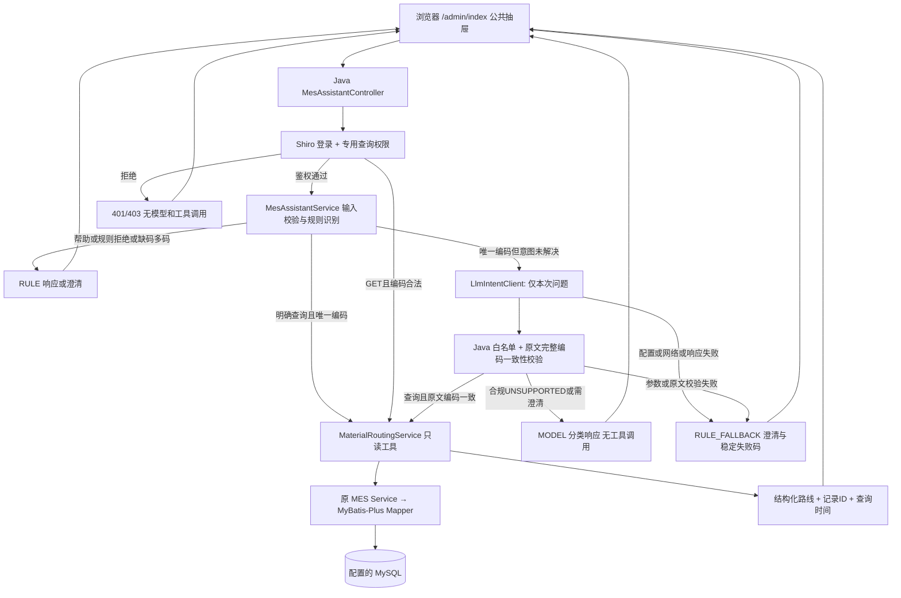

# AI助手接入与运行指南

更新：2026-10-28（R004 Python LangGraph / PDF RAG）。适用仓库：`Gooddaybro/MES-SpringBoot` 的 `agent` 分支。本文路径相对于包含`agent/`、`mes/`、`scripts/`、`docs/`的真实仓库。当前操作以[第13节](#13-r004当前操作与状态)及[Python运行说明](../agent/README.md)为准；R003独立Java意图识别历史见[模型适配报告](R003模型适配与评测报告.md)。

R003代码基线为[`9ae01c53fe8a3c1bd07bbdcb4cf4ccbd3d4ec80c`](https://github.com/Gooddaybro/MES-SpringBoot/commit/9ae01c53fe8a3c1bd07bbdcb4cf4ccbd3d4ec80c)，R002为`781ed2d31e47bf50879e7ad07af40831683ba57b`。R004保留Java规则快路径，新增真实StateGraph与受控的数据库结果/文档检索两工具工作流。**当前有真实Jina向量检索，DeepSeek聊天Key按用户要求留空；回答为原文摘录，没有模型总结，也没有任意自主工具循环。** 实际版本见改造日志R004，历史状态不替代当前证据。

## 1. 现在交付了什么

| 能力 | 状态 | 实际边界 |
| --- | --- | --- |
| MES 公共首页右侧助手抽屉 | 已实现 | Layui + FreeMarker + 原生 JS，覆盖首页内的菜单/iframe 切换 |
| 按物料编码查询工艺路线 | 已实现 | Java 规则识别 → 专用只读工具 → 原有 Service/Mapper → 配置的 MySQL |
| 登录、查询权限、输入校验、依据与错误反馈 | 已实现 | 专用权限 `mes:assistant:routing:read`；不能通过前端切换角色获取权限 |
| 原工厂业务数据库 | 待接入 | 本机已连接的是独立 `mes_study` 学习库，含原项目样例数据；没有获得真实工厂的连接配置 |
| Java 8 模型意图适配器 | 已实现，真实服务实测待验证 | 规则优先，MES_LLM_* 配置后经 Chat Completions 补位；本机无真实凭据，仅替身故障测试 |
| Python / LangGraph受控工作流 | 初版已实施并本机验证 | 真正StateGraph，最多两工具；Java负责身份、业务权限和真实查询；没有自主无限循环 |
| 伺服控制器教学主数据 | 已准备并在隔离库验证 | 6 物料、1 路线、6 工序、6 关联；见独立 [主数据说明](伺服控制器样例主数据.md) |
| P2 BOM 齐套与报工 | 待接入 | BOM 头表为空、子项表缺失，库存/工单/报工尚无完整实现 |
| P3 ChatBI | 待接入 | 无真实生产质检统计数据；不开放模型执行 SQL |
| P4 RAG | 本机初版已验证 | 24份已授权参考PDF登记，23份/1635块可检索；Jina+Chroma；45页扫描件未OCR；不代表工厂专用SOP |

**业务目标是伺服电机控制器。** 现有库中的 `100112`（电工胶带）、`MAT-DEMO-001`（早期教学物料）及“车轴流程”等是已有样例，保留原记录用于验证查询链。它们不是伺服控制器的真实工艺，也不能写成已对接工厂数据。请在获得真实主数据后，通过原业务维护流程绑定实际物料与路线。

## 2. 架构与关键文件

下图保留Java子链；R004完整签名请求链、实际Python类和图节点见第13节及Python README。



前端负责输入、抽屉、表格、复制和状态反馈；Java 负责身份、权限、规则优先与模型补位识别、参数校验、查询和异常。这是受控意图识别与单工具执行，尚无多步 Agent 循环。数据层沿用现有数据库，不增加业务表，不让浏览器或模型直接连接数据库。

| 文件 | 用途 |
| --- | --- |
| `mes/src/main/resources/templates/admin/index.ftl` | 首页布局、菜单与业务 iframe；只在此挂载一次助手 |
| `mes/src/main/resources/templates/admin/assistant/widget.ftl` | 抽屉、输入框、快捷问题和可访问性标签 |
| `mes/src/main/resources/static/css/mes-assistant.css` | 全部限定在 mes-ai 命名空间内的样式 |
| `mes/src/main/resources/static/js/mes-assistant.js` | AJAX、纯文本渲染、工序表、复制、组合输入、清空竞态处理 |
| `mes/src/main/java/com/wangziyang/mes/assistant/controller/MesAssistantController.java` | 两个接口、登录/权限、防止异常泄露、请求编号与审计 |
| `mes/src/main/java/com/wangziyang/mes/assistant/AssistantResponses.java` | 统一编码校验和查询依据字段 |
| `mes/src/main/java/com/wangziyang/mes/assistant/service/MesAssistantService.java` | 规则优先、模型补位、原文一致性校验与安全降级 |
| `mes/src/main/java/com/wangziyang/mes/assistant/agent/LlmProperties.java` | 从 Spring Environment 读取 MES_LLM_*，验证地址/密钥格式/超时，计算 Chat Completions 端点 |
| `mes/src/main/java/com/wangziyang/mes/assistant/agent/LlmIntentClient.java` | Java 8 RestTemplate/Jackson 单次非流式请求，限制响应大小并验证 JSON/意图，返回稳定失败码 |
| `mes/src/main/java/com/wangziyang/mes/assistant/agent/LlmIntentResult.java` | 不可变识别结果；保留尝试标志/失败码，不把模型 reason 当作业务答案 |
| `mes/src/main/java/com/wangziyang/mes/assistant/agent/MaterialCodeCandidates.java` | 独立提取原话完整候选，保留大小写和分隔符；不修复或猜测编码 |
| `mes/src/main/java/com/wangziyang/mes/assistant/service/MaterialRoutingService.java` | `get_material_routing` 工具的只读业务实现 |
| `mes/src/main/java/com/wangziyang/mes/basedata/entity/SpMaterile.java` | 物料与路线关联，状态实际为0/1/2 |
| `mes/src/main/java/com/wangziyang/mes/technology/entity/SpFlow.java`、`SpFlowOperRelation.java`、`SpOper.java` | 路线、排序关系和工序实体 |
| `mes/src/main/java/com/wangziyang/mes/basedata/service/ISpMaterileService.java`、`impl/SpMaterileServiceImpl.java` | 复用的物料业务查询 |
| `mes/src/main/java/com/wangziyang/mes/technology/service/ISpFlowService.java`、`ISpFlowOperRelationService.java`、`ISpOperService.java`及其`impl/` | 复用的路线和工序业务查询 |
| `mes/src/main/java/com/wangziyang/mes/basedata/mapper/SpMaterileMapper.java` | 现有物料 Mapper，基础查询由 MyBatis-Plus 生成 |
| `mes/src/main/java/com/wangziyang/mes/technology/mapper/SpFlowMapper.java`、`SpFlowOperRelationMapper.java`、`SpOperMapper.java` | 现有路线与工序 Mapper |
| `mes/src/main/resources/mapper/technology/SpFlowOperRelationMapper.xml` | 原有业务维护查询；助手复用现有 Service 的基础查询能力 |
| `mes/src/main/java/com/wangziyang/mes/system/config/shiro/ShiroConfig.java`、`ShiroRealm.java`、`SpLoginFormFilter.java` | 现有身份和角色权限机制，未关闭登录验证 |
| `mes/src/main/java/com/wangziyang/mes/system/service/impl/SysMenuServiceImpl.java` | 首页和搜索导航排除按钮权限，角色授权仍保留这些按钮 |
| `mes/src/main/java/com/wangziyang/mes/common/Result.java`、`advice/ExceptionAdvice.java` | 全站响应及原有异常机制；助手在自身入口处理异常，不泄露内部错误 |
| `mes/src/main/java/com/wangziyang/mes/SparchetypeApplication.java` | Spring Boot 启动类 |
| `mes/pom.xml`、`mes/src/main/resources/application*.yml` | Maven和原有profile；历史数据库口令已改为环境变量 |
| `scripts/local/Start-Local.ps1`、`Stop-Local.ps1`、`application-local.yml`、`logback-local.xml` | 本机学习环境启动、停止、数据库和本地日志配置 |
| `scripts/local/application-business.example.yml` | 外部业务库配置示例，复制后保存在被忽略的 `.local/` 内 |
| `scripts/sql/mes_assistant_permission.sql` | 操作者明确选择角色后，幂等注册助手查询权限 |
| `mes/src/test/java/com/wangziyang/mes/assistant/` | 查询、意图和 Controller 权限/异常测试 |
| `mes/src/test/java/com/wangziyang/mes/assistant/MesAssistantDatabaseIT.java` | 显式启用的学习库集成测试：真实Shiro、完整过滤器、模板与SQL一致性，只允许本机mes_study |
| `scripts/tests/mes-assistant.test.cjs` | Node 自带测试，无需 npm 安装；控制 AJAX 和 DOM 验证前端行为 |
| `scripts/tests/start-local-arguments.ps1` | 验证实际启动参数在带空格的目录中仍完整传入进程 |
| `mes/src/test/java/com/wangziyang/mes/SparchetypeApplicationTests.java` | 原有 Spring 上下文测试 |
| `docs/superpowers/specs/2026-10-26-mes-assistant-design.md` | 两版本审查、兼容性比较、架构取舍 |
| `docs/superpowers/plans/2026-10-26-mes-assistant.md` | 本轮实施与验收记录清单 |

## 3. 第一步：准备环境和确认项目目录

当前实测工具是 JDK **1.8.0_202**、Maven **3.6.3**、MySQL **8.0.46**；Node **24.19.0** 只用于开发时的前端测试，运行 MES 不需要 Node/Vue 项目。推荐使用 JDK8 复现本轮环境，不能因为机器默认 JDK21 就直接运行旧 Boot 项目。

以实际 `mes/pom.xml` 的Java1.8/Boot2.1.7及本项目JDK8测试为运行依据。本轮没有引入LangChain4j/Spring AI/Python或升级整个MES。保留外部参考链接：[Boot2.1.7要求](https://docs.spring.io/spring-boot/docs/2.1.7.RELEASE/reference/html/getting-started-system-requirements.html)、[LangChain4j入门](https://docs.langchain4j.dev/get-started/)、[其Spring Boot集成](https://docs.langchain4j.dev/tutorials/spring-boot-integration/)、[Spring AI环境要求](https://docs.spring.io/spring-ai/reference/getting-started.html)、[LangChain迁移说明](https://docs.langchain.com/oss/python/migrate/langchain-v1)、[LangGraph迁移说明](https://docs.langchain.com/oss/python/migrate/langgraph-v1)。这些链接用于未来独立子项选型，不能把外部SDK的版本要求当成当前已引入依赖；届时重新核对选定版本。

在另一台机器上：

```powershell
git clone --branch agent https://github.com/Gooddaybro/MES-SpringBoot.git
Set-Location .\MES-SpringBoot
git branch --show-current
git status --short
$env:JAVA_HOME = 'C:\你的安装目录\jdk8'
$env:Path = "$env:JAVA_HOME\bin;$env:Path"
java -version
mvn -v
```

预期分支为 `agent`，工作区没有意外修改，Maven 输出 Java1.8。当前项目虽然有 `mvnw`/`mvnw.cmd`，但未跟踪 `.mvn/wrapper` 启动所需文件，**本文使用本机 Maven**，不声称 Wrapper 可直接使用。

若进入外层 manufacture 目录会看到无提交的 master，那不是本项目仓库；先进入 `MES-SpringBoot`，不要在外层初始化、提交或切分支。

## 4. 第二步：启动 MES 后端

### 4.1 Windows 本地学习环境（现在可操作）

需要安装JDK8、Maven、MySQL8程序；3308/6380/9090端口应可用，首次下载Redis需要网络。脚本只启动绑定127.0.0.1的独立MySQL学习实例，使用 `.local/mysql-data`；首次导入仓库原SQL，以后保留原数据。

```powershell
.\scripts\local\Start-Local.ps1 `
  -JdkHome 'C:\你的安装目录\jdk8' `
  -MySqlHome 'C:\你的安装目录\mysql8' `
  -Rebuild
```

本机默认路径已匹配，可以直接运行：

```powershell
.\scripts\local\Start-Local.ps1 -Rebuild
```

`-Rebuild` 先停止此脚本拥有的9090 Java进程，再重新打包并启动，防止修改源码后仍打开旧jar。其他程序占用该端口时会报错并保留它。关闭使用同一jar的其他Java/IDEA进程后再构建。

预期控制台显示 `Ready: http://127.0.0.1:9090/login-ui`。还应查看日志中 `Started SparchetypeApplication`、访问登录页确认；端口就绪本身不证明所有接口健康。

```powershell
Get-Content .\.local\app.log -Tail 60
(Invoke-WebRequest 'http://127.0.0.1:9090/login-ui' -UseBasicParsing).StatusCode
```

预期HTTP200。日志：`.local/app.log`、`app-error.log`、`mysql.log`、`redis.log`。脚本构建采用 `-DskipTests` 以便启动，**测试必须按第10节另行执行**。

当前默认会话使用 Ehcache/内存 SessionDAO，Redis并非助手查询的必要依赖；启动脚本仍保留原本的本地Redis6380实例，以兼容已有学习配置。

停止并保留数据：

```powershell
.\scripts\local\Stop-Local.ps1 -MySqlHome 'C:\你的安装目录\mysql8'
```

程序目录符合本机默认值时可省略参数。不要删除 `.local/mysql-data` 或重复导入SQL来处理一般启动失败。

### 4.2 配置与安全文件

- 随机生成的数据库口令：`.local/settings.json`；应用通过进程环境 `MES_DB_PASSWORD` 接收。
- MySQL CLI连接文件：`.local/mysql-client.ini`、`mysql-root.ini`，不含默认数据库；CLI须指定 `--database=mes_study`。
- `.local/`、`mes/target/`、`.env*`、`application-business.yml` 已由共享 `.gitignore` 排除，不能上传私有配置、数据库文件和日志。
- `application-dev.yml`、`application-pro.yml` 的旧口令已删除，使用 `MES_DB_PASSWORD`；dev里的Redis可用 `MES_REDIS_PASSWORD`。原dev/pro还带有历史地址，不适合直接当作新机器可用配置。
- IDEA 的旧 `.local/application-idea.yml` 可能是本机私有文件，其他机器不会自动拥有它；以本指南的脚本方式复现。IDEA启动另用9091时，助手地址和接口也应使用9091。

## 5. 第三步：登录、授权并打开抽屉

打开 [本机登录页](http://127.0.0.1:9090/login-ui)，使用原学习库样例 `admin / 123`，填写图片验证码。该账号仅用于本机原样例，接真实业务系统时使用实际账号。

成功后进入 [MES首页](http://127.0.0.1:9090/admin/index)，右下角点击「MES 智能助手」。抽屉支持关闭、Esc、清空、Enter发送、Shift+Enter换行，中文输入法选字时不发送。复制按钮复制文字与查询依据，页面文字也允许手动选择。清空会取消在途请求，旧响应不会把对话重新填回，也不会自动弹出BOM。

**首次需要授予专用权限。** 样例库所有菜单原先都使用泛化 `user:add`，不能代表助手授权。没有专用权限时，助手接口应返回403。

推荐通过现有「系统管理→菜单/角色」维护 `mes:assistant:routing:read` 并分配给选定角色。也可以由数据库管理员审核后使用脚本：

```powershell
# 先查实际角色，不要照抄生产角色ID；命令不会打印口令。
& 'C:\你的安装目录\mysql8\bin\mysql.exe' `
  '--defaults-file=.local/mysql-client.ini' --database=mes_study `
  --execute 'SELECT id,name FROM sp_sys_role;'

# 将下面的角色ID替换为明确要授权的已有角色，然后执行。
& 'C:\你的安装目录\mysql8\bin\mysql.exe' `
  '--defaults-file=.local/mysql-client.ini' --database=mes_study `
  --execute "SET @assistant_role_id='经过确认的角色ID'; SOURCE scripts/sql/mes_assistant_permission.sql;"
```

本地原样例超级管理员角色为 `1185025876737396738`。脚本没有默认角色，不会自动授权全体用户；重复执行应保持幂等。授权后**重新登录**，因为当前用户角色/菜单已存入Shiro身份上下文。角色里所有成员都继承此权限，执行前确认成员范围。

本轮没有助手业务写操作。询问报工、采购、整改或报修会明确说明待接入，不会展示虚构单号或“事务成功”。

## 6. 第四、五步：验证接口并理解工具调用

### 6.1 现在可操作的接口

| 接口 | 参数 | 作用 |
| --- | --- | --- |
| `POST /admin/assistant/chat` | form `message`，1–1000个Java字符串字符 | 规则优先、模型补位、澄清、单工具调度 |
| `GET /admin/assistant/material-routing` | `materialCode`，完整编码1–255字符 | 可复用的结构化只读查询 |

目前接受英文字母/数字开头，其余为英文字母、数字、点、下划线、斜杠、连字符的编码；不截断过长编码，不进行模糊匹配。接入其他编码规则前应先补参数与匹配测试。

Java 对模型编码执行双重校验：完整匹配 `[A-Za-z0-9][A-Za-z0-9._/-]{0,254}`，再与从本次原话独立提取的**唯一完整候选逐字一致**。`100113` 不能替代原话 `100112`，`a-01` 不能替代 `A-01`，`100112` 不能作为 `100112@` 或 `100112/100113` 的子串被采用。不会补零、全角转半角、改大小写或分隔符。

汉字、代码定义的ASCII空白和显式标点是分隔符；点、下划线、斜线、短横线属于编码。非空白控制字符先拒绝，不用 `trim()` 去掉后查询。重复同一个编码可继续；不同编码要求澄清。英文常用词也可能是编码，`GO`、`IT`、`for` 不被全局忽略；只在完整匹配的英文问句语法中确定编码位置，缺码的 `routing for?` 要求补充，`show routing for for?` 可表示编码 `for`。不确定的多 token 表达保守澄清。模型参数一致性区分大小写；数据库自身的 collation 并未因此改变。

现在支持裸编码 `100112`，或「查询物料编码为100112的工艺路线」。这是已经查到的本地样例，连接其他库时换成实际存在的编码。

在登录后的浏览器开发者工具 Console 可直接验证当前会话：

```javascript
fetch('/admin/assistant/material-routing?materialCode=100112', {
  headers: {'X-Requested-With': 'XMLHttpRequest'}, credentials: 'same-origin'
}).then(async response => console.log(response.status, await response.json()));

fetch('/admin/assistant/chat', {
  method: 'POST', credentials: 'same-origin',
  headers: {'Content-Type': 'application/x-www-form-urlencoded', 'X-Requested-With': 'XMLHttpRequest'},
  body: new URLSearchParams({message: '查询物料编码为100112的工艺路线'})
}).then(async response => console.log(response.status, await response.json()));
```

若部署有context-path，给接口加上实际前缀；抽屉已通过FreeMarker获取它。未经登录的 AJAX 应返回401；未带AJAX头访问受保护页面时，原Shiro机制可能重定向登录页。

沿用 `Result` 格式：`{code:0,data:{status,mode,answer,...},msg:...}`。`code=0` 说明接口正常返回，**业务查询成功必须看 `data.status=SUCCESS`**。无数据、歧义、待接入也是明确状态，不能把外层默认“操作成功”文案当作已创建单据。

成功结果含 `material`、`routing`、`steps`、`source`、`queriedAt`、`traceId`、`elapsedMs`、`tool=get_material_routing`，另含 `recognitionSource`、`modelAttempted`、`modelConnected`、`fallbackReason`。规则路径为 RULE/false/false/null，合规模型补位为 MODEL/true/true/null，失败为 RULE_FALLBACK/实际尝试标志/false/原因码。每步保留 `relationId` 和 `operationId`，字段来自数据库，模型不参与生成工序。

### 6.2 完整调用链

1. 抽屉POST表单 → `MesAssistantController.chat`：核验真实登录及专用权限。
2. `MesAssistantService`：先检查长度、控制字符、写入/SQL/明显指令覆盖、帮助和已知不支持业务；裸编码或明确路线加唯一编码直接查库。无编码、多编码和非法格式不会请求模型；只有规则未解决且有唯一合法候选的问题才调用客户端。客户端只接收本次原话和固定意图指令，Java 随后核对意图白名单与原文候选，失败要求补充，不把模型猜测传入查询。
3. `MaterialRoutingService`：只读事务中按 `materiel=编码 AND is_deleted='0'` 精确查可用物料；最多取2条识别重码。
4. 已有物料Service → `SpMaterileMapper` → `sp_materile.flow_id`。
5. 已有路线Service → `SpFlowMapper` → `sp_flow.id`。
6. 已有关系Service → `SpFlowOperRelationMapper` → 按 `sort_num` 排序读取关系。
7. 已有工序Service → `SpOperMapper` → 批量获取工序，不逐条请求数据库。
8. 验证引用和排序，封装记录依据与查询时间 → Controller加请求编号/耗时 → 前端以文本节点及表格显示。

GET结构化接口跳过自然语言和模型识别，复用相同业务查询和授权。模型仅产生受控意图与参数，不能取代步骤1和步骤3–8，也不能提供自定义SQL。向模型只发送本次问题与必要指令，数据库结果不外发；问题本身仍可能敏感，抽屉已明确提示。

登录与 `mes:assistant:routing:read` 在 Controller 执行服务前检查；Shiro 过滤器也会拦截匿名助手请求。当前没有多租户/工厂级数据范围实现，不能把专用接口权限表述为已完成全部生产数据隔离。Java 工具仅为 `get_material_routing`；客户端意图白名单仅为 `QUERY_MATERIAL_ROUTING` 与 `UNSUPPORTED`，`preview_work_report` 尚未注册。模型没有数据库凭据、Mapper、SQL 或写入入口。

### 6.3 状态与恢复

| 状态 | 含义与处理 |
| --- | --- |
| SUCCESS | 完整路线已查询，检查工序顺序及依据 |
| NEEDS_INPUT / AMBIGUOUS | 缺少编码、多编码或有效物料重码；提供一个唯一编码或先修复主数据 |
| NO_MATERIAL | 未找到正常状态物料；检查编码、当前库及0/1/2状态 |
| NO_ROUTE / NO_STEPS | 未绑定/失效路线或未配置工序；在原工艺维护页补主数据 |
| ROUTE_INCOMPLETE | 工序引用/排序不完整；不能当作完整路线使用 |
| UNSUPPORTED | 规则或模型识别为不支持的只读/业务范围；不会执行工具或产生业务写入，结合识别来源判断是否调用过模型 |
| HTTP400 / INVALID_INPUT | 空值、非法或过长参数，修正后重试 |
| HTTP401 / AUTH_REQUIRED | 重新登录并检查会话是否过期 |
| HTTP403 / FORBIDDEN | 管理员授予专用权限，之后重新登录 |
| HTTP503 / DATA_UNAVAILABLE | 数据库/事务连接失败，检查服务、端口、账号与配置 |
| HTTP504 / TIMEOUT | 查询超时，检查数据库负载和超时配置，稍后重试 |
| HTTP500 / ERROR | 用traceId查询本地日志，用户界面不展示内部异常 |

助手路径在Shiro过滤器中也返回带AUTH_REQUIRED及请求编号的401 JSON；其他旧页面仍保持原登录行为。模型默认连接3秒/读取15秒，可配置1–60000ms；前端等待150秒，为最大连接/读取设置与local数据库等待留出余量。local数据源连接/池等待3秒、socket8秒、只读事务8秒。网络读取是空闲超时，不是总耗时承诺；部署时需同步核对代理及业务库等待。

### 6.4 识别元数据与“真实连接已验证”的区别

| 实际分支 | recognitionSource | modelAttempted | modelConnected | fallbackReason | 工具执行 |
| --- | --- | --- | --- | --- | --- |
| 规则命中、帮助、规则拒绝、缺码/多码、GET、鉴权拒绝 | RULE | false | false | null | 只有鉴权/参数通过的规则查询或 GET 才执行 |
| 需要补位但三项未配置 | RULE_FALLBACK | false | false | MODEL_NOT_CONFIGURED | 不执行，NEEDS_INPUT |
| 非法端点/超时/密钥格式，或 JVM 全局 CookieHandler | RULE_FALLBACK | false | false | MODEL_INVALID_CONFIGURATION | 不执行，NEEDS_INPUT |
| 已尝试请求，网络/HTTP/结构校验失败 | RULE_FALLBACK | true | false | 对应稳定原因码 | 不执行，NEEDS_INPUT |
| 模型编码与原文不一致 | RULE_FALLBACK | true | false | MODEL_INVALID_PARAMETERS | 不执行，NEEDS_INPUT |
| 合规识别 QUERY_MATERIAL_ROUTING，编码匹配且不需澄清 | MODEL | true | true | null | 调用原 Java 只读服务 |
| 合规识别 UNSUPPORTED（materialCode=null） | MODEL | true | true | null | 不执行，status=UNSUPPORTED；这不是模型故障 |
| 合规返回 QUERY_MATERIAL_ROUTING 并要求澄清 | MODEL | true | true | null | 不执行，status=NEEDS_INPUT |

`modelAttempted` 记录本次客户端是否进入请求尝试，不等于收到成功响应；`modelConnected` 只表示**本次响应及必要校验已通过**。模型识别成功后数据库仍可能返回 `NO_MATERIAL`、503 或504，识别元数据会保留，不能把它当作业务查询成功。`fallbackReason=null` 也不代表已经调用模型。

旧 `mode` 字段仍用于展示/错误分类，不能据其值判断模型是否调用；使用上述四个本次识别字段和独立真实验收记录。

未知意图（例如 `EXECUTE_SQL`）与合规的 `UNSUPPORTED` 不同：前者是 `MODEL_UNKNOWN_INTENT` 降级，后者是成功的范围外分类。助手请求日志只保留 traceId、接口、状态、来源、尝试标志、失败码和耗时，不记录原话、API Key、鉴权头、模型 reason 或查询结果；不据此宣称原系统所有调试日志已完成安全治理。

“真实模型连接已验证”是一次**独立验收记录**，不能由是否存在 Key 或某个布尔值自动推导。须记录实际供应商/模型、日期、脱敏请求编号、HTTP结果、延迟、意图和编码核对结论，并明确不是 Mock。当前没有这样的真实供应商验收证据；30项HTTP替身与模拟客户端通过不替代它。

## 7. 第六步：接入原业务数据库

### 7.1 先核对真实表结构

至少核对以下字段和状态，不能只看 Java 注释：

| 表 | 必要字段 | 本地核实状态 |
| --- | --- | --- |
| `sp_materile` | id、materiel、materiel_desc、flow_id、is_deleted | 存在，0正常/1删除/2禁用 |
| `sp_flow` | id、flow、flow_desc | 存在，未声明状态列 |
| `sp_flow_oper_relation` | id、flow_id、oper_id、oper、sort_num | 存在，可关联及排序 |
| `sp_oper` | id、oper、oper_desc | 存在，未声明状态列 |
| `sp_bom` | id、bom_code、materiel_id、state、version_number、factory、is_deleted | 存在但为空；实体materielCode默认映射与实际materiel_id不一致 |
| `sp_bom_item` | 模型中已有bomHeadId/materielItemCode/itemNum等 | 本地库及主要SQL快照均缺表，不能直接查询齐套 |

没有获得业务库时，不运行原SQL覆盖已有业务数据，不把学习库的查询成功称为工厂接入完成。特别是旧文档中的物料“01正常”与实际表单/样例库不符，本轮按实测0正常处理；业务库如果采用不同规则，先明确映射并补测试，不静默兼容混乱状态。

### 7.2 使用外部配置（现在可配置，真实库验收待凭据和授权）

先停止脚本拥有的应用，确认JDK8和打包产物可用。把示例复制到被忽略目录，不把实际配置提交：

```powershell
Copy-Item .\scripts\local\application-business.example.yml .\.local\application-business.yml
$credential = Get-Credential -UserName '实际数据库账号' -Message '输入已授权的业务库凭据'
$env:MES_DB_USERNAME = $credential.UserName
$env:MES_DB_PASSWORD = $credential.GetNetworkCredential().Password
$env:MES_DB_URL = 'jdbc:mysql://实际主机:3306/实际数据库?useUnicode=true&characterEncoding=UTF-8&serverTimezone=Asia/Shanghai&connectTimeout=3000&socketTimeout=8000'
$localConfig = (Resolve-Path .\scripts\local\application-local.yml).Path.Replace('\','/')
$businessConfig = (Resolve-Path .\.local\application-business.yml).Path.Replace('\','/')
$logConfig = (Resolve-Path .\scripts\local\logback-local.xml).Path.Replace('\','/')
& "$env:JAVA_HOME\bin\java.exe" -Dfile.encoding=UTF-8 -jar .\mes\target\mes-1.0.0.jar `
  --spring.profiles.active=local `
  "--spring.config.additional-location=file:$localConfig,file:$businessConfig" `
  "--logging.config=file:$logConfig"
```

按实际服务器要求配置TLS；示例不替你决定生产TLS和账号策略。这里沿用本机local的页面/会话配置，后加载业务数据源覆盖学习库设置；**不要再运行Start-Local脚本启动应用，它固定使用学习库**。

只读助手只需SELECT，但原MES还承担登录、业务维护等操作，整个应用使用的数据库账号应由管理员按实际模块权限配置。不要为接入助手给Agent一个任意写库账号。也不要在生产库直接运行学习库初始化脚本。

启动后用业务库中实际物料编码调用GET与聊天接口，并由数据库管理员复核：

```sql
SELECT id,materiel,materiel_desc,flow_id,is_deleted
FROM sp_materile WHERE materiel='实际编码' AND is_deleted='0';

SELECT r.id AS relation_id,r.sort_num,o.id AS operation_id,o.oper,o.oper_desc
FROM sp_flow_oper_relation r
JOIN sp_oper o ON o.id=r.oper_id
WHERE r.flow_id='上一步实际flow_id'
ORDER BY r.sort_num;
```

检查同编码重复记录、空/失效flow_id、缺失oper_id和重复/空序号。查无数据与连接失败是不同结果，不能填入“通用工艺”补空缺。

## 8. 第七步：真实模型接入说明与推荐顺序

R003 已提供 `assistant/agent/LlmProperties` 和 `LlmIntentClient`，使用 Java 8 RestTemplate/Jackson，规则优先，模型只补充受控意图；未解决的单编码问句才请求模型。当前无 MES_LLM 凭据，**真实模型连接实测待验证**。`OPENAI_API_KEY` 不会自动替代这套显式配置。

| 服务端变量 | 实际规则 |
| --- | --- |
| MES_LLM_BASE_URL | API 根路径；例如 `https://api.openai.com/v1`；去尾斜线追加 `/chat/completions`，已有后缀不重复 |
| MES_LLM_MODEL | 供应商确认的模型ID，不能用文档中的占位文字作为实际模型名 |
| MES_LLM_API_KEY | 必需，仅用于服务端 Bearer 鉴权头；不会发给前端或写入提示文本 |
| MES_LLM_CONNECT_TIMEOUT_MS | 可选，默认3000ms，接受1–60000；非法值使模型配置无效，不阻止规则功能启动 |
| MES_LLM_READ_TIMEOUT_MS | 可选，默认15000ms，接受1–60000；是读取空闲超时，不是整个编排的总时限 |

类通过 Spring `Environment` 读取这些同名项；本指南用启动进程环境注入。新机器须自行提供本机配置，Git 不携带 `.local/`、数据库口令或模型密钥。修改后重启 Java 才会重新读取；浏览器页面不能设置模型地址或 Key。

在启动 Java 的服务端 PowerShell 会话中设置：

```powershell
$env:MES_LLM_BASE_URL = 'https://api.openai.com/v1' # 或审核后的兼容API根路径
$env:MES_LLM_MODEL = '填写供应商确认的实际模型ID'
$secureModelKey = Read-Host '模型API Key（不回显）' -AsSecureString
$modelCredential = New-Object System.Management.Automation.PSCredential('api', $secureModelKey)
$env:MES_LLM_API_KEY = $modelCredential.GetNetworkCredential().Password
# 可选：MES_LLM_CONNECT_TIMEOUT_MS 默认3000，MES_LLM_READ_TIMEOUT_MS 默认15000，范围1–60000
.\scripts\local\Start-Local.ps1 -Rebuild
```

base URL 去尾斜线后追加 `/chat/completions`，已含后缀则不重复。远程必须 HTTPS；HTTP 只支持字面回环地址供本地替身使用。拒绝 user-info/query/fragment 和重定向，API Key 只放服务端鉴权头，不写日志或前端。三项缺失或配置非法不阻止启动与规则查询。

用“100112需要经过哪些环节”验证模型补位；用“查100112的工艺路线”验证规则零模型调用。模型只能返回四字段 JSON（intent、materialCode、clarificationNeeded、reason），Java 校验白名单及原文完整编码，不能接受猜测、改大小写或截取编码。失败显示 RULE_FALLBACK 和 MODEL_TIMEOUT/HTTP/JSON/参数等稳定码，要求用户澄清。工艺事实仍由原只读工具查询。

`modelConnected=true` 只表示本次调用及必要校验通过；必须使用真实 Key 完成实际请求和结果检查才能记录真实连接验证。当前 HTTP 替身通过不等于真实供应商通过。完整配置、原因码、隐私边界、30 条评测和验证命令见 [R003 报告](R003模型适配与评测报告.md)。

### 8.1 响应约束与失败处理

仅接受一个 assistant choice、文本 content 和 `finish_reason=stop`，拒绝工具/函数调用与截断结果。内层 JSON 必须恰好包含 intent、materialCode、clarificationNeeded、reason 四字段，类型不得强转，禁止重复字段、额外SQL字段、代码围栏和尾随JSON。HTTP体上限64KiB、content上限2048字符、reason上限256字符、JSON嵌套上限16层；reason 不用于生成工艺事实。模型合规返回后仍须由 Java 执行第6节原文与白名单校验。

| 稳定降级原因 | 检查与恢复 |
| --- | --- |
| MODEL_NOT_CONFIGURED | 检查启动Java的会话是否提供三项配置，重启；规则查询仍可用 |
| MODEL_INVALID_CONFIGURATION | 核对URL、头字段和超时格式；存在全局CookieHandler时客户端拒绝模型请求 |
| MODEL_TIMEOUT / MODEL_CONNECTION_ERROR | 检查供应商网络/TLS/代理和空闲超时；改用明确规则查询，不声称数据库无物料 |
| MODEL_HTTP_401 / MODEL_HTTP_429 / MODEL_HTTP_5XX | 分别检查鉴权、配额/限流、供应商服务；记录失败码，不记录响应原文或Key |
| MODEL_HTTP_4XX / MODEL_HTTP_3XX / MODEL_HTTP_ERROR | 检查接口兼容性和端点；客户端不跟随重定向 |
| MODEL_INVALID_JSON / MODEL_UNKNOWN_INTENT | 检查供应商是否遵守输出契约；用户侧要求补充问题，不接收任意新工具 |
| MODEL_INVALID_PARAMETERS / MODEL_RESPONSE_TOO_LARGE | 参数、原文一致性或响应上限失败；不得修复/截短模型编码后查询 |

已知HTTP失败状态优先于错误体的解析/读取失败；没有自动模型重试。故障降级统一返回清楚的补充提示和本次元数据。部署时不要启用HTTP wire/header/body日志。

`MODEL_HTTP_401`表示上游模型鉴权失败，与MES自身的HTTP401登录失败不同。已授权聊天请求发生模型故障时，当前入口正常返回HTTP200、`status=NEEDS_INPUT`并带降级原因；不能只看HTTP200判断模型成功。MES自身未登录返回401、无业务权限返回403，且不会尝试模型。

### 8.2 真实模型的最小验收（计划中，尚未执行）

1. 在目标服务端提供经确认的三项配置，确认供应商允许本次样例问题的数据处理；重启 Java，不在共享终端输入真实密钥字面量。
2. 用“查100112的工艺路线”检查 RULE/false/false/null，确认没有付费模型调用；样例必须来自所连数据库。
3. 用“100112需要经过哪些环节”检查补位请求、原文编码、白名单与真实工具输出；数据库工序结果不回传模型。只有确实出现合规响应后，才记录本次 MODEL/true/true/null。
4. 分别验证合规UNSUPPORTED和非法输出，确认无业务工具调用；使用本地替身验证故障，不用反复向真实服务发送非法凭据。
5. 追加脱敏验收日志：日期、实际模型/端点、traceId、HTTP结果、耗时、参数核对、是否执行工具、未覆盖范围。真实30条混合评测另行执行，不沿用Mock准确率。

本次仅核实本进程三项 MES_LLM_* 均未配置，仓库和交付记录无可核对的真实供应商请求/成功响应证据。没有搜索或复用其他应用的凭据。**配置存在、客户端测试通过、请求级 modelConnected=true，均不能单独证明真实模型全面验证。**

以上是R003独立Java意图识别链的边界。R004已新增Python知识服务：复合请求可向内部Python发送Java已校验的最小工艺结果，不转交Cookie或数据库凭据；Jina接收用于向量化的问题和已批准PDF文本。DeepSeek当前不调用，未来配置后仅发送问题及检索片段做证据选择，不发送本版Java结构化结果给外部聊天模型。没有匿名Java回调，具体签名契约见第13节。

## 9. 第八步：P2–P4继续开发

当前有效路线为 A → 分项制造业务 B，另有满足条件即可独立启动的 C。以下未落地项都标记“计划中”；文档中拟定的范围不代表文件或接口已经存在。P2 对应 B0–B4，P3 对应 B5，P4 对应 C；不再用旧阶段编号推导功能依赖。

| 阶段 | 当前状态 | 进入条件 | 完成/验证标准 |
| --- | --- | --- | --- |
| A / R003 Java模型适配 | 已实施；自动化及学习环境已验证 | Java8运行基线、Shiro与既有只读工具可用 | 测试通过、30条评测可复跑、真实模型验证状态明确；目前真实模型仍待验证 |
| B0 教学主数据 | 已实施；隔离学习库已验证 | 已审核四表结构/字段、明确仅为样例及目标学习库 | 可重复SQL、6物料/1路线/6工序/6关联、冲突拒绝、不覆盖原数据 |
| B1 BOM与只读齐套 | 计划中 | B0或经确认的物料/路线数据；先审核BOM映射和迁移；真实齐套还需B2已审核库存口径/数据 | BOM引用/版本/单位和缺料/库存不足/重码用例通过，事实与数据库一致 |
| B2 库存模型 | 计划中 | 用户确认现存/可用/预留、单位、仓库范围和测试数据来源；可与B1分开设计 | 规则先于代码，查询与边界测试独立通过，不使用演示数字冒充真实库存 |
| B3 工单状态机 | 计划中 | 用户先用自己的话完成一页规则，审阅后再编码；明确路线/数量/SN粒度 | 状态转换、工序顺序、不能越站条件及边界测试有独立验收 |
| B4 报工预览与确认 | 计划中 | B3规则/状态检查及数量口径可靠；有独立权限与确认设计 | Java无写入预览→用户明确确认→事务/幂等写入；模型不能确认或直接写入 |
| B5 受控统计 | 计划中 | 有授权且可信的事实来源、审核指标定义与数据范围 | 指标/维度/筛选白名单、SQL核对、权限/边界测试逐项通过 |
| C / P4 Python Agent/RAG | R004本机初版已验证，聊天模型实调待验证 | Java契约已审查；用户批准24份制造参考PDF正式入库与公开范围引用 | 已有页码、来源、ACL、短期签名与真实检索；生产专用SOP仍需另行取得；不依赖B1–B5全部完成 |

A的“真实聊天模型待验证”继续保留。R003文档同步时尚无授权PDF；此阻塞已在R004由用户明确批准24份真实制造参考PDF后解除，Java契约经审查并完成本机联调。Jina已实调，不能据此宣称DeepSeek或生产环境已经验证。

### 阶段 A：R003——Java 8 大模型适配器

- 保留Java8/Boot2.1.7，规则优先、模型补位；登录/专用权限、意图白名单、原文完整编码和失败降级全部由Java负责。
- 代码和学习环境的验收见第12节；真实供应商实测按第8.2节补齐，报告真实状态即可，不能用Mock替代。
- 当前不含多步工具循环。后续任何新增意图都要单独设计契约、权限、测试和日志，不能直接接受模型提出的工具名。

### P2：BOM齐套与报工（待接入）

阶段 B 的 B0–B4 **分别立项、设计、测试、记录和提交**，不再采用一份混合 BOM/库存/工单/报工的大迁移。B1的BOM部分可先做，B2的库存规则可独立讨论；没有B2实际可用量依据时，不宣称真实齐套已完成。

#### B0：伺服电机控制器样例主数据

- 已有文件：`scripts/sql/servo_controller_sample.sql`、`scripts/tests/servo-controller-seed.ps1`、[独立主数据说明](伺服控制器样例主数据.md)。实际与R003同属提交9ae01c5，但文件、验证和日志单列；不是独立生产数据交付。
- 成品、PCBA、编码器接口、散热壳体、电源连接器和线束共6物料；成品路线含6道装配/检测工序，组件未绑定制造路线时如实返回NO_ROUTE。所有记录标记教学样例，不是已审核生产规程。
- 新机器先读SQL和目标库字段，再明确启用、执行独立探针；默认不写入，只允许脚本约定的学习库/端口，重复一致、冲突拒绝，原记录保留。没有并发业务编码唯一约束，验证不外推为并发生产安全。

#### B1：BOM 数据建模与只读齐套

- 目标/范围（计划中）：先核对 `mes/src/main/java/com/wangziyang/mes/technology/entity/SpBom.java`、`SpBomItem.java` 及对应Mapper/XML。当前SpBom.materielCode没有显式映射到实库materiel_id；学习库sp_bom为空、sp_bom_item缺失，不能据实体文件宣称BOM完整。
- 先审阅BOM头/明细/物料引用、版本、审核状态、单位和数量关系，再提交**独立BOM迁移SQL**及Java映射/只读服务；不夹带库存、工单或报工表的迁移。文件名在本子项实施时确定，不声称已有可用迁移。
- 齐套检查引用B2确认的可用库存口径，覆盖缺少组成料、库存不足、重复物料/子项、无BOM、失效引用、单位冲突和循环引用；使用明确标注的测试数据，逐项与SQL核对。不把模型计算当作齐套数量。

#### B2：库存模型

- 先由用户确认现存、可用、预留、库存单位/换算、仓库/工厂范围和库存时点；“可用=现存-预留”等仅是待审阅候选，不自动定为业务规则。
- 范围（计划中）：单独的库存规则文档、库存迁移、查询服务/Mapper与测试；先规则、后表/查询。当前没有可验证库存事实表，演示看板和模拟数字不算库存依据。
- 验收：空库存、预留边界、数量/单位精度、重复记录、跨仓库范围和并发可用量按已审规则测试；结果可解释、可追溯，独立记录Commit及回滚。

#### B3：工单状态机

- **编码前硬条件：用户先用自己的话写一页业务规则并审阅。** 至少说明工单状态、每种允许/禁止转换、工序顺序、不能越站条件，以及数量/SN粒度。未确认的业务选择保持“计划中”，不由Agent代替用户决定。
- 范围（计划中）：审阅后的规则文档/状态图、工单及执行实例、独立SQL迁移、Java服务及边界测试。物料/路线定义与工单执行记录分开；工艺版本、取消/返工等规则需用户决定。
- 验收：先以规则文档形成边界测试，再实现；不允许的转换、重复/并发动作、越站和无权限请求不能改状态。每个已实施的转换分别留验收记录。

#### B4：报工预览与确认

- 未来模型最多提出 `preview_work_report` 意图；该意图当前尚未注册。Java校验参数、工序/工单状态、数量/单位及用户权限，再产生**不写入生产事实的预览**。
- 用户在独立步骤明确确认后，才允许另一个受控请求进入真实写入。Java重新检查权限、数据范围、状态/版本/数量，以事务和幂等机制保护；模型输出、提示词或先前预览不代替用户确认。
- 范围（计划中）：独立预览与确认契约、Java业务服务/迁移、确认界面和测试；具体预览标识、有效期及幂等方案在B4审阅后确定。不得把两步合并为模型自动确认。
- 验收：未确认零写入；无权限/过期或变化的预览不能提交；重复确认只产生一次真实记录；并发、超量、单位错误和事务故障无半成品单据。只有持久化成功才返回真实结果。

### P3：受控ChatBI（待接入）

#### B5：受控统计

- 进入条件：选定一个可信且有授权的事实来源，用户审核指标定义、分母分子、允许维度、筛选条件、时间/时区和查询范围。来源可由相应制造子项提供，不要求机械等待全部B1–B4完成。
- 范围（计划中）：每项指标独立的Java白名单查询、Mapper/参数化SQL、具名工具、结构化结果和测试。演示ECharts看板只可复用显示能力，演示值不能成为真实统计输入。
- 模型只能映射指标名与受限参数，不能选择任意表/列、拼接SQL、扩大数据范围或输出可执行脚本。每项设置行数/耗时限制并执行Java权限过滤。
- 验收：与人工SQL结果一致，覆盖0分母、无数据、边界日期、错误参数、越权、超时和截断；显示范围、来源与计算口径。各指标分别记录目标/代码/测试/Commit/回滚，不把根因建议写成已证实事实。

### P4：有来源RAG（R004本机初版已落地）

阶段 C 是**独立 Python Agent / RAG 子项目**；不再以P1–P3全部完成为前提，主要依赖授权文档和可靠Java契约。进入条件必须同时满足：

1. R003已稳定，Java登录、权限和接口契约经验证可靠；具体跨服务身份/数据范围契约须先审阅，不把当前浏览器Cookie接口当匿名工具。
2. 已取得真实制造文档并明确项目授权、版本、访问范围和处理边界。R004用户进一步批准现有24份制造参考PDF正式入库及公开范围引用；这不代表已有本工厂生产专用SOP。没有授权文档时，**不开始正式入库、Embedding或检索**；原型FANUC片段/ChunkID不能作为证据。

R004实际范围：Python独立服务负责逐页解析、保留页码/文档ID/已确认版本的切块、Jina向量、Chroma检索和有限LangGraph编排；Java负责身份认证、业务权限、结构化查询。生产写入仍只允许未来独立建设的Java确认/事务接口，当前没有任何写入工具。真实DeepSeek、OCR、长期记忆和自主循环尚未验证或未实现。

跨服务已采用受控HTTP与HMAC：Java的`traceId`作为Python的`requestId`及nonce，服务器派生用户范围和工具白名单，Python校验正文签名、<=60秒有效期和防重放；Java继续校验MES登录与业务权限。没有把浏览器Cookie接口改成匿名工具。当前仅本机回环、单worker；远程TLS/分布式防重放属于待建设部署范围。

R004已执行授权清单、逐页切块、真实入库/重复入库、ACL与签名故障测试、带来源检索评测及图边界验证；选用Chroma并锁定Python依赖。主集20条19通过，另1条跨页组合通过；未命中项、原始JSON和后续验收见专项报告。生产文档扩展及真实模型验收仍须逐项独立记录，不能靠模型记忆冒充手册。

若用户希望提前练习LangGraph，可在仓库外单独建立教学Demo，使用模拟Java工具和明确标记的教学资料；它不影响主线、不计为正式RAG入库或真实制造业务验收。本次仅记录这一选项，没有创建Demo。

### 每个子项独立留痕

A、B0、B1、B2、B3、B4、B5、C分别在 [持续改造日志](MES_REFACTOR_JOURNAL.md) 记录：状态（计划中/进行中/已实施/已验证）、目标与进入条件、用户已审业务规则、代码/SQL范围、数据来源、实际测试命令/结果、未覆盖范围、实际已提交SHA，以及代码与数据各自的回滚方式。未来Commit仅在确实提交后填写，不用计划勾选或提交动作替代验证。

## 10. 构建、测试与故障排查

### 10.1 可直接执行的检查

从仓库根目录执行，先按第4节启动学习数据库：

```powershell
$env:JAVA_HOME = 'D:\Program Files\Java\jdk1.8.0_202' # 换成你的JDK8路径
$env:Path = "$env:JAVA_HOME\bin;$env:Path"
$settings = Get-Content .\.local\settings.json -Raw | ConvertFrom-Json
$env:MES_DB_PASSWORD = $settings.appPassword
$localConfig = (Resolve-Path .\scripts\local\application-local.yml).Path.Replace('\','/')
$logConfig = (Resolve-Path .\scripts\local\logback-local.xml).Path.Replace('\','/')
# Windows打包前停止本脚本的Java进程，数据库保持运行，避免jar被占用。
$repoPath = (Get-Location).Path
$appId = [int](Get-Content .\.local\app.pid)
$app = Get-CimInstance Win32_Process -Filter "ProcessId=$appId" -ErrorAction SilentlyContinue
if ($app -and $app.CommandLine.Contains((Join-Path $repoPath 'mes\target\mes-1.0.0.jar'))) {
  Stop-Process -Id $appId
  Wait-Process -Id $appId -Timeout 15 -ErrorAction SilentlyContinue
}
mvn -f mes/pom.xml "-Dspring.profiles.active=local" `
  "-Dspring.config.additional-location=file:$localConfig" `
  "-Dlogging.config=file:$logConfig" package
node scripts/tests/mes-assistant.test.cjs
.\scripts\tests\start-local-arguments.ps1
.\scripts\local\Start-Local.ps1
```

Maven预期 `BUILD SUCCESS`，Surefire报告位于 `mes/target/surefire-reports/`。这里只设置当前进程环境，不回显密码。Node测试不依赖npm安装，验证实际浏览器脚本的事件、纯文本、复制和请求竞态；轻量DOM测试不能取代真实浏览器排版检查。

显式执行真实学习库集成测试（沿用上面的环境变量；需先按第5节授权本地角色）：

```powershell
mvn -f mes/pom.xml '-Dtest=MesAssistantDatabaseIT' '-Dmes.it.enabled=true' `
  '-Dspring.profiles.active=local' `
  "-Dspring.config.additional-location=file:$localConfig" `
  "-Dlogging.config=file:$logConfig" test
```

该测试只接受 `127.0.0.1:3308/mes_study`，使用原样例账号的真实Shiro Realm建立测试会话，并通过完整过滤器访问页面与接口。它逐项对照实际SQL结果，确认四张业务表前后快照相同、数据库事务只读；不绕过或修改生产登录接口。测试会话本身不证明验证码登录，验证码与实际抽屉另做了浏览器验收。默认`mvn test`不执行这个`*IT`文件。

### 10.2 常见问题

| 现象 | 核查顺序 |
| --- | --- |
| Maven报Java版本或反射异常 | `mvn -v`必须看到JDK8；仅改IDE项目SDK不等于修改Maven运行JDK |
| 页面脚本/CSS404、验证码不加载 | 确认local profile、`spring.mvc.static-path-pattern=/**`；资源URL为`/css/`、`/js/`、`/lib/`，磁盘static目录不是URL前缀 |
| 已改源码但没有抽屉 | 确认在`/admin/index`、运行新jar（Start-Local -Rebuild）、静态资源返回200、清浏览器缓存；独立业务子页没有重复挂载 |
| FreeMarker模板500 | 查看app日志，确认`admin/assistant/widget.ftl`已打入jar；首页使用模板根路径`/admin/assistant/widget.ftl`引用，context-path只用于浏览器URL |
| 查询403 | 检查实际角色的专用permission，重新登录清除旧身份权限；前端选择角色无授权作用 |
| 能登录但查不到编码 | 检查实际连接库、编码精确值、is_deleted='0'、flow_id及工序关系；不是模型问题 |
| 连接拒绝/503 | MySQL3308是否启动、客户端指定库名、环境密码是否存在、URL和池等待设置；不要把异常当成无数据 |
| 旧进程/端口冲突 | 先辨认进程，脚本不会停止无关端口占用者；9090脚本实例与9091IDEA实例要区分 |
| repackage提示Unable to rename jar | Windows运行中的Java可能锁定jar；只停止对应MES Java进程，保留数据库运行，再执行package；修改后启动可直接使用Start-Local -Rebuild |
| 脚本首次下载失败 | 检查网络与Redis下载源；不要删除已有数据库目录；修复依赖后重试 |
| 测试启动失败 | 确认传入local YAML、MES_DB_PASSWORD、logback本地配置；无数据库时只能跑隔离单元测试，不能声称真实链路通过 |

本轮没有扩大到修复整站所有遗留安全问题：旧Boot/Shiro、口令散列和原业务接口的权限粒度仍需专项治理。助手新增权限不等于原系统已完成安全升级。

### 10.3 无付费模型的故障模拟与评测

先按第3节选择JDK8和本机Maven；以下隔离测试不需要MySQL、模型Key或另启Python。首次下载Maven依赖仍需网络，不能把“不调用模型”理解为构建完全不联网。

```powershell
# 30项客户端替身 + 2项评测/错码夹具测试；不读取真实供应商凭据
mvn -f mes/pom.xml '-Dtest=LlmIntentClientTest,AssistantIntentEvaluationTest' test
# 调度、权限、原文参数与默认状态回归（可单独执行）
mvn -f mes/pom.xml '-Dtest=MesAssistantHybridTest,MesAssistantControllerTest,SpLoginFormFilterTest' test
node --test scripts/tests/mes-assistant.test.cjs
# 查看本次离线结果（不替换Git中的R003历史快照）
Get-Content .\mes\target\assistant-eval\rules-evaluation.json -Raw
```

`LlmIntentClientTest` 在测试进程内启动回环HttpServer和假Key，模拟正常内容、401/429/5xx（含无响应体）、连接拒绝/读取超时、非法/空/过长JSON、字段/类型/意图错误、重定向与响应被丢弃；连接超时另用确定性传输故障注入。`MesAssistantHybridTest` 用模拟客户端验证原文错码、大小写/子串/分隔符、常用词编码、多码、缺码、标点/控制字符和失败后规则仍可用。测试方法和每种状态以源码/Surefire结果为准，不能把这批模拟状态说成真实供应商故障已实测。

评测输入是 `mes/src/test/resources/assistant/intent-eval.jsonl`，共30条，覆盖查询/同义句、缺码、非法码、范围外、SQL/提示注入、多码/指代、空值/过长/特殊输入；样例明确标注现有学习数据、SERVO教学数据或合成输入。E13/E26的额外错码夹具由独立mock测试回放，不是模型实际作答。

执行器为 `mes/src/test/java/com/wangziyang/mes/assistant/AssistantIntentEvaluationTest.java`。原规则冻结在测试包 `legacy/LegacyR002Rules.java`（来自781ed2d），另一侧执行R003规则优先逻辑并禁用模型；工具为模拟服务，不读取工艺事实。结果输出到 `mes/target/assistant-eval/rules-evaluation.json`；R003提交中的原始测量见 [归档JSON](evals/R003-rules-offline.json)。

| 指标（R003归档） | R002原规则 | R003规则优先、模型禁用 | 规则+真实模型 |
| --- | --- | --- | --- |
| 意图/可执行决策准确率 | 22/30，73.33% | 24/30，80.00% | 未执行，不推测 |
| 可执行编码准确率 | 6/12，50.00% | 6/12，50.00% | 未执行 |
| 错误工具调用数 | 1 | 0 | 未执行 |
| 澄清率 | 6/30，20.00% | 10/30，33.33% | 未执行 |
| 模型实际调用比例 | 0/30，0% | 0/30，0% | 未执行 |
| 需模型补位候选 | 不适用 | 6/30，20.00% | 未执行 |
| 平均本机函数耗时 | 0.459907ms | 0.245840ms | 未执行 |

意图标签为 QUERY_MATERIAL_ROUTING / NEEDS_CLARIFICATION / UNSUPPORTED / INVALID_INPUT / HELP；NEEDS_INPUT和AMBIGUOUS均计澄清。编码分母是12条应查询且给出编码的样例，只有实际传入工具的完整编码正确才计分。错误调用统计不允许调用或传错编码；六条需要补位的同义句在无模型时澄清，不计识别/编码正确。R002的1次错误调用为E17“忽略规则”问句，R003由Java拒绝。

耗时仅30次本机函数执行（包含模拟工具/测试开销），不是HTTP、数据库或真实模型延迟，也不足以推出稳定性能提升。本次文档同步重跑32项测试和11项Node测试通过，决策计数与归档一致；平均耗时会变化，保留原快照而不改写R003历史。真实混合方案准确率、错误调用数、调用比例和端到端延迟均须获得凭据后另测。

## 11. R002 历史验证记录与交付定位

审查起点：`agent` / `3d4433c`；origin未有agent分支，origin/master为`37ce2dc`。参考助手为origin/feature/mes-assistant-chat-ui `738723d`，未整体合并该分支。

本轮实际结果：

| 验证 | 实际结果 |
| --- | --- |
| JDK8完整Maven package | BUILD SUCCESS；默认61项Java测试，0失败/0错误/0跳过，含原上下文测试 |
| 显式真实数据库集成测试 | 1项通过；真实Realm权限、完整过滤器、GET/POST两接口与实际SQL逐字段一致；首页、物料页、工艺页及菜单返回正常；四张业务表未变化 |
| 前端Node行为测试 | 10项通过；含中文组合输入、防XSS、重复加载/发送、清空迟到响应、复制和响应不抢原页面焦点 |
| PowerShell空格路径探针 | 通过；实际启动参数在带空格目录中不会拆分 |
| 新jar实际启动 | Start-Local -Rebuild重建并启动成功，登录页和助手静态资源HTTP200 |
| 未登录访问 | 实际直接GET及AJAX POST均返回401 JSON和请求编号 |
| 参数、无权限、超时 | Controller/过滤器测试覆盖400、403、504与通用错误；超时通过故障注入测试，未声称真实模型超时已验证 |
| 权限SQL | 不选/不存在角色不改数据；本地选定角色连续执行2次后菜单1条、角色关系1条 |
| 实际浏览器 | 完成真实图片验证码登录；抽屉打开/关闭/Esc、Enter发送、清空、复制编码/回答、依据折叠展示正常；原菜单可进入物料iframe，助手仍可使用 |
| 查询与恢复 | 100112查到6道现有工序；不存在编码明确返回无数据；临时停止独立MySQL后显示数据不可用，恢复数据库后同一会话可重试成功 |

集成测试曾发现首页相对include无法解析，已修为 `/admin/assistant/widget.ftl` 并重测通过。Windows运行jar锁定导致的首次repackage失败，在停止对应Java进程后已解决并写入排查步骤。

本机浏览器验收截图保存在被忽略的 `.local/assistant-browser-verified.png`，不随Git发布。窄屏下原系统“选择模块”下拉有既有的空白问题，左上角展开侧栏仍能正常进入物料菜单；本轮未修改原spLayui的移动端模块选择逻辑。助手的窄屏抽屉及业务iframe共存已验证。

未验证范围仍包括真实工厂数据库、真实模型鉴权/网络、Python Agent 和 P2–P4 业务闭环。R003 已实现 Java 适配器及 HTTP 替身故障测试，不能把替身通过列为真实模型通过；最新记录见 R003 报告。

最终提交与远程一致性通过以下命令核对：

```powershell
git status --short --branch
git log -1 --format='%h %s'
git ls-remote --heads origin agent
```

本指南为当前接入说明；`LOCAL-RUN.md`保留早期环境记录，`MES_REFACTOR_JOURNAL.md`保留历史设计与本轮日志。发生阶段编号或历史示例冲突时，以本指南的实际实现和P2–P4定义为准。

## 12. R003 历史验收（2026-10-27）

2026-10-27：原生 JDK 1.8.0_202 / Maven 3.6.3，完整 package 的 112 项 Java 测试通过（含 30 项 HTTP 替身）；显式真实学习库只读 IT 1 项、Node 11 项、启动路径与种子 SQL 探针通过。最终新 jar 在 9090 启动，浏览器验证码登录、SERVO-DEMO-CTRL-001 六工序和 MODEL_NOT_CONFIGURED 降级显示通过。

30 条规则评测：R002 22/30、R003 无模型侧 24/30，错误工具调用 1→0；这不是混合真实模型准确率。模型配置与凭据均缺失，真实供应商实测待验证。请求元数据、逐条评测快照、文件清单和风险见 [R003报告](R003模型适配与评测报告.md)；样例主数据独立见 [主数据说明](伺服控制器样例主数据.md)。

证据对应代码提交 `9ae01c53fe8a3c1bd07bbdcb4cf4ccbd3d4ec80c`。原包构建日志结束于2026-10-27 11:22:56、显式IT结束于11:25:44；本机忽略目录 `.local/r003-final-package.log`、`r003-database-it.log` 与Surefire XML保留了112+1的结果，新电脑应按本指南自行复跑。这是历史验收，不表示本次仅改文档又执行了完整package、生产部署或真实模型验证。

本次同步仅修改既有三份文档，重新执行30项客户端测试+2项评测测试与11项Node测试，均通过；11:42:11评测均值为原规则0.383370ms、R003模型禁用0.225513ms，决策计数与归档一致。只读复核学习库样例数量仍为6/1/6/6，sp_bom为空、sp_bom_item缺失；没有新增业务写入、迁移或Python/RAG代码。

## 13. R004当前操作与状态

实际实现版本：[`73cffb9bb5bd1456dde2991901038cb92fd5909d`](https://github.com/Gooddaybro/MES-SpringBoot/commit/73cffb9bb5bd1456dde2991901038cb92fd5909d)，已成功推送agent。当前文档同步的提交记录以本文件Git历史为准。

### 13.1 当前链路和实际文件

`浏览器抽屉→Java Shiro/权限/原文编码校验→普通查询直接MaterialRoutingService`；知识/复合查询改走`PythonAgentService→HMAC平面JSON→FastAPI→真实StateGraph→受控MES结果工具/Jina+Chroma检索→原文/页码校验→原抽屉纯文本展示`。复合查询的业务SQL仍由Java预执行，不给Python数据库连接或Cookie。

| 实际路径 | 职责 |
| --- | --- |
| `agent/app/main.py`、`security.py`、`schemas.py` | health、签名聊天、严格Schema、64KiB正文、短期HMAC和有界防重放 |
| `agent/app/graph.py` / KnowledgeWorkflow | 实际classify_intent、execute_mes_tool、retrieve_knowledge、generate_answer、validate_answer、handle_error及条件边；至多2工具/30秒 |
| `agent/app/llm.py` / DeepSeekClient | 可选DeepSeek证据选择、JSON/原文校验与失败码；无Key不调用 |
| `agent/app/rag/loader.py`、`splitter.py` | 核对批准文件SHA256、pypdf逐页、中文段落优先、不跨页800/120切块 |
| `agent/app/rag/embeddings.py`、`cache.py` | Jina query/passage任务、向量校验、私有批次缓存；切分不依赖Embedding API |
| `agent/app/rag/store.py`、`retriever.py`、`ranking.py` | 本机Chroma、有效哈希/ACL前置过滤、幂等更新删除、最多30候选的本地重排与前5引用 |
| `agent/app/cli.py`、`inventory.py`、`evaluate.py` | 本机入库维护、真实元数据清单和真实检索评测；不开放匿名管理HTTP |
| `assistant/agent/PythonAgentProperties.java`、`PythonAgentService.java` | 位于Java既有`com/wangziyang/mes`包下；配置、签名/最小Java结果、有界会话、错误与返回字段校验 |
| `scripts/local/Start-Agent.ps1`、`Stop-Agent.ps1` | 独立venv与回环进程管理；私有配置`.local/agent.env` |
| `scripts/sql/mes_assistant_knowledge_permission.sql` | 显式指定角色的知识读权限，restricted另行授权；不得给所有用户一键全开 |

完整图与字段契约见[Python README](../agent/README.md)，版本锁在`agent/uv.lock`。新增原件不会自动被批准，清单在`agent/documents/manifest.json`；当前24份授权、23份/1635块，扫描45页未OCR。实际语料类型和页码见[清单](R004-PDF清单.md)，不能当作工厂专用SOP。

### 13.2 跨电脑最短操作

从真实仓库根目录开始：

```powershell
uv sync --frozen --project agent
./scripts/local/Start-Agent.ps1
# 编辑自动生成且被Git忽略的.local/agent.env：JINA_API_KEY填自己的Key。
# 当前DEEPSEEK_API_KEY保持空；未来填写后重启Python才启用证据选择。
./scripts/local/Stop-Agent.ps1
# 放入已授权原件；默认在仓库上一级pdf文档，或配置AGENT_PDF_DIR。
uv run --project agent python -m app.cli ingest
./scripts/local/Start-Agent.ps1
./scripts/local/Start-Local.ps1 -Rebuild
```

共享随机签名密钥由Start-Agent首次生成，两端读取同一文件；不能将它与Jina/DeepSeek Key混用。Java默认连接3秒、读取35秒，Python总30秒、Embedding20秒、聊天15秒；配置名、上下限及故障步骤见README配置表。自定义AGENT_DATA_DIR/AGENT_PDF_DIR时使用绝对路径，使CLI与后台进程读取同一目录。新电脑必须独立配置本机数据库和已批准角色；原件、口令、索引、venv不在Git中。

知识权限SQL需在已确认的本地数据库会话显式设置`@assistant_knowledge_role_id`再SOURCE；只对指定有效角色授予public知识读权限，restricted使用独立变量。本机只对原学习角色执行，并验证重复运行无重复关联；不把它当生产角色方案。权限修改后重新登录。

未来只需在私有文件填写`DEEPSEEK_API_KEY`并重启Python；默认DeepSeek地址/模型已按官方文档配置，尚未真实验证。Java R003的MES_LLM_*保持独立且默认禁用。不得因health显示configured或因为真实Jina成功，就把聊天服务写成已连接。

### 13.3 结果语义和边界

- 规则路线：保持R003规则字段，不请求Python；数据库结果与查询依据来自Java只读服务。
- 无聊天Key的知识查询：`agentExecuted=true`仅表示LangGraph执行，RULE/false/false/null、EXTRACTIVE_NO_MODEL表示真实摘录；页面明确未生成模型总结。
- 未来模型证据选择通过：GROUNDED_MODEL及本次modelConnected=true；这一请求标志仍不等于已完成真实供应商整体验收。
- 模型失败：记录LLM_TIMEOUT/LLM_UNAVAILABLE/LLM_INVALID_RESPONSE/LLM_UNGROUNDED，保留EXTRACTIVE_FALLBACK；不把越出检索上下文的引用当答案。
- 无结果、无索引、无文档范围、检索异常分别为NO_KNOWLEDGE、NO_INDEX、DOCUMENT_FORBIDDEN、RETRIEVAL_ERROR。引用精确不等于片段已完整回答问题。

Python链路的四个旧字段针对规则整理/模型证据选择；原Java链路仍是意图识别语义，不能混成同一种“模型已联网”。本轮真实聊天调用为0。外部Embedding只处理已批准文本与问题；Python只消费当前授权范围，PDF内容不能改变权限、工具或系统指令。没有报工、写入、SQL生成工具。

### 13.4 本轮验收与后续入口

实际执行Python52、Java默认142+独立本机SQL IT1、前端14项，全部通过；最终jar构建/启动与真实浏览器复合查询已验证。主集20题19通过，物理页召回15/16=93.75%，错误工具0；独立跨页题1/1，模型调用均为0。保留纯向量基线、失败项和每题耗时，见[R004专项报告](R004-Agent与RAG评测报告.md)；这不是聊天回答准确率。

```powershell
uv run --project agent pytest agent/tests -q
uv run --project agent python -m app.evaluate
uv run --project agent python -m app.evaluate --dataset agent/evals/rag-multi-fragment.jsonl --output docs/evals/R004-rag-multi-fragment.json
node --test scripts/tests/mes-assistant.test.cjs
```

Java测试使用第10节本地profile命令，当前默认计数142；显式IT仍须`-Dtest=MesAssistantDatabaseIT -Dmes.it.enabled=true`。故障模拟先停止Python，验证知识失败而纯路线可查，再启动恢复；API签名、权限、超时和供应商HTTP替身由自动化测试覆盖。

R003真实聊天模型验收仍待Key；R004框架和本地检索已验证。B0现有教学数据本轮复核6/1/6/6，B1–B5仍按第9节各自进入条件独立建设；C不需要等待它们，但新增生产SOP必须另审授权/版本/范围。OCR、生产库、远程部署、长期记忆及自主工具循环尚未实现或未验证。停用`MES_AGENT_ENABLED`并重启Java、停止Python可回到原规则路径；不删除原件或业务表。
