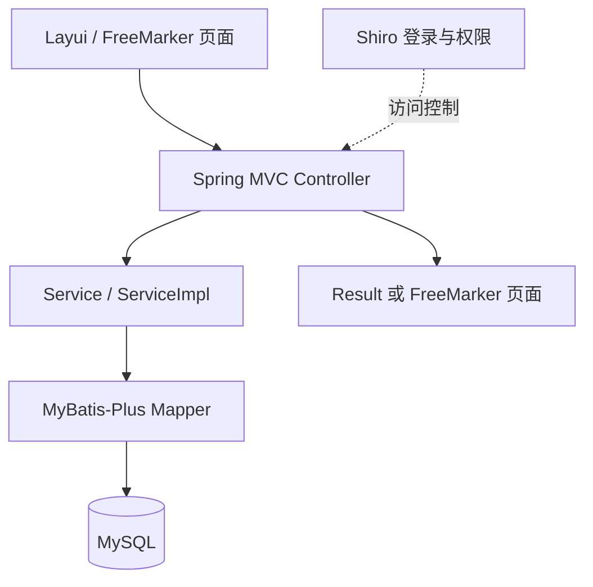
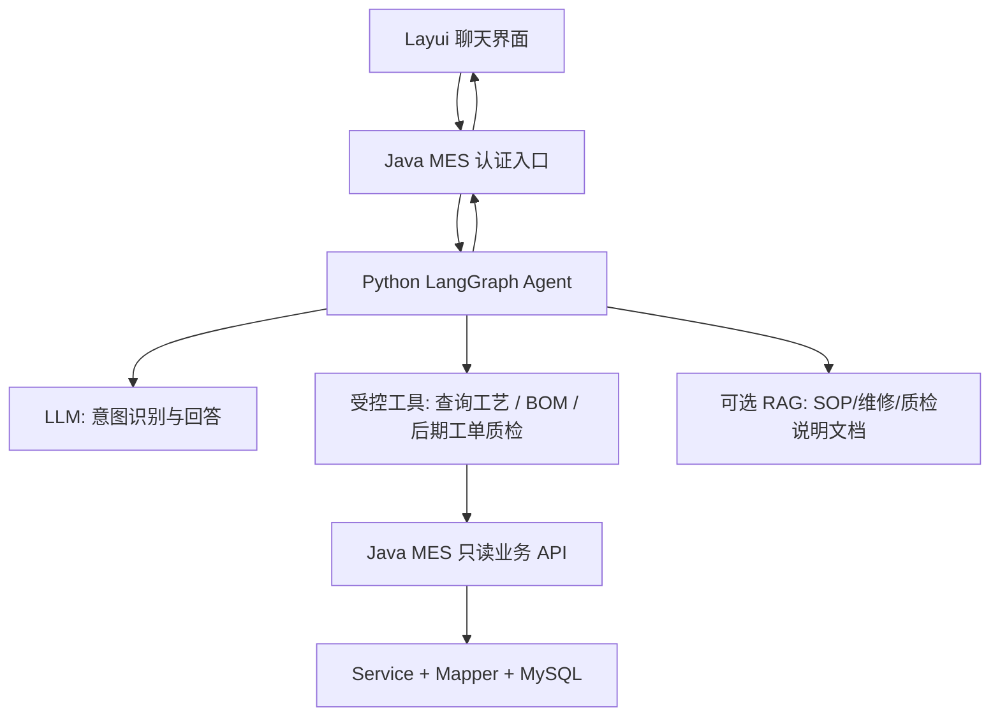
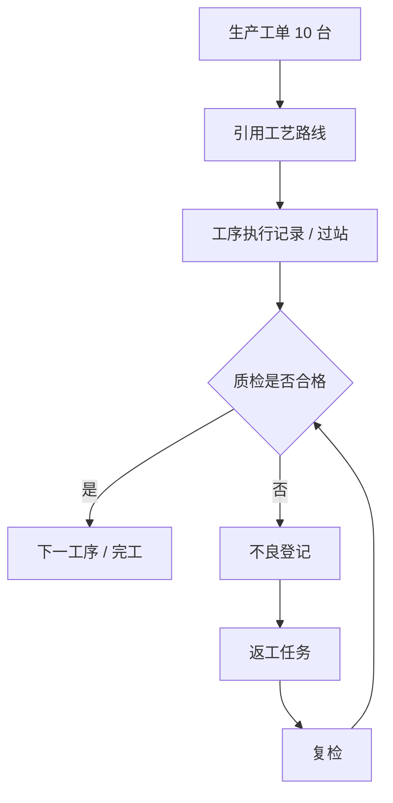

# MES-SpringBoot 二次开发：架构、路线与改造日志

> 维护日期：2026-10-26
> 仓库： https://github.com/Gooddaybro/MES-SpringBoot
> 本轮源码核对基线：`6348d20f38352e9237cc0dda8ce0cd7aec68f678`（master，2026-10-22）
> 本文状态：架构梳理与改造规划（并非功能已完成的证明）
> 核心原则：先验证代码和业务，再形成小型闭环，最后接入 AI；每次改动都保留记录、测试与提交号。

> 当前交付以 [AI助手接入与运行指南](AI助手接入与运行指南.md) 为准：A=R003 Java8受控模型意图识别；B0–B4分拆P2主数据/BOM/库存/工单/报工，B5对应P3受控统计；C=P4独立Python Agent/RAG，满足Java契约可靠和真实PDF授权即可启动，不依赖B项全部完成。R003代码已实施、自动化和学习环境已验证，真实模型验证仍为计划中。下文旧编号和Python优先草图均保留为历史，不是当前完成状态。

## 0. 项目目标与工作方法

目标：将旧版 MES 练习项目改造成「面向伺服电机控制器制造场景、具有工单—工序—质检业务闭环和 AI 辅助查询能力」的个人二次开发项目，重点体现 Java 后端、制造业业务建模、Agent 工具调用及可验证的工程能力。

建议工作方法：
1. **自己先提出场景/规则**：这个岗位的用户是谁，数据从哪里来，需要解决什么问题，异常怎么办？
2. **AI 辅助梳理方案**：补充表结构、接口、边界条件、测试用例和可选设计，让人来审核。
3. **一轮只做一个最小改动**：先跑通一条业务链，再补测试、提交 Git，并在本文件新增一条日志。
4. **理解优先于堆栈**：应能自己解释业务数据、实体关系、请求链路、事务边界和设计取舍。

## 1. 仓库实际架构（基于 master 分支静态检查）

### 1.1 技术栈

| 层次 | 从仓库可确认的技术 |
| --- | --- |
| 后端 | Java 8、Spring Boot 2.1.7.RELEASE，单体 Maven Jar |
| Web/页面 | Spring MVC、FreeMarker (.ftl)、Layui、jQuery、ECharts |
| 持久化 | MyBatis-Plus 3.1.2、MySQL 8、Druid |
| 登录权限 | Apache Shiro 1.4.0，用户/角色/菜单 |
| 缓存/会话 | application.yml 默认选择 Ehcache，非 Redis 模式使用内存 SessionDAO；另有 Redis/Jedis 依赖与可选实现 |
| 文档/工具 | Springfox Swagger 2.9.2、Hutool、Dockerfile |
| 自动化测试 | 一个 Spring Boot 上下文启动测试；不能据此认定业务逻辑已被覆盖 |

依据：mes/pom.xml、mes/src/main/resources/application*.yml、后端包结构、mes/src/test。

**注意**：README 的功能清单中包含大量「规划功能」，但不代表已在代码中实现。不要把演示看板、工单下达、过站、质检和设备维修直接写成已完成的项目经历。

### 1.2 后端模块

| 代码目录 | 目前可确认内容 | 说明 |
| --- | --- | --- |
| system | 登录、用户、角色、菜单、部门、字典、Shiro | 基础平台 |
| basedata | 物料、字典、动态表/字段配置 | 物料有 flowId 可关联工艺路线 |
| technology | 工艺路线、工序、路线与工序关系、BOM 头/子项模型 | 核心 MES 基础数据 |
| digitization | 计划看板页面路由 | 并非完整工单计划引擎 |
| common | 结果封装、异常处理、MyBatis 配置、工具 | 共用设施 |

暂无经核实的独立「工单执行」「过站记录」「质检单」「不良返工」后端业务模块。现有 SQL 快照（scripts/sql/MySQL-sparchetype_20200330.sql）也未发现工单执行/质检记录的业务表。

### 1.3 当前请求链路

项目根目录 mes/ 是 Maven 工程；Java 包根路径：mes/src/main/java/com/wangziyang/mes/；页面：mes/src/main/resources/templates/；前端静态资源：mes/src/main/resources/static/；SQL：scripts/sql/。

**可跟踪的现有业务实例：工艺路线维护**

- Controller：technology/controller/SpFlowOperRelationController.java
- Service：technology/service/impl/SpFlowOperRelationServiceImpl.java
- Mapper：technology/mapper/SpFlowOperRelationMapper.java
- 实体：technology/entity/SpFlow.java、SpFlowOperRelation.java、SpOper.java
- 路径示例：POST /basedata/flow/process/add-or-update
- 行为：提交路线与工序列表；服务检查至少两道工序，保存路线头、构建带前/后工序和 sortNum 的关系数据；该写入方法有事务注解。
- 数据关系：物料 SpMaterile.flowId → 工艺路线 SpFlow.id → 关系 SpFlowOperRelation（按 sortNum）→ 工序 SpOper。这里的箭头是业务/字段关联，不能假定全部已设置数据库外键。

### 1.4 需要特别区分的实体

- **物料/产品型号**：定义「生产什么」（SpMaterile，含 model 和 flowId），不是生产任务实例。
- **工艺路线**：定义「通常按什么顺序生产」（SpFlow + SpFlowOperRelation），不是某台伺服电机控制器正在执行的工序记录。
- **BOM**：定义「需要哪些组成物料」（SpBom + SpBomItem），不是实际消耗记录。
- **工单**（拟新增）：定义「本次要生产多少、何时完成、状态是什么」。
- **过站/质检记录**（拟新增）：记录「本次具体执行了什么、检查结果如何」，与工艺定义分开存储。

## 2. 优先修复/验证的技术风险

- Spring Boot 2.1.7、Java 8、Shiro 1.4.0、Springfox 2.9.2 等依赖较老。先建立可复现运行基线并做依赖安全审计，再安排兼容性升级；避免立即全量换框架导致业务学习中断。
- ShiroConfig 中口令校验采用 MD5 多轮散列，并保留加盐 TODO；建议后续迁移到现代密码哈希，并设计历史账户兼容策略。
- ShiroConfig 中对 /druid/** 的访问标为 anon；确认控制台是否暴露，生产环境应限制或禁用。
- `SpFlowOperRelationController` 的 `POST /basedata/flow/process/page` 直接返回空的成功 Result；需要补齐或明确禁用。不要与 `SpFlowController` 的 `POST /basedata/flow/page` 混淆，后者已有分页查询。
- 工艺路线新增/修改存在 TODO；应增加重复工序、无效工序 ID、流程重排序、删除后关联一致性等测试。“至少两个工序”是当前实现限制，是否符合目标业务需另行决定。
- 删除工艺路线目前在 Controller 中依次调用删除头表与关系表，未见覆盖两步的外层事务；建议迁入 Service 的同一事务，并检查物料引用。此处是静态检查发现的风险，尚未做运行复现。
- `SpBomItem` 实体声明了 `sp_bom_item`，但本轮读取的 `MySQL-sparchetype_20200330.sql` 没有该表；BOM 查询落地前必须核对实际库与其他建表来源。
- README 规划与源码落地存在差距；简历、答辩和日志只描述自己验证过的内容。
- 仓库中可能存在旧数据库地址、账号等配置痕迹；对外展示、发布新环境前检查凭据，不要将真实密钥提交 Git。

上述均为**代码审查提示，不是已修复事项**。

## 3. 改造路线：建议先小闭环，再逐步增强

### 3.1 当前有效路线与各子项进入条件（2026-10-27同步）

详细设计与验收口径见 [运行指南第9节](AI助手接入与运行指南.md#9-第八步p2p4继续开发)。这里的“计划中”不预填未来Commit；“已实施”是代码存在，“已验证”必须限定实际测试/环境，不能从Git提交推导真实模型成功。

| 子项 | 状态 | 进入条件与独立验收重点 |
| --- | --- | --- |
| A / R003 | 已实施；自动化/学习环境已验证 | Java8+专用权限+原文校验+白名单+降级；评测可跑、真实模型验证状态明确，目前无真实供应商证据 |
| B0 主数据 | 已验证（隔离学习库） | 四表/字段审核、显式目标库与教学标记；种子SQL幂等/冲突保护；原记录保留；独立记录在R003-B0 |
| B1 BOM与齐套 | 计划中 | 先审核SpBom.materielCode→materiel_id、BOM明细/物料/版本/单位关系；独立BOM迁移；真实齐套依赖B2确认的可用库存数据，覆盖缺料/不足/重复 |
| B2 库存 | 计划中 | 用户先确认库存口径/单位/可用/预留/范围，再设计独立迁移、查询和边界测试；不使用演示库存冒充事实，可与B1分开设计 |
| B3 工单 | 计划中 | 用户编码前先用自己的话写一页规则并审阅，定义状态转换/工序顺序/不能越站条件；先规则与边界测试，不由Agent替用户作全部决定 |
| B4 报工 | 计划中 | B3及数量口径可靠；模型只提preview_work_report，Java校验并预览；用户另步明确确认后才允许Java事务/幂等写入，未确认零写入 |
| B5 统计 | 计划中 | 有授权事实来源和用户审核指标；指标/维度/筛选/范围白名单，参数化查询，逐指标SQL核对；模型不得拼任意SQL |
| C / P4 | 计划中 | R003稳定且Java权限/契约可靠 + 取得可用于本项目的真实SOP/质检PDF及明确授权，两项同时满足；不要求BOM/库存/工单全部完成 |

C 的Python服务负责PDF解析、保留页码切块、Embedding、检索与LangGraph多工具编排；Java负责身份、业务权限、结构化查询与生产写入。跨服务受控HTTP契约需携带requestId、用户数据范围、短期签名上下文并校验伪造/过期/越权；这些机制尚未实现，当前只有traceId追踪字段。没有授权PDF不开展正式入库和检索。若用户希望先练习，可另在仓库外建立模拟Java工具的LangGraph教学Demo；本次没有创建。

每个A/B0/B1/B2/B3/B4/B5/C子项分别维护目标、进入条件、已审规则、代码/SQL范围、数据来源、真实测试结果、未覆盖范围、实际已提交SHA和代码/数据回滚。B1–B5不合并成一个混合迁移或一次大任务；进入下一项不使上一项自动变为已验证。

### 3.2 R000/R001历史阶段表（旧编号，保留快照）

下表反映早期设想，尤其“P1 + LangGraph”等能力证明不是当前代码证据。当前阶段、进入条件和完成标准以3.1及运行指南为准。

| 阶段 | 内容 | 能力证明 | 完成判据 |
| --- | --- | --- | --- |
| P0 | 基线：运行、画 ER 图、标注真实接口与数据 | 读懂旧工程 | 关键页面与接口可重复运行；基线测试记录 |
| P1 | **工艺路线只读 API + AI 查询助手（MVP）** | Java 接口 + Tool Calling + LangGraph | 问「某型号有哪些工序」能查真实库并显示来源；无匹配会如实回答 |
| P2 | 工单管理与工序执行/过站记录 | 业务建模、事务、状态机 | 建工单→按顺序报工→完成；不能越站 |
| P3 | 质检、不良、返工与追溯 | 复杂业务规则 | 不良记录→返工→复检→追踪到工单与工序 |
| P4 | AI 异常归因辅助 + 质量知识 RAG | Agent + RAG + 工业场景 | 汇总真实缺陷记录，给出处；仅生成建议，不自动处置 |
| P5 | 工程化完善：压测、部署、依赖升级；测试、鉴权与日志从 P0/P1 起随功能落实 | 生产工程能力 | 关键路径自动测试与可复现部署 |

每次只进入一个阶段的一个子任务；P1 可以先使用已有工艺数据，不需要虚构「已存在的工单/质检数据」。

## 4. AI Agent 接入方案（拟新增，不是现有架构）

> 本节及第5、6节保留R000/R001提案/学习清单原文；其中拟定的 `/api/assistant`、状态01和Python优先顺序不适用于当前R003。实际接口是 `/admin/assistant`、物料正常状态0；当前已有Java适配器/工具，尚无Python/RAG。不要把历史未勾选清单当成尚未实施的最新事实，或把草图当作已实现。

### 4.1 推荐拆分

旧版 Java 服务先保留 MES 业务主数据和规则；Python 使用熟悉的 LangGraph 搭建 AI 编排层，不将新式 AI SDK 硬塞入旧版 Java 8 工程。

实现时必须明确鉴权传播：用户身份、数据范围、接口白名单和超时限制要由后端校验，不能只依赖模型提示词。Agent 不直接连接数据库，不执行任意 SQL，不具备擅自修改工单/质检结果的工具。

### 4.2 第一版先做一个 Tool，BOM 作为后续扩展

1. get_material_routing(materialCode)：由 Java 查询物料→flowId→工序关系（按 sortNum 排序），返回工艺步骤和数据库记录标识。
2. 后续候选 `get_bom(materialCode)`：由 Java 查询匹配 BOM 及子项；先补齐表结构验证，明确 `materielCode` 存物料 ID 还是编码，并确定工厂、版本与审核状态选择规则，再实施。当前不计入第一轮交付。

工具对应的 Java API 是**待新增的服务接口**，不是仓库当前已有的接口。先通过 Postman/curl 测通，再接 Python Tool Calling，最后接页面。

**第一条用户问句**：「型号/物料编码为 X 的伺服电机控制器，应该经过哪些工序？」
期待流程：模型识别需求→调用 get_material_routing→Java 查询真实工艺路线→返回按序号排序的步骤并标注关联记录→缺少数据时说明「库中未找到」。**不能让模型编造流程内容。**

**进阶问句**（必须等 P2/P3 落地）： 「近 7 天哪个工序的不良最多？主要问题是什么？」  
此时工具从质检记录聚合统计；大模型只负责解释和总结，统计值由 Java/SQL 计算，不由 LLM 猜测。

### 4.3 RAG 与 Agent 的分工

- Tool Calling：查实时结构化数据（物料、工艺、工单、质检）。
- RAG：查非结构化资料（SOP、维修经验、不良处理手册）。
- LangGraph：按问题路由、调用工具、整理可溯源回答，必要时人工审批。
- MES Service：执行业务状态判断、事务、权限与字段级校验；**模型不成为业务规则的最终裁判**。

### 4.4 第一项改造的具体边界（提案，待实现）

**用户问题**：“物料编码为 DEMO-SERVO-001 的伺服电机控制器，应该经过哪些工序？”此编码是示例，不代表库中已有记录。

先写普通 Java 查询，再把同一个查询能力包装成 Tool；单工具阶段可以使用固定流程，不必为展示 Agent 增加多代理架构。已有 LangGraph 经验可以复用为“识别查询参数→调用工具→核对结果→回答”。

| 项目 | 第一版约定 |
| --- | --- |
| 新接口（拟定） | `GET /api/assistant/material-routing?materialCode=...` |
| 参数映射 | API 的 `materialCode` 对应现有 `SpMaterile.materiel`；`model` 是另一个字段 |
| 查询关联 | 物料的 `flowId` → 路线 ID → 关系表 `flow_id` → 工序 `oper_id`；按 `sort_num` 升序 |
| 返回内容 | 物料 ID/编码、路线 ID/编码、工序 ID/编码/名称/顺序、查询时间；不返回整张实体的全部字段 |
| 状态过滤 | 核对实体、SQL 与真实库的状态含义；物料注释的正常值为 `01`，不可套用其他项目的 0/1 逻辑 |
| 无数据处理 | 分清物料不存在、未绑定路线、路线失效、无工序；不得生成“通用工艺”冒充查询结果 |
| 多条匹配 | 返回需要澄清的候选，不能默认取第一条；型号查询留待下一轮 |
| 访问控制 | Java 检查登录、接口权限与数据范围；Python 仅使用受限的服务凭据和经过验证的用户上下文，不能相信模型提供的 userId |
| 超时与错误 | 明确返回工具失败；不得把调用超时解释为“该物料没有工序” |
| 第一轮验收 | 正常物料顺序正确；不存在/无路线有明确提示；越权被拒绝；工具超时不编造答案 |

Java 建议新增 `assistant/controller`、`assistant/service`、`assistant/dto` 下的少量类，复用现有 Mapper。具体文件名在实施时确定。本轮不新建生产业务表。

**判断 AI 是否有价值**：同一条查询既可通过页面完成，也可通过自然语言完成；比较是否减少查找步骤、答案是否与接口一致。接入模型本身不是成果，能解释并验证这条链路才是成果。

## 5. 伺服电机控制器示例：未来的工单—工序—质检闭环

场景：工厂接到 10 台伺服电机控制器的生产订单。这里用「生产工单」表示制造任务，用「序列号/SN」区分每一台具体机器。

拟新增的最小数据模型（名称仅作讨论）：
- mes_work_order：工单号、产品/物料、计划数量、状态、计划时间。
- mes_work_order_operation：工单/单台 SN、工序、执行顺序、开始结束时间、执行状态。
- mes_quality_inspection：工单/SN、工序、检验项、结果、检验时间、检验人。
- mes_quality_defect：检验记录、不良类型、返工状态、闭环时间。

上述为概念草图，实施前还需拆清工单数量与单台 SN：工单可以对应多台产品，每台产品要有独立执行实例；工序定义和实际执行记录不能共用一行。工单下达时应确定工艺版本或快照，避免后来修改工艺影响历史追溯。返工应追加执行/复检记录，不能覆盖原不良事实。

**核心规则示例**：未完成上一工序不能过站；不良未闭环不能正常完工；同一 SN 的关键动作应有唯一性/幂等校验。先定义状态图和测试，再写 Controller。

## 6. 第一轮可执行任务：P0/P1

- [ ] 本地记录当前分支、Git commit、JDK、MySQL、启动方式与页面截图（当前只知道用户此前本地 9090 页面可访问，尚未读取本地未提交代码）。
- [ ] 检查 MySQL 实际库表与 scripts/sql 的差别，不要直接导入带 DROP TABLE 的 SQL 覆盖现有库。
- [ ] 用自己语言画：物料→工艺路线→工序关系→工序；说明「定义」和「执行记录」的区别。
- [ ] 在 Java 新建只读的工艺路线查询接口及 DTO，按 sortNum 排序，保留权限检查。
- [ ] 编写至少三组用例：正常物料 / 无此物料 / 有物料但无工艺路线。
- [ ] 独立验证接口输出，再在 Python LangGraph 中封装为 Tool。
- [ ] 为 AI 工具增加结构化日志、超时及禁止写操作的限制。
- [ ] 在页面集成最小聊天窗口，演示「真实数据库查询」，记录结果截图与 commit。

## 7. 持续改造日志

> 记录规则：每次改造都追加，不覆盖历史；新记录使用「计划中」「进行中」「已实施」「已验证」，旧日志原文保留。代码已提交、测试通过、真实模型成功是不同证据；未运行不能写通过，SHA仅在提交后填写。每个子项分别记目标/进入条件、代码范围、测试、Commit、回滚，不能由计划勾选自动升级状态。后续变更需明确维护并提交本文件，不会自动同步。

### 2026-10-22 · R000 · 架构基线与路线制定

- 状态：**文档已建立；业务代码未修改；功能尚未实现**。
- 问题：README 列出较多规划内容，但代码实际完成度低于完整 MES；直接添加复杂 AI 助手会缺乏真实业务数据。
- 决策：保留现有单体作为业务后端，先做可验证的工艺路线查询 Tool；后续补工单、质检，再升级为面向生产异常的 Agent。
- 本次变更文件：docs/MES_REFACTOR_JOURNAL.md。
- 影响：仅新增项目分析与改造计划文档。
- 验证：根据 GitHub master 静态阅读项目文件；**未连接用户本地数据库，未执行应用或测试**。
- 下一步：P0 绘制实体关系，确定第一条 Java 只读工艺查询 API。
- Git 提交：以该文档的 GitHub 文件历史为准。

### 2026-10-22 · R001 · 复核架构并收敛第一项 AI 改造

- 状态：**文档修订完成；业务与 AI 功能仍为计划中**。
- 核对基线：`6348d20f38352e9237cc0dda8ce0cd7aec68f678`；读取完整仓库文件树、POM、工艺 Controller/Service/Mapper、物料/BOM 实体、Shiro 配置、主配置、页面、测试与 20200330 SQL 建表清单。
- 修正：三处 Mermaid 代码围栏原有反斜杠导致不能正常识别，已修正；纵向布局便于阅读。
- 澄清：空分页接口是 `/basedata/flow/process/page`；`/basedata/flow/page` 已有查询。默认缓存是 Ehcache，不能把 Redis 当作默认必需运行组件。
- 新发现：读取的 SQL 快照没有 `sp_bom_item`；路线删除两步缺少可见的统一事务边界，需后续验证修复。
- 决策：第一轮只做“按物料编码查询工艺路线”的 Java API 与一个 Tool；BOM 待建表和字段语义确认后再做。
- 补充：输入字段映射、空结果/多匹配/越权/超时处理、验收条件；工单与单台 SN 的区分及工艺快照、返工留痕要求。
- 修改文件：仅 `docs/MES_REFACTOR_JOURNAL.md`，保留 R000 历史。
- 验证：静态代码核对与 Markdown 围栏/仓库相对链接检查；未启动应用，未运行 Java 测试，未连接用户本机数据库。
- 回滚：可通过 Git 单独撤销此次文档提交。
- Commit：以本文件 Git 历史中 `docs: refine MES architecture audit and first AI milestone` 的提交为准。
- 下一步：用户先独立解释物料→路线→工序关系，再实现并验证 Java 只读查询接口。

### 2026-10-26 · R002 · 整合抽屉与真实物料工艺查询

- 状态：**已实施并验证；真实模型与工厂数据库仍待接入**。
- 工作分支：agent；起点3d4433c。审查了远程助手738723d以及用户的Markdown/HTML原型，保留Layui/FreeMarker，业务目标统一为伺服电机控制器。
- 交付：公共首页抽屉、规则意图识别、独立只读工艺查询工具、专用Shiro权限、依据与请求编号、明确的失败/歧义/待接入状态。新增代码不执行任何业务写入或任意SQL。
- 核实：学习库17表，物料正常值0；BOM子项表及库存/工单/IPQC/维修数据缺失，旧原型的模型、事务、向量检索均不能当作真实能力。
- 修正：工艺批量查询与断链校验、编码边界、输入法/清空竞态/XSS、防重复监听；过滤器仅对助手返回401 JSON；导航过滤按钮权限；修复实际FreeMarker include路径；启动参数支持空格目录和显式重建。
- 验证：JDK8完整package成功，默认61项Java测试通过；显式学习库集成测试1项通过，真实SQL逐字段一致且四表快照未变；Node10项与PowerShell参数探针通过。浏览器完成验证码登录、6道工序查询、复制/清空/依据、原菜单进入物料页及数据库停机/恢复后重试。
- 运行与文件清单：[AI助手接入与运行指南](AI助手接入与运行指南.md)、[交付报告](AI助手交付报告.md)。密钥、数据文件、日志与截图保存在被忽略的.local中。
- 仍待接入：真实工厂主数据、真实模型；P2 BOM齐套/报工、P3受控ChatBI、P4有来源RAG按新指南分期实施，不沿用历史阶段编号。
- Commit：以本次 `feat: 整合MES助手抽屉与真实工艺查询闭环` 的Git记录和交付回复中的实际SHA为准。

### 2026-10-27 · R003 · Java 8 模型意图适配与规则优先降级

- 改造状态：**已实施**；验证状态：**已验证（自动化与本机学习环境）**。真实供应商验证：**计划中（待验证）**，无真实Key请求/成功响应证据，不能把整个模型服务标为已验证。
- 分支/起点：继续 agent / 781ed2d，初始工作区干净且远端一致；没有切换分支、框架升级或 Python 服务。
- 核心：RestTemplate/Jackson 非流式 Chat Completions，服务端 MES_LLM_*；模型只返回两种受控意图。唯一原文完整编码逐字校验，规则命中零模型请求，故障稳定留痕，保留 Shiro 专用权限和现有 Java 只读工具。
- 安全：原话中的非法字符/控制字符不得裁掉；常用英文单词也可能是编码；未知多 token/缺码需澄清。无自定义 SQL、模型工艺事实或业务写入；问题本身可能敏感，前端明确提示外发边界。
- 验证：原生 JDK8/Maven package 成功，112 项默认 Java 测试（含 30 项 HTTP 替身）全通过；显式学习库 IT 1 项、Node 11 项、启动参数与种子 SQL 探针通过。最终本地 jar 已运行；浏览器完成验证码登录、六工序及 MODEL_NOT_CONFIGURED 降级验证。规范/质量审查通过。
- 评测：30 条固定样例，R002 22/30、R003 无模型侧 24/30，编码各 6/12，错误工具调用从 1 降至 0，澄清分别 6/30 与 10/30。平均本机函数耗时见归档 JSON；无凭据不发表真实模型混合准确率。
- 主数据独立交付：SERVO-DEMO-* 6 物料、1 路线、6 工序、6 关联；只写入已确认的隔离学习库，事务/冲突/幂等及原记录保护验证通过，无永久表结构变更。
- 文档：[R003模型适配与评测报告](R003模型适配与评测报告.md)、[伺服控制器样例主数据](伺服控制器样例主数据.md)。私有配置/日志/截图/jar 保持忽略。
- 下一步：配置真实模型后做最小补位联调与真实 30 条评测；P2 BOM/预览报工、P3 ChatBI、P4 RAG 仍未实现。当前不是多步 Agent。
- 实际代码Commit：[`9ae01c53fe8a3c1bd07bbdcb4cf4ccbd3d4ec80c`](https://github.com/Gooddaybro/MES-SpringBoot/commit/9ae01c53fe8a3c1bd07bbdcb4cf4ccbd3d4ec80c)，`feat: 接入MES模型意图适配与安全降级`，2026-10-27 11:32:00 +08:00；基线 `781ed2d31e47bf50879e7ad07af40831683ba57b`。这是已存在的提交，不预填本次文档提交SHA。

#### R003 实现证据、状态与原因

- 背景/目标：R002真实只读路线已通；在Java8旧栈内补充意图识别，控制成本/网络故障与错误参数风险。规则确定的查询零模型调用；未解决且唯一合法编码时才补位，失败要求补充而不猜测。
- 代码证据：`mes/src/main/java/com/wangziyang/mes/assistant/agent/` 下实际新增LlmProperties、LlmIntentClient、LlmIntentResult、MaterialCodeCandidates；修改同包根下service/MesAssistantService、controller/MesAssistantController、AssistantResponses。沿用未修改的MaterialRoutingService/原Mapper执行数据库事实查询。
- 其他实际文件：`mes/src/main/resources/templates/admin/index.ftl`、`admin/assistant/widget.ftl`、`static/js/mes-assistant.js`；测试包中的LlmIntentClientTest、MesAssistantHybridTest、AssistantIntentEvaluationTest、legacy/LegacyR002Rules及既有Service/Controller/过滤器测试；`mes/src/test/resources/assistant/intent-eval.jsonl`、`scripts/tests/mes-assistant.test.cjs`；运行/交付/专项报告、归档JSON、设计/计划文档和下面独立B0文件。完整29文件以 `git show --name-status 9ae01c5` 和 [R003专项报告](R003模型适配与评测报告.md) 为准。
- 参数：模型返回必须属于QUERY_MATERIAL_ROUTING/UNSUPPORTED；编码完整格式、唯一原话候选和大小写/分隔符逐字一致，不能补全/纠正/截子串；非空白控制字符先拒绝。英文常用词编码、多码、缺码/标点与非法字符都有回归。
- 状态：规则为RULE/false/false/null；需要补位但未配置为RULE_FALLBACK/false/false/MODEL_NOT_CONFIGURED；已尝试后故障为RULE_FALLBACK/true/false/原因码；合规识别（含UNSUPPORTED/主动澄清）为MODEL/true/true/null。模型识别通过后DB失败仍保留识别状态，不能把它当业务成功。
- 失败留痕：配置、网络/超时、401/429/5xx、JSON/未知意图/参数/超长响应各有稳定原因码；不自动重试或将失败解释为无物料。未知意图降级与合规UNSUPPORTED分类明确区分。
- 隐私/权限：先Shiro登录和mes:assistant:routing:read，再执行服务；不把模型userId/SQL当授权。只外发本次原话和固定识别指令，不发DB工序/BOM/库存/工单事实、Cookie或密码；Key仅在服务器鉴权头，日志不含Key、原话或模型reason。原话本身可能敏感，前端明确提示；工厂/租户数据范围与跨服务签名尚未实现。

#### R003 评测、故障与构建证据

| 指标/来源 | R002原规则 | R003规则优先、模型禁用 | 规则+真实模型 |
| --- | --- | --- | --- |
| 30条意图/可执行决策准确率 | 22/30，73.33% | 24/30，80.00% | 未执行 |
| 12条应查编码准确率 | 6/12，50.00% | 6/12，50.00% | 未执行 |
| 错误工具调用 | 1 | 0 | 未执行 |
| 澄清率 | 6/30，20.00% | 10/30，33.33% | 未执行 |
| 模型调用比例 | 0/30 | 0/30（6条需补位但无配置） | 未执行 |
| 平均本机函数耗时（R003归档） | 0.459907ms | 0.245840ms | 未执行 |

归档证据：[docs/evals/R003-rules-offline.json](evals/R003-rules-offline.json)。原规则冻结于781ed2d，工具模拟、无模型/DB延迟；标签/分母解释见 [指南10.3](AI助手接入与运行指南.md#103-无付费模型的故障模拟与评测)。这不是“规则+真实模型80%”，也不根据6条补位候选推测收益。E13/E26仅是错码/改大小写的mock夹具。

- 2026-10-27原生JDK1.8.0_202/Maven3.6.3完整package：112测试，0失败/错误/跳过，结束11:22:56；显式本机MesAssistantDatabaseIT：1测试通过，结束11:25:44，真实Realm/SQL/模板与四表只读快照校验。112项中包含30客户端HTTP替身、16混合调度、2评测测试，其余为原功能/权限回归；不能把30再加到112上。
- HTTP替身：回环HttpServer/假Key，覆盖正常JSON、401/429/5xx及空错误体、读取超时、连接拒绝、连接超时故障注入、无效/缺字段/错类型/空/过长响应、未知意图、重定向和无重复POST；原文不一致由混合服务/夹具测试拒绝。以上不是供应商实测。
- 前端11项、空格启动路径及种子探针均有R003执行记录；新jar/浏览器登录与规则查询、MODEL_NOT_CONFIGURED显示验收属于本机学习环境。证据不外推到生产部署。

#### R003-B0：伺服控制器样例主数据（独立条目）

- 状态：**已验证（隔离学习库）**；目标是可复用教学主数据，不是生产工艺/BOM。
- 代码范围：`scripts/sql/servo_controller_sample.sql`、`scripts/tests/servo-controller-seed.ps1`、[伺服控制器样例主数据](伺服控制器样例主数据.md)。与R003同在实际9ae01c5中，文件/目标/验收独立记录，不能宣称有一个不存在的独立B0提交。
- 字段/数据：四表InnoDB；sp_materile.materiel/flow_id→sp_flow.id→关系sort_num/oper_id→sp_oper；字典material/PG/FG、PCS。SERVO-DEMO-*含成品/PCBA/接口/壳体/连接器/线束6物料，1路线、6工序、6关联，描述标注教学样例。
- 验证：明确本机mes_study/3308启用；无启用不变、重复执行相同、冲突拒绝、原四表记录保留。当前文档同步只读复核数量仍6/1/6/6，sp_bom=0行、无sp_bom_item；没有再次导入/写业务数据。
- 回滚：Git回滚脚本不会移除已入库记录；样例数据先导出、核对引用并审阅后再决定保留/清理，不运行无范围删除。只撤销B0不能直接整次revert9ae01c5，否则连同核心适配器一起撤销；应按实际文件范围另立审阅过的回滚提交。

#### R003 未解决范围与回滚

- 真实模型三项配置在本次进程检查均未提供，无供应商请求和成功响应记录；真实混合准确率/调用成本/网络端到端耗时待验证。读取超时仅空闲超时，持续慢速响应不等于总请求时限已保证。
- 真实工厂主数据、生产部署、工厂/租户级数据范围、完整多步Agent、preview_work_report、B1–B5、Python/RAG/授权PDF入库仍未实现或未验证，按当前路线分别进入，不合并宣称完成。
- 可先撤去MES_LLM_*并重启Java停用模型补位，规则功能继续。若需撤销整次R003，审阅 `git revert 9ae01c53fe8a3c1bd07bbdcb4cf4ccbd3d4ec80c` 的影响和后续文档冲突；该命令涉及原29文件，本次未执行，也不会自动删除数据库样例。仅回滚本轮文档则按其实际文档提交单独revert，不触及业务代码/数据库。

#### R003 文档同步复核（2026-10-27）

- 状态：**已实施（文档）/已验证（下述检查）**；起点9ae01c5，agent工作区初始干净，远端一致。仅修改本日志、运行指南和交付报告三份既有文档，不新增重复文档/业务代码。
- 本次实际执行：JDK8 `mvn -f mes/pom.xml -Dtest=LlmIntentClientTest,AssistantIntentEvaluationTest test`，32测试0失败/错误/跳过，11:42:11结束；Node11项通过。评测决策计数与R003归档逐项一致，本次均值0.383370ms/0.225513ms，仅本机函数；保留历史JSON不覆盖。
- 本次证据检查：Git提交/代码/归档JSON、原112+1日志/Surefire、三变量配置存在性、学习库只读数量及BOM字段。没有重新运行完整package、数据库IT、浏览器/生产部署或真实模型；没有写入学习库或建立RAG/Demo。
- 文档检查：Git diff仅三份既有文档且`git diff --check`通过；三份R002历史正文逐段比对未变、原有链接目标保留、围栏配对和本地链接检查通过；未发现本机运行口令、Key或Cookie进入变更。
- 文档提交只在成功后由交付回复及 `git log -1 --format='%H %s' -- docs/AI助手接入与运行指南.md docs/MES_REFACTOR_JOURNAL.md docs/AI助手交付报告.md` 给出实际SHA，不在提交前伪造自身SHA。

### 后续日志模板（每次复制一段并填充）

#### YYYY-MM-DD · R00N · 变更主题

- 子项：A / B0 / B1 / B2 / B3 / B4 / B5 / C（分别记录）
- 状态：计划中 / 进行中 / 已实施 / 已验证（注明环境和覆盖范围）
- 进入条件与用户已审业务规则：
- 业务问题与场景：
- 改动前的行为：
- 新增或修改文件：
- 数据表 / 接口 / 状态规则：
- 为什么选这种方案（替代方案与取舍）：
- 自己独立完成的部分 / AI 辅助的部分：
- 验证：测试命令、预期、实际结果及截图：
- 已知问题 / 回滚方法：
- Commit/PR（仅填写实际已提交的SHA/地址）：
- 下一步：

## 8. 仓库参考入口

- [README 功能规划](../README.md)
- [Maven 依赖](../mes/pom.xml)
- [工艺路线 Controller](../mes/src/main/java/com/wangziyang/mes/technology/controller/SpFlowOperRelationController.java)
- [工艺路线 Service](../mes/src/main/java/com/wangziyang/mes/technology/service/impl/SpFlowOperRelationServiceImpl.java)
- [物料 Controller](../mes/src/main/java/com/wangziyang/mes/basedata/controller/SpMaterileController.java)
- [BOM Controller](../mes/src/main/java/com/wangziyang/mes/technology/controller/SpBomController.java)
- [Shiro 配置](../mes/src/main/java/com/wangziyang/mes/system/config/shiro/ShiroConfig.java)
- [SQL 快照](../scripts/sql/MySQL-sparchetype_20200330.sql)
- [开源协议 AGPLv3](../LICENSE)

**许可证提醒**：原仓库是 AGPLv3；如对外部署、分发或展示二次开发成果，应检查该协议的源码开放与许可证义务。
