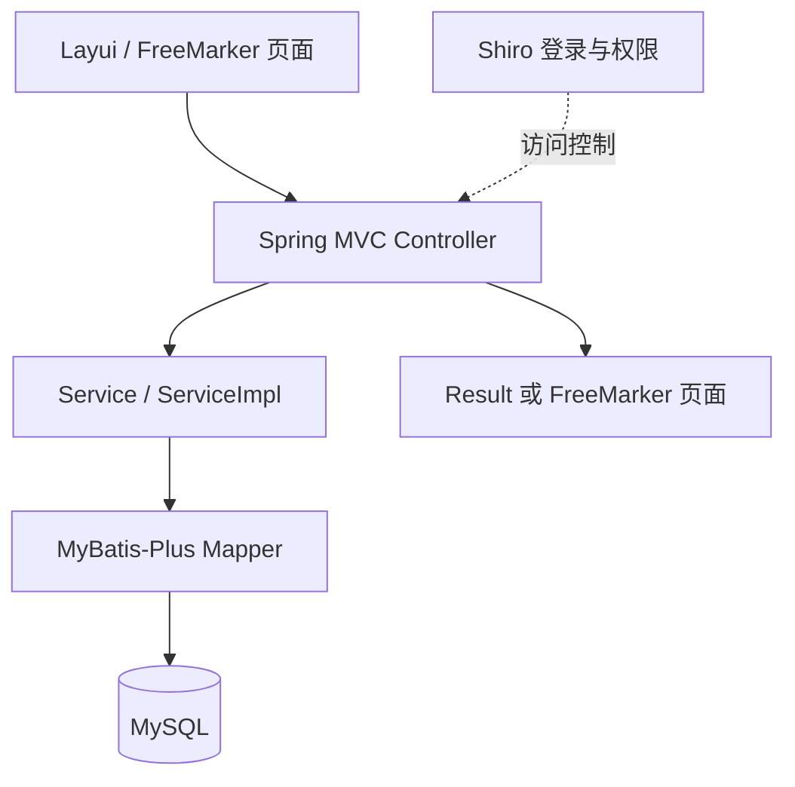
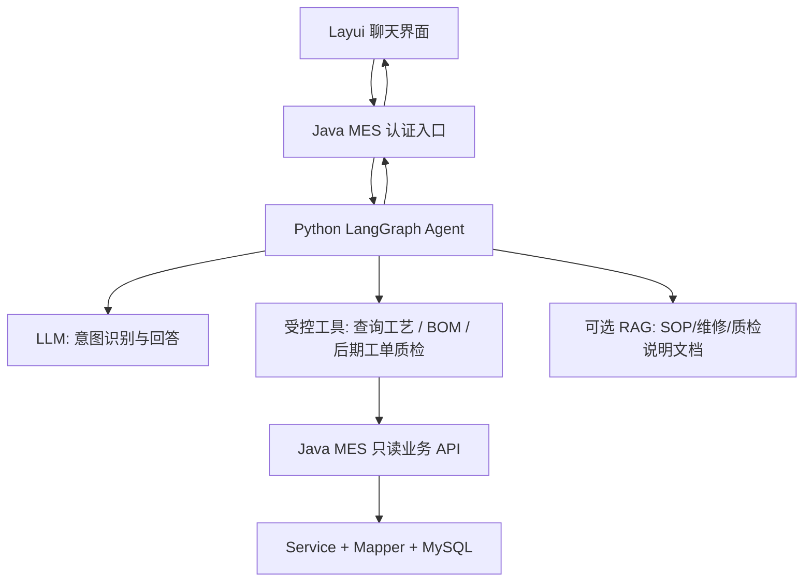
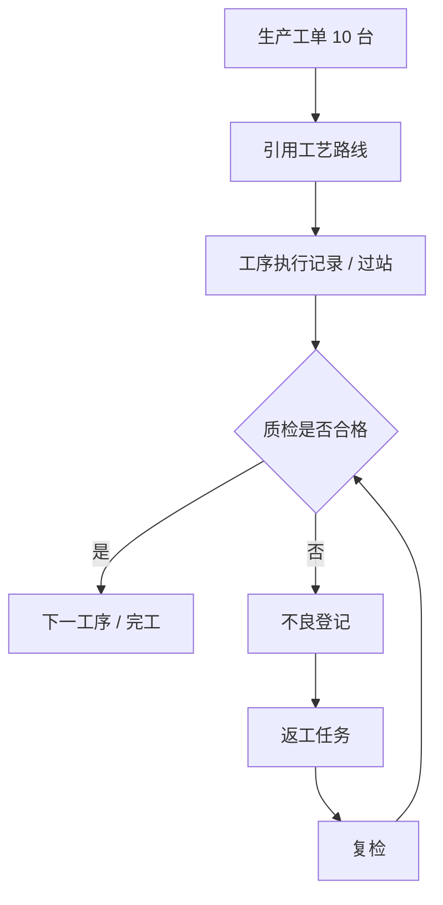

# MES-SpringBoot 二次开发：架构、路线与改造日志

> 维护日期：2026-10-22
> 仓库： https://github.com/Gooddaybro/MES-SpringBoot
> 本轮源码核对基线：`6348d20f38352e9237cc0dda8ce0cd7aec68f678`（master，2026-10-22）
> 本文状态：架构梳理与改造规划（并非功能已完成的证明）
> 核心原则：先验证代码和业务，再形成小型闭环，最后接入 AI；每次改动都保留记录、测试与提交号。

## 0. 项目目标与工作方法

目标：将旧版 MES 练习项目改造成「面向装载机制造场景、具有工单—工序—质检业务闭环和 AI 辅助查询能力」的个人二次开发项目，重点体现 Java 后端、制造业业务建模、Agent 工具调用及可验证的工程能力。

建议工作方法：
1. **自己先提出场景/规则**：这个岗位的用户是谁，数据从哪里来，需要解决什么问题，异常怎么办？
2. **AI 辅助梳理方案**：补充表结构、接口、边界条件、测试用例和可选设计，让人来审核。
3. **一轮只做一个最小改动**：先跑通一条业务链，再补测试、提交 Git，并在本文件新增一条日志。
4. **理解优先于堆栈**：应能自己解释业务数据、实体关系、请求链路、事务边界和设计取舍。

## 1. 仓库实际架构（基于 master 分支静态检查）

### 1.1 技术栈

| 层次 | 从仓库可确认的技术 |
| --- | --- |
| 后端 | Java 8、Spring Boot 2.1.7.RELEASE，单体 Maven Jar |
| Web/页面 | Spring MVC、FreeMarker (.ftl)、Layui、jQuery、ECharts |
| 持久化 | MyBatis-Plus 3.1.2、MySQL 8、Druid |
| 登录权限 | Apache Shiro 1.4.0，用户/角色/菜单 |
| 缓存/会话 | application.yml 默认选择 Ehcache，非 Redis 模式使用内存 SessionDAO；另有 Redis/Jedis 依赖与可选实现 |
| 文档/工具 | Springfox Swagger 2.9.2、Hutool、Dockerfile |
| 自动化测试 | 一个 Spring Boot 上下文启动测试；不能据此认定业务逻辑已被覆盖 |

依据：mes/pom.xml、mes/src/main/resources/application*.yml、后端包结构、mes/src/test。

**注意**：README 的功能清单中包含大量「规划功能」，但不代表已在代码中实现。不要把演示看板、工单下达、过站、质检和设备维修直接写成已完成的项目经历。

### 1.2 后端模块

| 代码目录 | 目前可确认内容 | 说明 |
| --- | --- | --- |
| system | 登录、用户、角色、菜单、部门、字典、Shiro | 基础平台 |
| basedata | 物料、字典、动态表/字段配置 | 物料有 flowId 可关联工艺路线 |
| technology | 工艺路线、工序、路线与工序关系、BOM 头/子项模型 | 核心 MES 基础数据 |
| digitization | 计划看板页面路由 | 并非完整工单计划引擎 |
| common | 结果封装、异常处理、MyBatis 配置、工具 | 共用设施 |

暂无经核实的独立「工单执行」「过站记录」「质检单」「不良返工」后端业务模块。现有 SQL 快照（scripts/sql/MySQL-sparchetype_20200330.sql）也未发现工单执行/质检记录的业务表。

### 1.3 当前请求链路

项目根目录 mes/ 是 Maven 工程；Java 包根路径：mes/src/main/java/com/wangziyang/mes/；页面：mes/src/main/resources/templates/；前端静态资源：mes/src/main/resources/static/；SQL：scripts/sql/。

**可跟踪的现有业务实例：工艺路线维护**

- Controller：technology/controller/SpFlowOperRelationController.java
- Service：technology/service/impl/SpFlowOperRelationServiceImpl.java
- Mapper：technology/mapper/SpFlowOperRelationMapper.java
- 实体：technology/entity/SpFlow.java、SpFlowOperRelation.java、SpOper.java
- 路径示例：POST /basedata/flow/process/add-or-update
- 行为：提交路线与工序列表；服务检查至少两道工序，保存路线头、构建带前/后工序和 sortNum 的关系数据；该写入方法有事务注解。
- 数据关系：物料 SpMaterile.flowId → 工艺路线 SpFlow.id → 关系 SpFlowOperRelation（按 sortNum）→ 工序 SpOper。这里的箭头是业务/字段关联，不能假定全部已设置数据库外键。

### 1.4 需要特别区分的实体

- **物料/产品型号**：定义「生产什么」（SpMaterile，含 model 和 flowId），不是生产任务实例。
- **工艺路线**：定义「通常按什么顺序生产」（SpFlow + SpFlowOperRelation），不是某台装载机正在执行的工序记录。
- **BOM**：定义「需要哪些组成物料」（SpBom + SpBomItem），不是实际消耗记录。
- **工单**（拟新增）：定义「本次要生产多少、何时完成、状态是什么」。
- **过站/质检记录**（拟新增）：记录「本次具体执行了什么、检查结果如何」，与工艺定义分开存储。

## 2. 优先修复/验证的技术风险

- Spring Boot 2.1.7、Java 8、Shiro 1.4.0、Springfox 2.9.2 等依赖较老。先建立可复现运行基线并做依赖安全审计，再安排兼容性升级；避免立即全量换框架导致业务学习中断。
- ShiroConfig 中口令校验采用 MD5 多轮散列，并保留加盐 TODO；建议后续迁移到现代密码哈希，并设计历史账户兼容策略。
- ShiroConfig 中对 /druid/** 的访问标为 anon；确认控制台是否暴露，生产环境应限制或禁用。
- `SpFlowOperRelationController` 的 `POST /basedata/flow/process/page` 直接返回空的成功 Result；需要补齐或明确禁用。不要与 `SpFlowController` 的 `POST /basedata/flow/page` 混淆，后者已有分页查询。
- 工艺路线新增/修改存在 TODO；应增加重复工序、无效工序 ID、流程重排序、删除后关联一致性等测试。“至少两个工序”是当前实现限制，是否符合目标业务需另行决定。
- 删除工艺路线目前在 Controller 中依次调用删除头表与关系表，未见覆盖两步的外层事务；建议迁入 Service 的同一事务，并检查物料引用。此处是静态检查发现的风险，尚未做运行复现。
- `SpBomItem` 实体声明了 `sp_bom_item`，但本轮读取的 `MySQL-sparchetype_20200330.sql` 没有该表；BOM 查询落地前必须核对实际库与其他建表来源。
- README 规划与源码落地存在差距；简历、答辩和日志只描述自己验证过的内容。
- 仓库中可能存在旧数据库地址、账号等配置痕迹；对外展示、发布新环境前检查凭据，不要将真实密钥提交 Git。

上述均为**代码审查提示，不是已修复事项**。

## 3. 改造路线：建议先小闭环，再逐步增强

| 阶段 | 内容 | 能力证明 | 完成判据 |
| --- | --- | --- | --- |
| P0 | 基线：运行、画 ER 图、标注真实接口与数据 | 读懂旧工程 | 关键页面与接口可重复运行；基线测试记录 |
| P1 | **工艺路线只读 API + AI 查询助手（MVP）** | Java 接口 + Tool Calling + LangGraph | 问「某型号有哪些工序」能查真实库并显示来源；无匹配会如实回答 |
| P2 | 工单管理与工序执行/过站记录 | 业务建模、事务、状态机 | 建工单→按顺序报工→完成；不能越站 |
| P3 | 质检、不良、返工与追溯 | 复杂业务规则 | 不良记录→返工→复检→追踪到工单与工序 |
| P4 | AI 异常归因辅助 + 质量知识 RAG | Agent + RAG + 工业场景 | 汇总真实缺陷记录，给出处；仅生成建议，不自动处置 |
| P5 | 工程化完善：压测、部署、依赖升级；测试、鉴权与日志从 P0/P1 起随功能落实 | 生产工程能力 | 关键路径自动测试与可复现部署 |

每次只进入一个阶段的一个子任务；P1 可以先使用已有工艺数据，不需要虚构「已存在的工单/质检数据」。

## 4. AI Agent 接入方案（拟新增，不是现有架构）

### 4.1 推荐拆分

旧版 Java 服务先保留 MES 业务主数据和规则；Python 使用熟悉的 LangGraph 搭建 AI 编排层，不将新式 AI SDK 硬塞入旧版 Java 8 工程。

实现时必须明确鉴权传播：用户身份、数据范围、接口白名单和超时限制要由后端校验，不能只依赖模型提示词。Agent 不直接连接数据库，不执行任意 SQL，不具备擅自修改工单/质检结果的工具。

### 4.2 第一版先做一个 Tool，BOM 作为后续扩展

1. get_material_routing(materialCode)：由 Java 查询物料→flowId→工序关系（按 sortNum 排序），返回工艺步骤和数据库记录标识。
2. 后续候选 `get_bom(materialCode)`：由 Java 查询匹配 BOM 及子项；先补齐表结构验证，明确 `materielCode` 存物料 ID 还是编码，并确定工厂、版本与审核状态选择规则，再实施。当前不计入第一轮交付。

工具对应的 Java API 是**待新增的服务接口**，不是仓库当前已有的接口。先通过 Postman/curl 测通，再接 Python Tool Calling，最后接页面。

**第一条用户问句**：「型号/物料编码为 X 的装载机，应该经过哪些工序？」  
期待流程：模型识别需求→调用 get_material_routing→Java 查询真实工艺路线→返回按序号排序的步骤并标注关联记录→缺少数据时说明「库中未找到」。**不能让模型编造流程内容。**

**进阶问句**（必须等 P2/P3 落地）： 「近 7 天哪个工序的不良最多？主要问题是什么？」  
此时工具从质检记录聚合统计；大模型只负责解释和总结，统计值由 Java/SQL 计算，不由 LLM 猜测。

### 4.3 RAG 与 Agent 的分工

- Tool Calling：查实时结构化数据（物料、工艺、工单、质检）。
- RAG：查非结构化资料（SOP、维修经验、不良处理手册）。
- LangGraph：按问题路由、调用工具、整理可溯源回答，必要时人工审批。
- MES Service：执行业务状态判断、事务、权限与字段级校验；**模型不成为业务规则的最终裁判**。

### 4.4 第一项改造的具体边界（提案，待实现）

**用户问题**：“物料编码为 DEMO-LOADER-001 的装载机，应该经过哪些工序？”此编码是示例，不代表库中已有记录。

先写普通 Java 查询，再把同一个查询能力包装成 Tool；单工具阶段可以使用固定流程，不必为展示 Agent 增加多代理架构。已有 LangGraph 经验可以复用为“识别查询参数→调用工具→核对结果→回答”。

| 项目 | 第一版约定 |
| --- | --- |
| 新接口（拟定） | `GET /api/assistant/material-routing?materialCode=...` |
| 参数映射 | API 的 `materialCode` 对应现有 `SpMaterile.materiel`；`model` 是另一个字段 |
| 查询关联 | 物料的 `flowId` → 路线 ID → 关系表 `flow_id` → 工序 `oper_id`；按 `sort_num` 升序 |
| 返回内容 | 物料 ID/编码、路线 ID/编码、工序 ID/编码/名称/顺序、查询时间；不返回整张实体的全部字段 |
| 状态过滤 | 核对实体、SQL 与真实库的状态含义；物料注释的正常值为 `01`，不可套用其他项目的 0/1 逻辑 |
| 无数据处理 | 分清物料不存在、未绑定路线、路线失效、无工序；不得生成“通用工艺”冒充查询结果 |
| 多条匹配 | 返回需要澄清的候选，不能默认取第一条；型号查询留待下一轮 |
| 访问控制 | Java 检查登录、接口权限与数据范围；Python 仅使用受限的服务凭据和经过验证的用户上下文，不能相信模型提供的 userId |
| 超时与错误 | 明确返回工具失败；不得把调用超时解释为“该物料没有工序” |
| 第一轮验收 | 正常物料顺序正确；不存在/无路线有明确提示；越权被拒绝；工具超时不编造答案 |

Java 建议新增 `assistant/controller`、`assistant/service`、`assistant/dto` 下的少量类，复用现有 Mapper。具体文件名在实施时确定。本轮不新建生产业务表。

**判断 AI 是否有价值**：同一条查询既可通过页面完成，也可通过自然语言完成；比较是否减少查找步骤、答案是否与接口一致。接入模型本身不是成果，能解释并验证这条链路才是成果。

## 5. 装载机示例：未来的工单—工序—质检闭环

场景：工厂接到 10 台装载机的生产订单。这里用「生产工单」表示制造任务，用「序列号/SN」区分每一台具体机器。

拟新增的最小数据模型（名称仅作讨论）：
- mes_work_order：工单号、产品/物料、计划数量、状态、计划时间。
- mes_work_order_operation：工单/单台 SN、工序、执行顺序、开始结束时间、执行状态。
- mes_quality_inspection：工单/SN、工序、检验项、结果、检验时间、检验人。
- mes_quality_defect：检验记录、不良类型、返工状态、闭环时间。

上述为概念草图，实施前还需拆清工单数量与单台 SN：工单可以对应多台产品，每台产品要有独立执行实例；工序定义和实际执行记录不能共用一行。工单下达时应确定工艺版本或快照，避免后来修改工艺影响历史追溯。返工应追加执行/复检记录，不能覆盖原不良事实。

**核心规则示例**：未完成上一工序不能过站；不良未闭环不能正常完工；同一 SN 的关键动作应有唯一性/幂等校验。先定义状态图和测试，再写 Controller。

## 6. 第一轮可执行任务：P0/P1

- [ ] 本地记录当前分支、Git commit、JDK、MySQL、启动方式与页面截图（当前只知道用户此前本地 9090 页面可访问，尚未读取本地未提交代码）。
- [ ] 检查 MySQL 实际库表与 scripts/sql 的差别，不要直接导入带 DROP TABLE 的 SQL 覆盖现有库。
- [ ] 用自己语言画：物料→工艺路线→工序关系→工序；说明「定义」和「执行记录」的区别。
- [ ] 在 Java 新建只读的工艺路线查询接口及 DTO，按 sortNum 排序，保留权限检查。
- [ ] 编写至少三组用例：正常物料 / 无此物料 / 有物料但无工艺路线。
- [ ] 独立验证接口输出，再在 Python LangGraph 中封装为 Tool。
- [ ] 为 AI 工具增加结构化日志、超时及禁止写操作的限制。
- [ ] 在页面集成最小聊天窗口，演示「真实数据库查询」，记录结果截图与 commit。

## 7. 持续改造日志

> 记录规则：每次改造都追加，不覆盖历史；「计划中」「进行中」「已完成」「已验证」必须区分；未运行的测试不能写成通过。完成时填真实提交 SHA 或 PR 地址。后续对本仓库的改造可继续维护本文件，但不会仅因聊天或本地代码变化就自动同步，需在明确变更后提交更新。

### 2026-10-22 · R000 · 架构基线与路线制定

- 状态：**文档已建立；业务代码未修改；功能尚未实现**。
- 问题：README 列出较多规划内容，但代码实际完成度低于完整 MES；直接添加复杂 AI 助手会缺乏真实业务数据。
- 决策：保留现有单体作为业务后端，先做可验证的工艺路线查询 Tool；后续补工单、质检，再升级为面向生产异常的 Agent。
- 本次变更文件：docs/MES_REFACTOR_JOURNAL.md。
- 影响：仅新增项目分析与改造计划文档。
- 验证：根据 GitHub master 静态阅读项目文件；**未连接用户本地数据库，未执行应用或测试**。
- 下一步：P0 绘制实体关系，确定第一条 Java 只读工艺查询 API。
- Git 提交：以该文档的 GitHub 文件历史为准。

### 2026-10-22 · R001 · 复核架构并收敛第一项 AI 改造

- 状态：**文档修订完成；业务与 AI 功能仍为计划中**。
- 核对基线：`6348d20f38352e9237cc0dda8ce0cd7aec68f678`；读取完整仓库文件树、POM、工艺 Controller/Service/Mapper、物料/BOM 实体、Shiro 配置、主配置、页面、测试与 20200330 SQL 建表清单。
- 修正：三处 Mermaid 代码围栏原有反斜杠导致不能正常识别，已修正；纵向布局便于阅读。
- 澄清：空分页接口是 `/basedata/flow/process/page`；`/basedata/flow/page` 已有查询。默认缓存是 Ehcache，不能把 Redis 当作默认必需运行组件。
- 新发现：读取的 SQL 快照没有 `sp_bom_item`；路线删除两步缺少可见的统一事务边界，需后续验证修复。
- 决策：第一轮只做“按物料编码查询工艺路线”的 Java API 与一个 Tool；BOM 待建表和字段语义确认后再做。
- 补充：输入字段映射、空结果/多匹配/越权/超时处理、验收条件；工单与单台 SN 的区分及工艺快照、返工留痕要求。
- 修改文件：仅 `docs/MES_REFACTOR_JOURNAL.md`，保留 R000 历史。
- 验证：静态代码核对与 Markdown 围栏/仓库相对链接检查；未启动应用，未运行 Java 测试，未连接用户本机数据库。
- 回滚：可通过 Git 单独撤销此次文档提交。
- Commit：以本文件 Git 历史中 `docs: refine MES architecture audit and first AI milestone` 的提交为准。
- 下一步：用户先独立解释物料→路线→工序关系，再实现并验证 Java 只读查询接口。

### 2026-10-25 · R002 · 后台悬浮工艺查询助手与真实数据查询接口

- 状态：**功能代码已提交到独立 feature 分支，静态审查完成；本地运行和测试待验证；未接入真实 LLM/LangGraph**。
- 目标：在 MES 后台加入可随时打开的聊天窗，让用户按真实物料编码查询工艺路线。
- 前端：修改 admin/index.ftl，引入独立 widget.ftl、mes-assistant.css、mes-assistant.js；支持快捷问句、发送、加载、错误提示、数据来源和响应式布局。
- 后端：新增 MesAssistantController 与 MesAssistantService；提供 Shiro 保护的 POST /admin/assistant/chat；只读查询物料、流程和排序工序，缺失数据时不虚构。
- 文档：新增 docs/MES_AI_ASSISTANT_UI.md，提供字符线框图、交互流程及验收项。
- 测试：新增 MesAssistantServiceTest 单元测试源文件，覆盖无编码、无物料及有工序的基础流程。**未在用户实际环境运行，不能称为通过。**
- 技术取舍：保留旧 Java 8 单体与 FreeMarker/Layui；先真实数据查询，之后由 LangGraph 取代规则意图判断。
- 风险：目前仅登录保护，尚未校验细粒度的数据范围权限；MySQL 状态字段含义待核；没有配置模型服务，通用 AI 对话不可用。
- Commit：参见 feature/mes-assistant-chat-ui 分支历史，代码提交为 8a7c98ea2ecbec2c42680ba7fb4916ba5d0de37f。
- 下一步：本地 JDK8/Maven 运行、验证数据库与可视化界面；进一步接入 Python LangGraph Agent。

### 后续日志模板（每次复制一段并填充）

#### YYYY-MM-DD · R00N · 变更主题

- 状态：计划中 / 进行中 / 已完成 / 已验证
- 业务问题与场景：
- 改动前的行为：
- 新增或修改文件：
- 数据表 / 接口 / 状态规则：
- 为什么选这种方案（替代方案与取舍）：
- 自己独立完成的部分 / AI 辅助的部分：
- 验证：测试命令、预期、实际结果及截图：
- 已知问题 / 回滚方法：
- Commit/PR：
- 下一步：

## 8. 仓库参考入口

- [README 功能规划](../README.md)
- [Maven 依赖](../mes/pom.xml)
- [工艺路线 Controller](../mes/src/main/java/com/wangziyang/mes/technology/controller/SpFlowOperRelationController.java)
- [工艺路线 Service](../mes/src/main/java/com/wangziyang/mes/technology/service/impl/SpFlowOperRelationServiceImpl.java)
- [物料 Controller](../mes/src/main/java/com/wangziyang/mes/basedata/controller/SpMaterileController.java)
- [BOM Controller](../mes/src/main/java/com/wangziyang/mes/technology/controller/SpBomController.java)
- [Shiro 配置](../mes/src/main/java/com/wangziyang/mes/system/config/shiro/ShiroConfig.java)
- [SQL 快照](../scripts/sql/MySQL-sparchetype_20200330.sql)
- [开源协议 AGPLv3](../LICENSE)

**许可证提醒**：原仓库是 AGPLv3；如对外部署、分发或展示二次开发成果，应检查该协议的源码开放与许可证义务。
