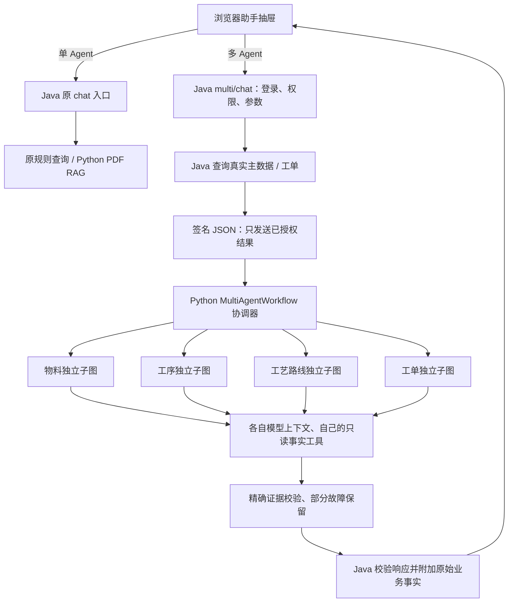

# R005：物料、工序、工艺路线、工单多 Agent

实施与实测日期：2026-10-29。用户已明确四项业务为物料、工序、工艺路线、工单。当前为本机 `mes_study` 学习环境；保留 R004 单 Agent，并一并交付其 DeepSeek 引用修复。2026-11-02按用户要求整理为 `feat：中文` 提交，随 `agent` 分支发布；准确提交号以Git历史为准。

2026-11-02提交前复核：当前分支已包含后续Flyway改造，Java默认测试182项、Python135项、Node20项全部通过，Ruff及JS语法检查通过；本次未重复调用外部模型或重做数据库写入验收。新空库的工单表已由Flyway V4包含，优先遵循[Flyway运行指南](Flyway数据库初始化与版本管理指南.md)；下文手工SQL步骤保留为R005独立初始化说明，已有库接管不得跳过核验与备份。

脱敏实测：[R005记录](evals/R005-multi-agent-smoke-20261029.json)。原始Cookie、模型Key、截图与私有日志均留在忽略Git的`.local/`中。

## 直接使用

1. 打开 `http://127.0.0.1:9090/login-ui`，正常验证码登录；首页右下角打开 MES 智能助手。
2. 默认“单 Agent · 工艺与知识”保留原路线查询、PDF RAG、追问和引用。
3. 选择“多 Agent · 物料 / 工序 / 路线 / 工单”。在“补充查询条件”填物料 `SERVO-DEMO-CTRL-001`、工单 `WO-SERVO-DEMO-001`，输入“综合查询物料、工序、工艺路线和工单”。
4. 查看四个 Agent 的状态、真实工具调用、模型标志、交接和 Java 事实。单独输入“查询物料…”、“查询工序…”、“查询工艺路线…”或“查询工单…”只调用对应业务；编码也可在问题里明确标注。
5. “业务工作台”链接进入 `http://127.0.0.1:9090/admin/manufacturing`，可查询三项主数据，以及创建、查询、开工、完工、取消工单。已有物料/路线维护页面保留。

IDEA 实例使用9091时，把上述端口替换为9091并在该实例重新登录；Java按钮不会启动MySQL/Redis/Python。脚本9090和IDEA9091是不同登录会话。Java重启后如收到401，请重新登录。

## 谁调用谁



| Agent | 唯一工具 | Java事实来源 |
|---|---|---|
| material | get_material | MasterDataQueryService.material → sp_materile |
| operation | get_operations | sp_oper；有物料条件时复用其真实路线工序 |
| routing | get_material_routing | 原MaterialRoutingService → 物料/路线/关联/工序四表 |
| workorder | get_work_order | WorkOrderService → mes_work_order及创建时工艺快照 |

浏览器请求Java的`POST /admin/assistant/multi/chat`；Java使用HTTP/HMAC JSON调用Python的`POST /api/multi-agent/chat`。Python通过`graph.ainvoke`执行协调器及四个分别编译的子图；每个子Agent有自己的提示、私有上下文及唯一工具，配置模型时独立进行有界工具调用/证据选择。四个独立业务可并发，总期限30秒。协调器的业务路由受代码约束，没有无限自主规划。

工具消费Java本次已经查询并授权的事实，不是Python回调数据库。Python不持有数据库凭据、用户Cookie或业务写入工具。外部DeepSeek会接收相应问题和**本次授权业务事实**；这一外发范围不同于R004只发送PDF片段的路径，抽屉首次说明已标明。单Agent的PDF引用及原权限保持独立。

## 工单规则

- 工单号唯一且区分大小写，计划数量必须正数、不超过10亿、最多3位小数，直接绑定BigDecimal，拒绝先经Double舍入。
- 创建时从正常物料的完整路线冻结物料、路线、顺序、工序编码和名称；存储数据库规范物料编码。修改主数据不会改写旧工单快照。
- `CREATED → IN_PROGRESS → COMPLETED`，以及`CREATED → CANCELLED`。未开工不能完工，开工后不能直接取消，完工/取消后不能再开工。
- 同号同物料同数量重复创建返回已有记录；数量或物料冲突拒绝。物料查询沿用原表不区分ASCII大小写的语义；状态转换重复提交不重复增加版本。
- 创建/状态转换是工作台的显式操作，Agent聊天只读。完成表示人工确认工单状态；未实现工序执行记录、SN、过站、报工、库存或质检闭环，不把工单状态当作这些制造事实。

## 新电脑初始化

先按原运行指南准备MySQL/Redis/JDK8、Python私有配置和现有主数据。原运行脚本不会自动导入本次迁移。连接明确目标数据库后运行：

```sql
USE mes_study;
SOURCE scripts/sql/r005_work_order.sql;
SET @r005_role_id='你明确选择的学习角色ID';
SOURCE scripts/sql/r005_multi_agent_permission.sql;
-- 可选：先建立原SERVO-DEMO主数据，再增加独立教学工单。
SET @r005_sample_confirm='LOCAL_LEARNING_ONLY';
SOURCE scripts/sql/r005_work_order_sample.sql;
```

权限脚本仅在本机3308/mes_study对明确选定的正常角色授予物料/工序/路线/工单读取及工单显式写入；不选择角色则不授权，不授予restricted PDF权限。教学种子同样需要明确本机启用，重复执行不覆盖工单状态/快照。其他业务库可审阅后单独应用建表和权限配置，本文未部署生产环境。

```powershell
./scripts/local/Start-Local.ps1 -Rebuild
./scripts/local/Stop-Agent.ps1
./scripts/local/Start-Agent.ps1
```

无聊天Key时四个子图仍可组织Java事实，明确标记模型未配置；连接/返回证据失败时保留事实并展示原因。服务不可用时Java保留只读业务结果，`agentExecuted=false`，不冒称四个Agent已执行。

## 已执行验证

| 检查 | 实测 |
|---|---|
| JDK8默认完整测试及package | 180通过，0失败/错误/跳过 |
| 新真实MySQL集成测试，单独JVM | 6通过：主数据、快照冻结、状态、无路线/取消、规范编码、并发创建 |
| 原MesAssistantDatabaseIT，单独JVM | 1通过，原真实Realm与只读路线链保留 |
| Python全量 / Ruff | 135通过；All checks passed |
| Node行为 | 原抽屉16项、工作台4项，共20通过；JS语法检查通过 |
| 本机迁移/权限/种子 | 重复执行保持原记录；无角色/无启用则无变更；教学工单状态和快照不被重复种子覆盖 |
| 真实四Agent HTTP | 全4个SUCCESS、各自modelAttempted/modelConnected=true、无降级；一次4678ms |
| 最终真实浏览器 | 正常验证码登录；默认single；切换multi后4个Agent均SUCCESS且模型响应通过；工作台物料查询成功 |
| 最终旧入口与错误处理 | 单Agent路线SUCCESS/6工序/无模型调用；错误数量HTTP400、无解析器细节；小写工序加物料条件查询SUCCESS/1条 |
| 真实HTTP工单闭环 | 规范编码/精确1.125/重复创建、非法完工409、开工与重复、完工、禁止重开409；临时测试工单已按精确ID与编号清理 |

多个不同Spring测试上下文共享原项目未命名Ehcache，合并默认测试与两个IT在同一JVM会冲突，因此以下三个Java命令分别执行，不改原缓存部署配置：

```powershell
$env:JAVA_HOME='D:/Program Files/Java/jdk1.8.0_202'
$env:Path=$env:JAVA_HOME+'/bin;'+$env:Path
# 替换成你自己的私有local配置路径，不把口令写进命令或提交Git。
mvn -f mes/pom.xml -Dspring.profiles.active=local "-Dspring.config.additional-location=file:D:/Documents/ChatGPT/manufacture/MES-SpringBoot/.local/application-idea.yml" package
mvn -f mes/pom.xml -Dspring.profiles.active=local "-Dspring.config.additional-location=file:D:/Documents/ChatGPT/manufacture/MES-SpringBoot/.local/application-idea.yml" -Dmes.manufacturing.it.enabled=true -Dtest=ManufacturingDatabaseIT test
mvn -f mes/pom.xml -Dspring.profiles.active=local "-Dspring.config.additional-location=file:D:/Documents/ChatGPT/manufacture/MES-SpringBoot/.local/application-idea.yml" -Dmes.it.enabled=true -Dtest=MesAssistantDatabaseIT test
Set-Location agent
uv run --frozen pytest -q
uv run --frozen ruff check app tests
Set-Location ..
node scripts/tests/mes-assistant.test.cjs
node scripts/tests/mes-manufacturing.test.cjs
./scripts/tests/r005-local-migrations.ps1 -MySqlExe 'D:/Program Files/mysql-8.0.46-winx64/bin/mysql.exe' -ClientConfig '.local/mysql-client.ini' -RoleId '明确授权的学习角色ID'
```

实际新增代码经过独立规范/质量审查。已复现并修复状态描述被误判写入、对象在前的写入命令误接纳、数量舍入、规范物料编码与大小写、全局异常处理器吞掉400并泄漏解析细节等问题。真实供应商烟测证明本机连接和这次场景可用，不代表模型准确率、并发负载或生产部署已验证。

## 回退

界面选回单Agent即可继续原功能，不需要删除新表。停Python会使新多Agent降级成Java事实，原纯路线查询仍可用。工单和权限如需撤销，先备份、核对引用和各角色后单独处理；Git回退不会自动撤销数据库记录。本轮没有执行DROP或无范围业务删除。测试创建的临时工单仅按自己生成的精确编号和测试主体清理，教学工单仍为CREATED/10/6道工序。
