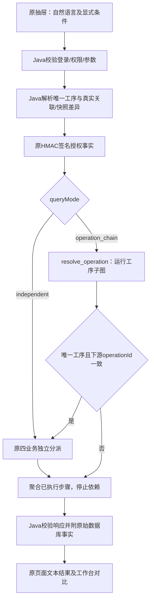

# MES Agent R006：能力盘点、受控查询与快照对比

日期：2026-11-02。开发分支 `agent`，起点 `75f9b49`。本次按任务最后一段完成**第一批**；没有同时实施聊天建单HITL或批量写入。项目保持JDK8、Spring Boot2.1.7、Shiro、Layui/FreeMarker和独立Python服务。

文件级设计/执行记录：[设计](superpowers/specs/2026-11-02-mes-r006-readonly-design.md)、[计划](superpowers/plans/2026-11-02-mes-r006-readonly.md)。后续闭环及数据依赖见[下一阶段规划](R006-后续业务闭环规划.md)。

## 1. 先核实的真实状态

任务背景提到R003/R004，但当前代码实际已有R005。不能将R005能力重复实现，也不能将README早年的规划表当作已完成模块。

| 功能 | 改造前实际状态 | 现有代码位置（仓库相对路径） | 原缺口 | 本轮处理 |
|---|---|---|---|---|
| 原物料页面名称搜索 | 已实现物料编码/名称LIKE及分页 | `mes/src/main/java/com/wangziyang/mes/basedata/controller/SpMaterileController.java` | Agent工具仅按编码或首20条正常物料 | 保留原页，新增受控名称/状态/分页工具 |
| 工序查询 | R005能按编码、或按物料路线查询；最多50条 | `manufacturing/MasterDataQueryService.java` | 无名称搜索与反向关联流程 | 增加名称搜索、真实ID消歧 |
| 工艺路线查询 | R002以来已有四表受控查询及断链/顺序校验 | `assistant/service/MaterialRoutingService.java` | 无按工序反查路线；无发布版本 | 复用原服务；新增有界关联查询，不冒称发布标准 |
| 四业务多Agent | R005已实现4个分别编译的子图、签名事实和故障降级 | `agent/app/multi_graph.py`、`assistant/agent/MultiAgentService.java` | 原来是独立分派，缺少工序先决条件 | 增加operation_chain条件边，保留独立模式 |
| PDF RAG | R004已有Jina/Chroma、页内切块、ACL、重排与精确引用 | `agent/app/graph.py`、`agent/app/rag/` | 文档没有物料/工序绑定，不能确认本厂SOP | 不重建；回归原测试，业务绑定列为后续 |
| 工单持久化创建 | R005工作台已有Java事务、精确数量、同号幂等 | `manufacturing/WorkOrderService.java` | 聊天不建单；没有预览凭据与确认闭环 | 保留原创建方法；本轮未接入聊天写入 |
| 历史工艺快照 | 已存在，冻结在mes_work_order.route_snapshot_json | 同上、`db/migration/V4__r005_work_order.sql` | 无差异接口；历史未存生产参数 | 新增只读差异分析，明确不可比较项 |
| 工单状态转换 | 已存在独立提交、事务、行锁及version条件 | `WorkOrderService.transition` | 无下达/暂停状态，无批量确认 | 不改状态机，不把“下达”解释成开工 |
| 工单筛选 | 原按编号/物料，首20条 | `WorkOrderService.query` | 无状态、日期、工序反查及翻页 | 新增search，工序筛选依据历史快照 |
| Copilot页面 | R005已有抽屉模式切换、执行轨迹、JSON事实、业务工作台 | `static/js/mes-assistant.js`、`templates/admin/assistant/` | 名称条件和对比操作入口缺失 | 扩展原页面及文本DOM，不迁移框架 |

表中Java短路径均位于`mes/src/main/java/com/wangziyang/mes/`；资源短路径位于`mes/src/main/resources/`。

### 四个业务模块与约束

| 模块 | Controller | Service / Mapper / Entity | 表与真实语义 |
|---|---|---|---|
| 物料 | SpMaterileController：list-ui、add-or-update-ui、POST page/add-or-update/delete | ISpMaterileService / SpMaterileServiceImpl / SpMaterileMapper / SpMaterile | sp_materile；materiel编码、materiel_desc名称、unit、mat_type、flow_id；is_deleted为0正常/1删除/2禁用。编码无唯一索引，因此必须消歧 |
| 工序 | SpOperController是空壳，不能宣称已有独立完整CRUD；R005受控入口是ManufacturingController.operations | ISpOperService / SpOperServiceImpl / SpOperMapper / SpOper | sp_oper：id、oper、oper_desc；没有启用状态、工时、设备或生产参数列 |
| 工艺路线 | SpFlowController仅page/list；SpFlowOperRelationController有页面、page/add-or-update/delete | ISpFlowService、ISpFlowOperRelationService / 对应Impl与Mapper / SpFlow、SpFlowOperRelation | sp_flow.id关联sp_materile.flow_id；sp_flow_oper_relation.flow_id/oper_id关联路线及工序，sort_num为顺序，oper_type可存在但旧工单未冻结它 |
| 工单 | ManufacturingController：GET orders、POST orders、POST orders/transition | WorkOrderService使用JdbcTemplate；没有独立Mapper/Entity，不能虚构类名 | mes_work_order：唯一且区分大小写的order_code、material_id/code/name、planned_quantity、state、route_id/code、快照JSON、version及审计/时间 |

原物料页由全局Shiro登录保护，Controller未声明与新Agent相同的业务按钮权限；本次不以接入Agent为由重写旧业务授权。新增工具统一执行服务端能力权限。项目没有工厂/租户行级授权字段，当前实现的是角色能力范围，**未实现多租户行级隔离**。

原路线维护在SpFlowOperRelationServiceImpl事务内保存头与工序关系，原表单要求至少两道工序；原MaterialRoutingService校验实际关系、存在的工序、正数且不重复的顺序。工艺差异复用该查询，不修改原维护语义。

### 必须保留的工单语义

- 创建使用BigDecimal，数量大于0、不超过10亿，最多3位小数。工单与快照在原Java事务中保存，快照含物料/路线身份、relationId、operationId、顺序、工序编码/名称。
- 同号同物料同数量返回原工单；冲突拒绝，重复创建不会刷新快照。
- 合法状态：`CREATED → IN_PROGRESS → COMPLETED`、`CREATED → CANCELLED`。状态单独提交；完成/取消不能重开，进行中不能直接取消。
- 转换使用FOR UPDATE及version/state条件，重复目标状态不重复增加version。本轮只在类中增加search方法，未改create/transition。

## 2. 数据库核验与迁移

本机有两个不同的mes_study，不能混用记录。连接器默认库是intelligent_outfit，本次SQL均显式限定mes_study。

| 核验目标 | 物料 / 工序 / 路线 / 关系 / 工单 | 证实的业务数据 | 用途与边界 |
|---|---|---|---|
| 127.0.0.1:3307/mes_study | 1 / 0 / 0 / 0 / 0 | 100112，电工胶带，现有flow_id找不到路线；BOM和BOM项均0 | 当前dev业务库只读核验；未补种工艺或工单 |
| 127.0.0.1:3308/mes_study | 8 / 15 / 8 / 36 / 1 | SERVO-DEMO-CTRL-001、SERVO-DEMO-OP50、WO-SERVO-DEMO-001（CREATED、6工序）等既有教学样例 | 已有独立学习库，真实SQL/HTTP验收；不是工厂生产数据 |

两个库均没有名为“老化测试”的匹配工序。真实链路使用已存在的“教学样例：绝缘与低压功能测试”；“老化测试”用于验证NO_OPERATION，未伪造该工序。

当前9091进程的已建立MySQL连接实际指向3308；dev配置文件指向3307不能证明现有进程已切换。测试与说明均明确目标，不将两个库的空结果和教学样例混在一起。现有Jina配置核实为jina-embeddings-v3 / 512维，本轮未重建向量索引。

Flyway已接入：仓库V1至V4；3307的版本历史1、2、3、4均成功。3308由此前显式学习初始化建立，没有flyway_schema_history，本次未擅自baseline或接管。**本轮新增表0、字段0、迁移脚本0**，原迁移没有修改或重放。

3308五张业务表数据（包括完整快照）及SHOW CREATE TABLE的SHA256在所有测试前后逐表一致；回滚夹具没有保留。3307没有执行写入。

## 3. Java工具接口

浏览器始终访问Java登录会话，不直接调用Python。下列均为GET只读接口，响应沿用`Result{code,msg,data}`。

| URL前缀/admin/manufacturing | 支持的条件 | Java最终权限 |
|---|---|---|
| /materials/search | materialCode、materialName、materialStatus | mes:assistant:material:read |
| /operations/search | operationCode、operationName、materialCode | mes:assistant:operation:read |
| /routings/search | materialCode（返回当前关联路线头） | mes:assistant:routing:read |
| /orders/search | workOrderCode、materialCode、state、createdFrom、createdTo | mes:assistant:workorder:read |
| /operation-impact | operationCode或operationName；可限制materialCode/workOrderCode、工单状态/日期；materialStatus用于物料列表 | 四项read全部具备后才开始查询 |
| /orders/compare-routing | workOrderCode | 工单read及路线read |

列表接口支持page（1..1000）、pageSize（1..50，默认20），稳定排序，响应count为**本页条数**，hasMore/truncated表示还有后续记录，不提供伪造的总量。工序候选始终从首屏最多两个候选解析，避免在后页误把某一个候选认作唯一。

名称最多100字符；LIKE中的`%`、`_`、`!`按字面转义，所有值绑定参数。状态只允许原库的值；时间为本地ISO日期/日期时间，起点包含、终点排除，不带时区。未支持字段、控制字符、非法状态、超限分页及逆序日期返回INVALID_INPUT/400。

跨模块查询先查工序，零匹配返回NO_OPERATION，多个候选返回AMBIGUOUS并停止。唯一operationId确定后，当前路线/物料通过真实flow_id/oper_id关联；工单通过快照JSON的operationId反查。因此，当前路线移除工序后，历史工单仍可匹配；空关联保持空列表。

物料名称不会自动变成唯一物料：名称搜索保留候选；关联查询要求先明确编码并清除名称条件，否则NEEDS_INPUT，绝不回退到全库工单。

主要状态：AUTH_REQUIRED/401、FORBIDDEN/403、INVALID_INPUT/400、SNAPSHOT_UNRELIABLE或MATERIAL_IDENTITY_CHANGED/409、DATA_UNAVAILABLE/503、TIMEOUT/504。NO_MATERIAL/NO_OPERATION/NO_ROUTE/NO_WORK_ORDER、AMBIGUOUS、NEEDS_INPUT是明确业务状态，不伪装成数据或已执行写入。

## 4. LangGraph与签名调用

保留原`POST /admin/assistant/chat → /api/agent/chat`及R004知识图。扩展现有`POST /admin/assistant/multi/chat → /api/multi-agent/chat`，不建立Python数据库写入或任意SQL工具。



Java仍预执行被授权的确定性查询并签名，Python消费事实；这不是Python回调Java后自主生成查询计划。LangGraph新增的先后顺序指的是事实工具/子图的依赖执行；数据库关联由Java完成。

工具名保持`get_material`、`get_operations`、`get_material_routing`、`get_work_order`；根据请求消费名单/关联/差异事实。`get_material_routing`在关联场景返回真实路线列表，原按唯一物料查步骤的路径保留。parameters可含已验证的名称/状态/日期/分页和服务端确定的operationId；不包含凭据。

State仍复用request/response/deadline，新增dependency_ok；request增加可选queryMode，缺省independent保持旧契约。协调器新增resolve_operation，成功后仅分派未执行子图；失败/空/歧义直接aggregate_results。所有步骤共享原总deadline，子图仍prepare_tools → select_evidence → validate_evidence。

HMAC继续覆盖完整原始JSON、POST路径、时间戳和nonce，60秒授权有效期、防重放及回环地址约束保留。queryMode和参数也在签名正文内。角色与权限只来自Java登录Subject；不能由模型/浏览器字段替代。

## 5. 工艺差异的真实含义

输入工单编号，取得原快照；核对快照物料ID/编码及当前物料ID，阻止同编码替代记录冒充历史物料。按operationId及重复出现次数对齐，并检查顺序、编码、名称；同时报告路线身份变更。

输出包括workOrderCode、materialCode、workOrderState、snapshotSteps、currentSteps、changes、hasChanges、potentialProductionImpact、requiresProcessReview、limitations。

- ADDED/REMOVED/ORDER_CHANGED/CODE_CHANGED/NAME_CHANGED/ROUTING_CHANGED属于已证实的字段差异。
- potentialProductionImpact仅指可能影响生产，不是已证实质量损失、产能下降或交期延误。纯名称变更不自动判定结构性生产影响。
- comparisonBasis为CURRENT_ASSIGNED_ROUTE。表中没有发布版本或生效日期，不能称为“最新已发布标准”；快照未存温度、扭矩、工时、oper_type等，不能比较这些参数。
- 快照缺失、ID/顺序不可靠时返回SNAPSHOT_UNRELIABLE；当前路线缺失/断链、物料身份替换时返回不能对比。任何路径都不修补或写回历史快照。

## 6. 前端操作

保留原Layui/FreeMarker页面和显式创建/状态表单。业务工作台`/admin/manufacturing`增加物料名称/状态、工序名称、工单状态/日期/分页、“按工序查询关联业务”和“工单工艺快照对比”。差异区域展示工单快照、当前路线、变更前后及无法确认内容。

首页抽屉选择“多Agent”，可输入：

```text
查询物料“教学样例”
查询包含绝缘与低压功能测试工序的物料，以及目前处于已创建状态的相关生产工单。
查询工序 SERVO-DEMO-OP50 的工单
对比工单 WO-SERVO-DEMO-001 使用的工艺和当前物料工艺的差异
```

前两条名称搜索及关联示例适用于3308教学库；3307应使用100112或“电工胶带”，工序/工单确实为空。上述编码必须以目标库为准，不能换库后假定仍存在。

补充条件支持物料/工序名称、工单状态、日期和分页。只读查询不会填造建单参数或触发状态变化。前端继续textContent/createElement输出并保留IME、清空竞态、焦点与复制；错误400优先显示Java准确说明。

自然语言支持上述明确句式及显式条件，不宣称任意语义解析。未理解的名称/否定/相对时间/数量/状态限制返回NEEDS_INPUT；例如“不包含”“去年”“不是已完成”不会丢弃条件后执行相反查询。名称可加引号或填写字段，时间使用显式起止字段。

## 7. Java/Python启动与联调

生产或现有开发实例沿用[原运行指南](AI助手接入与运行指南.md)及[Python说明](../agent/README.md)。本轮未覆盖私有配置、未重启用户现有9091/8001实例；更新生效需要按原方式重建并重启Java与Python。Java继续使用JDK8，不加入Spring AI依赖。

常规检查（仓库根目录；所有Maven的-D参数在PowerShell中完整引用）：

```powershell
$env:JAVA_HOME='D:/Program Files/Java/jdk1.8.0_202'
$env:Path=$env:JAVA_HOME+'/bin;'+$env:Path
mvn -f mes/pom.xml '-Dspring.profiles.active=local' '-Dspring.config.additional-location=file:D:/Documents/ChatGPT/manufacture/MES-SpringBoot/.local/application-idea.yml' package
uv run --frozen --project agent pytest agent/tests -q
Push-Location agent
uv run --frozen ruff check app tests
Pop-Location
node --test scripts/tests/mes-assistant.test.cjs scripts/tests/mes-manufacturing.test.cjs
```

替换为自己的私有local配置路径，不将口令写进命令。完整数据库IT必须显式选择3308/mes_study，不能改保护条件来测试生产库；不同Spring测试上下文使用独立Maven进程，以免原未命名Ehcache冲突：

```powershell
mvn -f mes/pom.xml '-Dspring.profiles.active=local' '-Dspring.config.additional-location=file:D:/Documents/ChatGPT/manufacture/MES-SpringBoot/.local/application-idea.yml' '-Dmes.readonly.it.enabled=true' '-Dtest=ReadOnlyBusinessDatabaseIT' test
mvn -f mes/pom.xml '-Dspring.profiles.active=local' '-Dspring.config.additional-location=file:D:/Documents/ChatGPT/manufacture/MES-SpringBoot/.local/application-idea.yml' '-Dmes.manufacturing.it.enabled=true' '-Dtest=ManufacturingDatabaseIT' test
mvn -f mes/pom.xml '-Dspring.profiles.active=local' '-Dspring.config.additional-location=file:D:/Documents/ChatGPT/manufacture/MES-SpringBoot/.local/application-idea.yml' '-Dmes.it.enabled=true' '-Dtest=MesAssistantDatabaseIT' test
```

真实Java↔Python签名HTTP测试使用独立8002端口、无供应商Key的`agent/tests/run_readonly_smoke_server.py`，不加载原PDF索引。详细启动见[独立HTTP测试](R006-独立HTTP测试.md)。它不是替身业务工具：所有业务事实由Java从3308读取，实际运行原FastAPI/MultiAgentWorkflow；Realm真实登录，MVC入口模拟，不冒充浏览器或验证码验收。

## 8. 测试与实测范围

执行时间为2026-11-02；脱敏机器记录见[JSON](evals/R006-readonly-20261102.json)，原始日志/私有配置保留忽略目录.local。

| 层级 | 结果 | 能证明什么 |
|---|---|---|
| 改造前基线 | Java182 / Python135 / Node20通过 | 起点稳定，R005已存在 |
| 最终默认Java及package | 221通过，0失败/错误/跳过；JDK8构建成功 | 新规则/权限/MVC/原服务和Spring上下文回归；不是221项生产实测 |
| Python全量及Ruff | 142通过；All checks passed | 包括新增7项工序依赖、身份校验、总期限；原RAG/引用/注入/签名测试保留 |
| 前端Node及语法 | 24通过；两个JS语法检查通过 | 名称条件、差异文本、错误说明、IME/XSS及原显式写表单行为 |
| 新MySQL IT | ReadOnlyBusinessDatabaseIT 7通过 | 真实SQL、既有样例、多候选/空关联、回滚差异、快照历史匹配、原FTL渲染 |
| 新跨服务IT | ReadOnlyAgentDatabaseIT 4通过 | 真实Realm/数据库/签名HTTP/LangGraph，唯一工序/真实无工序/对比/不可达降级；模型调用0 |
| 原业务IT及原页面/Realm IT | ManufacturingDatabaseIT 6通过；MesAssistantDatabaseIT 1通过，均0失败/错误/跳过 | 原创建快照、状态、幂等与并发，以及原核心页面导航；分别在独立Maven进程运行 |
| 真实生产、浏览器新功能交互、付费模型质量 | 本轮未执行 | 不将学习样例、MVC或测试向量冒充生产效果 |

首次回滚IT的两个变更夹具因同一外层测试事务的MyBatis会话缓存读到旧值；在JDBC夹具编辑后显式清理测试会话缓存，7项重跑全通过。没有修改生产缓存配置来让测试通过。

需求测试对应：存在/不存在物料、模糊多候选、空关联、相同/不同快照、无有效路线禁止原create、读路径不写入、无权限拒绝、原幂等/状态规则、Python故障、RAG无依据拒答及原页面均有对应测试。**聊天建单未实现，因此HITL令牌过期/重复确认/确认时并发变更的完整验收仍属第二批**，不能用原同号幂等测试替代。

## 9. 文件范围、回退与交付

新增BusinessQuery、BusinessQuestion、OperationImpactService、RoutingComparisonService；扩展MasterDataQueryService/WorkOrderService的只读方法、ManufacturingController/MultiAgentController及MultiAgentService；扩展原Python契约/协调图、两份原FTL与JS。测试及完整文件清单见文件级计划与Git提交。新增文档含本报告、独立HTTP测试、后续规划和脱敏验收记录。

原有6个未提交文件已备份并保留；除改造日志追加本轮条目外，不修改它们。本轮提交不包含此前文档/配置改动，也不包含.local、数据库、Key、Cookie或索引。继续agent，普通提交并推送origin/agent；真实SHA和是否推送成功以本次交付及Git记录为准。

回退：可选择原单Agent、停止Python或设置MES_AGENT_ENABLED=false后重启Java，原Java工艺查询仍可用。若撤销本轮，审阅本轮独立提交的revert，不覆盖用户未提交内容；没有新数据库结构或业务数据需要删除。本次未执行Git强推、DROP、初始化重放或生产写入。
