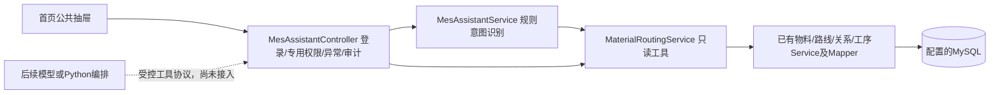

# MES 助手渐进式改造设计与审查

日期：2026-10-26。基线：`agent` / `3d4433c`，工作区初始干净。用户已授权审查后继续实施、测试、提交和推送；在当前分支原地开发。

## 1. 核实结果

- 实际仓库是 `MES-SpringBoot/`；外层 manufacture 是另一个无提交的 master 仓库，不能在那里提交。
- origin = Gooddaybro/MES-SpringBoot，upstream = wangziyang6/MES-SpringBoot；远程尚无 agent 分支。当前 HEAD 比 origin/master 多一条本地提交，尽管提交说明提及助手，实际没有助手业务代码。
- 工程：`mes/pom.xml`，Java 8、Boot 2.1.7、MyBatis-Plus 3.1.2、Druid 1.1.9、Shiro 1.4.0；Layui 2.5.6 / jQuery / FreeMarker，由 Java 渲染，业务页面位于首页 iframe 内。
- 登录和权限来自 ShiroRealm 的用户→角色→菜单 permission。现有样例菜单全部复用 user:add，不能将它当作助手专用授权，也不能按 admin 用户名绕过权限。
- 本机默认 JAVA_HOME 为 JDK21，构建必须显式选已有 JDK8；Maven 3.6.3 可用。Wrapper 启动脚本存在，但 `.mvn/wrapper` 缺失。
- 本机独立 mes_study/MySQL 8.0.46 共17表。真实关系：sp_materile.materiel → flow_id → sp_flow.id → sp_flow_oper_relation(flow_id,sort_num,oper_id) → sp_oper。物料页面和数据库均为 is_deleted=0 正常、1 删除、2 禁用；实体注释的 00/01/02 已过时。
- mes_study 中 100112、MAT-DEMO-001 是已有样例物料；现有路线描述含车轴，不能将它们称作伺服电机控制器生产数据。保留原数据，本轮不造生产数据。
- sp_bom 为空，实际字段 materiel_id 与 SpBom.materielCode 默认映射不一致，sp_bom_item 不存在。库存、工单、报工、IPQC、维修记录模块未实现；Milvus、Embedding、FANUC 文档和 RAG 未配置。连接器默认指向另一个数据库，未将其当成 MES 数据源。

## 2. 两版材料比较

| 材料 | 优点与可复用设计 | 问题与处理 |
| --- | --- | --- |
| origin/feature/mes-assistant-chat-ui @738723d，含 MES_AI_ASSISTANT_UI.md | 现成 Layui 公共首页挂载、原生 DOM 文本渲染、真实 Service 查询、只读边界 | 无专用权限、无清空/复制、逐工序查库、状态与依据不完整、编码多义和中文输入需加强；按本设计重写相关逻辑，不合并其他历史 |
| 用户 mes_springboot_ai_agent.md + html，1361行静态原型 | 侧边抽屉、结构化业务卡、可展开查询过程、未来写入前确认、P2–P4场景 | 实际是 Tailwind CDN + 原生 JS，Vue 映射仅为示例；无网络请求，mesState 与事务/模型/RAG均模拟；有 innerHTML、全局 select-none、缺陷率×35、清空重放BOM等问题，不导入这些实现 |

## 3. 兼容性与选择

| 方案 | 成本/部署/扩展/故障隔离 | 结论 |
| --- | --- | --- |
| 本轮 Java 内规则路由 + 只读工具 Service | 无新运行时；结果确定且可验证；后续可替换意图识别 | 推荐并实施 |
| Java8 通过 HTTP 调兼容模型 | 部署简单；需另做配置、结构化输出校验、超时和凭据保护 | 后续最小模型接入选项，当前未实现 |
| Java + 独立 Python LangChain/LangGraph | Python3.10+、增加服务与鉴权运维；多步骤编排和故障隔离更好 | 工具增多、确需编排时再接，不建立空服务 |
| 在旧工程直接加入当前 Java AI Starter | 当前 LangChain4j 最低JDK17，Boot集成面向Boot3.5+/4；Spring AI2.x面向Boot4.x | 不升级整个MES来迁就SDK |

官方核对来源（2026-10-26）：[Boot2.1.7](https://docs.spring.io/spring-boot/docs/2.1.7.RELEASE/reference/html/getting-started-system-requirements.html)、[Spring AI](https://docs.spring.io/spring-ai/reference/getting-started.html)、[LangChain4j](https://docs.langchain4j.dev/get-started/)、[其Boot集成](https://docs.langchain4j.dev/tutorials/spring-boot-integration/)、[LangChain v1](https://docs.langchain.com/oss/python/migrate/langchain-v1)、[LangGraph v1](https://docs.langchain.com/oss/python/migrate/langgraph-v1)。这些资料是兼容性依据，不代表项目已经安装这些依赖。

## 4. 实施边界与协议

- POST `/admin/assistant/chat`：表单 message，1–1000字；GET `/admin/assistant/material-routing`：materialCode。两接口均要求真实登录及 `mes:assistant:routing:read`。
- 沿用 Result 的 code/data/msg。data 含 status/mode/answer/traceId/elapsedMs/modelConnected=false；查询数据含 tool=get_material_routing、material{id,code,name,status}、routing{id,code,name}、steps[{relationId,operationId,order,code,name}]、source、queriedAt。
- 明确区分 HELP、NEEDS_INPUT、AMBIGUOUS、UNSUPPORTED、INVALID_INPUT、NO_MATERIAL、NO_ROUTE、NO_STEPS、ROUTE_INCOMPLETE、SUCCESS 及认证/权限/数据库失败；非成功不得冒充完整路线。
- 只允许精确编码查询，不取第一个候选；多编码/重复有效物料要求澄清；仅状态0可用。批量读取工序，校验顺序和失效引用，保留记录ID及查询时间。
- HTTP400参数、401未登录、403无权限、503数据库不可用、504查询超时、500其他异常。错误正文不暴露SQL、地址、口令；日志记traceId、主体ID、状态、耗时，不记录问题全文或密钥。
- 挂载在 admin/index.ftl 一次，覆盖其内菜单iframe切换；独立打开业务子页不重复挂载。CSS全部限定 mes-ai 前缀；使用 textContent/createTextNode。支持开关、Esc、清空并取消在途请求、复制、Enter/Shift+Enter/组合输入、请求超时与防重复发送。
- 本轮无业务写接口、无模拟库存/工单/图表。写入意图一律提示待接入；未来统一走后端生成预览→明确确认→重新鉴权/版本校验→幂等事务→审计，确认不替代权限。
- 专用权限使用现有菜单角色系统授权，SQL明确要求操作者选择角色；不自动授权所有用户。

## 5. 验收与风险

先增加有意义的失败测试，再实现查询和界面；JUnit验证规则、查询边界、数据库异常与权限；前端行为测试验证安全渲染、清空竞态、重复初始化和中文输入。随后JDK8完整构建、原上下文测试、真实MySQL/API和浏览器验收。通过本地样例数据只证明调用链，不证明已接入真实工厂或真实模型。

旧Shiro/Boot、安全散列、BOM字段不一致和原菜单权限粗糙保持为独立后续事项；不把本轮助手权限改造描述为整站安全修复。P2 BOM齐套/报工、P3受控ChatBI、P4有来源RAG的文件、缺口、顺序、验收详列运行指南。
